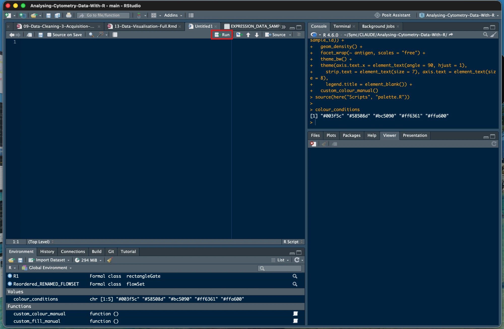

# Chapter 4 - File Management and Data Access

## What We're Building

Before we can analyse cytometry data, we need to organise our work properly. Think of this like setting up a laboratory - you need specific places for raw samples, processed data, and results. In R, we create a structured folder system and use tools that make file management consistent and portable.

We'll accomplish three things:

1. Create an organised folder structure for the course
2. Set up an R Project so file paths work reliably
3. Download and verify the course datasets

## Version Notes

**File hosting:** Course data is available via GitHub Releases (Zenodo planned as a backup once beta testing is complete)
**Dataset structure:** One set of FCS files, already normalised, debarcoded, and gated to live singlets, plus a staged `RDS/` folder that lets you jump into any later chapter without rerunning earlier ones
**Approach:** Uses R Projects and the `here` package for portable file paths

## The Essentials {.essentials}

### Step 1: Create Your Project Folder

Create a folder on your computer where you have plenty of space (the datasets total about 400MB). Name it something clear like `Cytometry_R_Course`.

**Where to create it:** Anywhere you can easily find it - Desktop, Documents, or a dedicated projects folder all work fine.

### Step 2: Create an R Project

An R Project is a special file that tells RStudio where your work lives. This makes file management much easier.

1. Open RStudio
2. Click File > New Project
3. Choose "Existing Directory"
4. Navigate to the folder you just created
5. Click "Create Project"

**What this does:** Creates a file ending in `.Rproj` in your folder. When you open this file, RStudio automatically sets your working directory correctly.

### Step 3: Create Your Folder Structure with dir.create()

Every chapter in this course reads and writes files using the `here` package, always relative to this structure:

```
Cytometry_R_Course/
├── Cytometry_R_Course.Rproj
├── Data/
│   ├── fcs/                # 5 .fcs files, already normalised, debarcoded, and gated to live singlets
│   ├── ungated/            # the same 5 samples before gating, only needed for the optional Gating chapter's demo
│   ├── RDS/                # processed R objects, one file per pipeline stage
│   └── other/              # catchall for peripheral/supporting files, e.g. sample_info.csv
├── Scripts/                # your chapter scripts, plus the provided palette.R and backup/
├── Figures/                # empty for now - plots get saved here
├── Tables/                 # empty for now - summary tables get saved here
└── Outputs/                # empty for now - diagnostic reports from packages like flowCut get saved here
```

You'll use `dir.create()` well beyond this course setup. Any time you start a new analysis and want to stay on the command line rather than clicking through a file explorer, this is how you'll build your folder structure. Create all of it now:


``` r
library(here)
#> here() starts at /Users/dcarragher/Sync/CLAUDE/Analysing-Cytometry-Data-With-R
dir.create(here("Data", "RDS"), recursive = TRUE, showWarnings = FALSE)
dir.create(here("Scripts"), showWarnings = FALSE)
dir.create(here("Figures"), showWarnings = FALSE)
dir.create(here("Tables"), showWarnings = FALSE)
dir.create(here("Outputs"), showWarnings = FALSE)
```

### Step 4: Download This Course's Data

This step is specific to this course, and it's a bit artificial: in your own future analyses, your `Data/fcs/` and `Data/other/` folders would fill up with your own instrument output, not a downloaded ZIP. Here, everyone needs to start from identical data, so we provide it as one package. We only give you the final, ready-to-use data, not every intermediate processing stage, so you're not stuck storing gigabytes you'll never use.

Download the course datasets from: [**ACDwR-course-data-v1.zip**](https://github.com/Immun0/Analysing-Cytometry-Data-With-R-2026/releases/download/Data/ACDwR-course-data-v1.zip) (299 MB)

**What you're downloading:** A ZIP file containing:

- FCS files, already normalised, debarcoded, and gated to live singlets (`Data/fcs/`)
- Peripheral/supporting files, e.g. sample metadata (`Data/other/`)
- A starter set of provided RDS files (`Data/RDS/`), so you can jump ahead to any chapter

Extract the ZIP file into the folder structure you just created with `dir.create()` above.

**Download the scripts too:** [**ACDwR-scripts-v1.zip**](https://github.com/Immun0/Analysing-Cytometry-Data-With-R-2026/releases/download/Data/ACDwR-scripts-v1.zip). It is tiny, and it extracts into the same folder. It holds two things:

- `Scripts/palette.R`, one shared colour definition that Chapters 13 and 14 both load. Without it those chapters stop with a file-not-found error.
- `Scripts/backup/`, a working script for every chapter from 3 to 16, generated from this book. Use it as a safety net and keep writing your own scripts. When your own script will not run, open both and find the line that differs. Chapters 1 and 2 have no code worth keeping in a file, which is why the numbering starts at 3.

**Note:** `Data/ungated/` isn't part of this main download. It's the same 5 samples before gating, only needed if you do the optional Gating chapter's (Chapter 7) hands-on demo, and is provided separately from there, since most learners won't need it.

Two files you'll use throughout this course live in `Data/other/`: a metadata sheet, one row per sample, recording things like the experimental condition and patient ID, used to label results and compare conditions later. And a panel sheet, listing every channel on the instrument alongside the actual marker name it measures, used to turn cryptic metal-tag channel names like `Nd145Di` into readable marker names like `CD4`. Both get used starting in later chapters, we're introducing them here so their purpose is clear before that code shows up.

### Step 5: Work in a Script, Not the Console

Everything so far has gone into the Console. That was right for it: checking your R version is a one-off, and installing packages in Chapter 3 is something nobody keeps. Analysis is different. Console lines are not saved, so when you close RStudio they are gone, and with them any record of what you ran, in what order, and what you changed when something did not work.

From here on, the code in this course goes in a script, and the script goes in the `Scripts/` folder you just created.

1. **File > New File > R Script.** A pane opens at the top left, the Source pane.
2. **File > Save**, navigate into `Scripts/`, and name it `04-File-Management.R`.
3. Type or paste the code into the script rather than into the Console.
4. Leave the cursor on the line you want and press **Ctrl+Enter** (Windows and Linux) or **Cmd+Enter** (Mac). The line runs in the Console below and the cursor drops to the next line. Select several lines first and the same keys run all of them in order.
5. If you would rather click, the **Run** button at the top right of the Source pane does exactly the same thing as Ctrl+Enter: it runs the current line, or the lines you have selected.

<div class="figure" style="text-align: center">

<p class="caption">(\#fig:rstudio-run-button)The red box highlights the Run button, at the top right of the script. Here the Console has been moved to the top right; on a fresh install it sits below the script.</p>
</div>

Typing in the script does nothing on its own until you send a line to the Console with Ctrl+Enter or Run. When you do, you will see the line appear in the Console after the `>` prompt, exactly as if you had typed it there, with its result or error underneath. If a result you expected never appears, check the Console first: the line may not have been sent.

The Console has not gone anywhere. It still runs the code and prints the results and the errors. What changes is that the script keeps a copy, so tomorrow you open the file and re-run it instead of rebuilding it from memory.

**Run the rest of this chapter from that script**, starting with Step 6 below. Then keep one script per chapter, named for the chapter, so `Scripts/05-Data-Import.R` is next.

**Success check:** `Scripts/04-File-Management.R` exists, it is open in the Source pane, and pressing Ctrl+Enter on a line runs it in the Console below.

### Step 6: Verify here() Works


``` r
here()
#> [1] "/Users/dcarragher/Sync/CLAUDE/Analysing-Cytometry-Data-With-R"
```

**Success looks like this (Windows):**
```
[1] "C:/Users/YourName/Documents/Cytometry_R_Course"
```

**Success looks like this (Mac):**
```
[1] "/Users/YourName/Documents/Cytometry_R_Course"
```

**Problem looks like this:**
```
[1] "C:/Users/YourName/Documents"
```
If the path stops one level too early, or shows somewhere unexpected like your Downloads folder, RStudio didn't open via the `.Rproj` file. Close RStudio, then double-click `Cytometry_R_Course.Rproj` in File Explorer to reopen it correctly.

### Step 7: Verify Your Data

Check that the datasets are in the right place:


``` r
list.files(here("Data", "fcs"))
#> [1] "2PFANASPermLIVE.fcs"              
#> [2] "3_fcs-files_Live Singlets_R-Gated"
#> [3] "4PFA1GLUTNASPermLIVE.fcs"         
#> [4] "4PFANASPermLIVE.fcs"              
#> [5] "4PFANoPermLIVE.fcs"               
#> [6] "8PFANASPermLIVE.fcs"              
#> [7] "pruned"
```

**Success looks like this:**
```
[1] "2PFANASPermLIVE.fcs" "4PFA1GLUTNASPermLIVE.fcs" "4PFANASPermLIVE.fcs" "4PFANoPermLIVE.fcs" "8PFANASPermLIVE.fcs"
```

**Problem looks like this:**
```
character(0)
```
An empty result like this means the files aren't in `Data/fcs/`. On Windows, double-check the ZIP extracted the files directly into that folder rather than into a nested subfolder, Windows' built-in extractor sometimes creates an extra folder level named after the ZIP file.

You're now ready to load cytometry data in the next chapter.

## A Deeper Dive {.deeper-dive}

### Understanding Working Directories

A "working directory" is R's current location in your computer's file system. It's like R's "you are here" marker. When you tell R to load a file, it looks in the working directory unless you specify a complete path.

**Check your working directory:**

``` r
getwd()
```

**Why this matters:** If R is in the wrong place, it won't find your files. R Projects solve this by automatically setting the working directory to your project folder.

### What R Projects Actually Do

An R Project is a file that RStudio recognises. When you open a `.Rproj` file, RStudio:

1. Sets the working directory to the project folder
2. Remembers which files you had open
3. Restores your previous workspace settings

This means you can close RStudio, reopen the project later, and everything works exactly as before.

### File Paths in R

**Forward slashes vs backslashes:**
Windows uses backslashes in file paths: `C:\Users\Name\Documents`
R uses forward slashes: `C:/Users/Name/Documents`

The backslash `\` is an "escape character" in R, it has special meaning in the programming language. Using forward slashes avoids confusion.

**Absolute vs relative paths:**

Absolute path, complete location from the drive root:

``` r
"C:/Users/YourName/Documents/Cytometry_R_Course/Data/fcs"
#> [1] "C:/Users/YourName/Documents/Cytometry_R_Course/Data/fcs"
```

Relative path, location from the current working directory:

``` r
"Data/fcs"
#> [1] "Data/fcs"
```

Relative paths are portable - they work on any computer as long as the folder structure stays the same.

### The here Package in Detail

The `here` package builds file paths relative to your project root. This solves the portability problem.

**Without here:**

``` r
# This only works on your computer
data <- read.csv("C:/Users/YourName/Cytometry_R_Course/Data/other/samples.csv")
```

**With here:**

``` r
# This works on anyone's computer
data <- read.csv(here("Data", "other", "samples.csv"))
```

**How here finds your project:**
It looks for special files that indicate a project root:

1. `.Rproj` files (highest priority)
2. `.here` files
3. `.git` folders (for version control)

When you use `here()`, it builds paths starting from wherever it found one of these markers.

**Building paths with here:**

``` r
here()                                     # Project root
#> [1] "/Users/dcarragher/Sync/CLAUDE/Analysing-Cytometry-Data-With-R"
here("Data")                               # Data folder
#> [1] "/Users/dcarragher/Sync/CLAUDE/Analysing-Cytometry-Data-With-R/Data"
here("Data", "fcs")                 # FCS subfolder
#> [1] "/Users/dcarragher/Sync/CLAUDE/Analysing-Cytometry-Data-With-R/Data/fcs"
here("Data", "fcs", "2PFANASPermLIVE.fcs")  # A specific file
#> [1] "/Users/dcarragher/Sync/CLAUDE/Analysing-Cytometry-Data-With-R/Data/fcs/2PFANASPermLIVE.fcs"
```

R automatically adds the correct separators between each component.

### Why Just One Version of the FCS Data?

The `Data/fcs/` files you download are already normalised, debarcoded, and gated to live singlets, the final, ready-to-analyse state, not raw instrument output. We don't ship every intermediate processing stage (there can be several, each several times the size of the final files), just the data you'll actually work with throughout the course.

The one exception is the Gating chapter, which demonstrates removing debris, doublets, and dead cells directly in R. That needs data which still has those events in it, so it uses its own separate example file, outside this project's folder structure entirely. The chapter itself tells you how to get that file when you reach it.

### Why a Staged RDS Folder?

Every processing step in this course, cleaning, gating, downsampling, transforming, clustering, saves its result as an RDS file in `Data/RDS/`, named to describe exactly what's been done to it (for example `ARCSINH_DOWNSAMPLED_CLEANED_FLOWSET.rds` means cleaned, then downsampled, then arcsinh-transformed, in that order). We also ship a starter set of these files pre-made.

This means you don't have to run every chapter in sequence to reach the one you're interested in. Want to jump straight to clustering? Load the RDS file that matches the state clustering expects, and go. The one exception is Chapters 1-5: those chapters teach you how to set up this folder structure and import data in the first place, so we don't hand you a pre-built version of them. Everything from Chapter 6 onward is fair game to skip into directly.

### File Organisation Best Practices

**Recommended structure for cytometry analysis:**
```
Project_Root/
├── Data/
│   ├── fcs/              # Original FCS files (never modify)
│   ├── RDS/              # Processed R objects, one per pipeline stage
│   └── other/            # Catchall for peripheral/supporting files
├── Scripts/              # R code files
├── Figures/              # Plots and visualisations
├── Tables/               # Statistical summaries
└── Outputs/              # Diagnostic reports from packages like flowCut
```

Keep this flat rather than nesting `Figures/` and `Tables/` inside a `Results/` folder. That's one less level to type in every `here()` call, and one less thing to get wrong.

**Principles:**

- Keep raw data separate and unmodified
- Use clear, descriptive folder and file names
- Group related files together
- Make structure consistent across the whole course

### Creating Folders and Files

**Create a new folder:**

``` r
dir.create(here("Scripts"))
```

**Create multiple folders at once:**

``` r
dir.create(here("Figures"))
dir.create(here("Tables"))
```

**Warning:** Creating and deleting files in R is permanent. There's no recycle bin or undo. When learning, it's safer to create folders manually in your file explorer.

### Navigating Folders in R

**List folders (directories) in current location:**

``` r
list.dirs()
#>    [1] "."                                                                                                  
#>    [2] "./_book"                                                                                            
#>    [3] "./_book/06-Data-Visualisation_files"                                                                
#>    [4] "./_book/06-Data-Visualisation_files/figure-html"                                                    
#>    [5] "./_book/07-Data-Cleaning-1-Gating-Data_files"                                                       
#>    [6] "./_book/07-Data-Cleaning-1-Gating-Data_files/figure-html"                                           
#>    [7] "./_book/08-Data-Cleaning-2-Channel-Names_files"                                                     
#>    [8] "./_book/08-Data-Cleaning-2-Channel-Names_files/figure-html"                                         
#>    [9] "./_book/09-Data-Cleaning-3-Acquisition-Anomalies_files"                                             
#>   [10] "./_book/09-Data-Cleaning-3-Acquisition-Anomalies_files/figure-html"                                 
#>   [11] "./_book/10-Downsampling_files"                                                                      
#>   [12] "./_book/10-Downsampling_files/figure-html"                                                          
#>   [13] "./_book/11-Data-Transformation_files"                                                               
#>   [14] "./_book/11-Data-Transformation_files/figure-html"                                                   
#>   [15] "./_book/12-Extract-Expression-Data_files"                                                           
#>   [16] "./_book/12-Extract-Expression-Data_files/figure-html"                                               
#>   [17] "./_book/13-Data-Visualisation-Full_files"                                                           
#>   [18] "./_book/13-Data-Visualisation-Full_files/figure-html"                                               
#>   [19] "./_book/14-Dimensionality-Reduction_files"                                                          
#>   [20] "./_book/14-Dimensionality-Reduction_files/figure-html"                                              
#>   [21] "./_book/15-Clustering_files"                                                                        
#>   [22] "./_book/15-Clustering_files/figure-html"                                                            
#>   [23] "./_book/16-Statistics-and-Publication-Figures_files"                                                
#>   [24] "./_book/16-Statistics-and-Publication-Figures_files/figure-html"                                    
#>   [25] "./_book/Images"                                                                                     
#>   [26] "./_book/libs"                                                                                       
#>   [27] "./_book/libs/bootstrap-4.6.0"                                                                       
#>   [28] "./_book/libs/bootstrap-4.6.0/fonts"                                                                 
#>   [29] "./_book/libs/bootstrap-4.6.0/fonts/bootstrap"                                                       
#>   [30] "./_book/libs/bs3compat-0.12.0"                                                                      
#>   [31] "./_book/libs/bs4_book-1.0.0"                                                                        
#>   [32] "./_book/libs/jquery-3.6.0"                                                                          
#>   [33] "./_bookdown_files"                                                                                  
#>   [34] "./.git"                                                                                             
#>   [35] "./.git/hooks"                                                                                       
#>   [36] "./.git/info"                                                                                        
#>   [37] "./.git/logs"                                                                                        
#>   [38] "./.git/logs/refs"                                                                                   
#>   [39] "./.git/logs/refs/heads"                                                                             
#>   [40] "./.git/logs/refs/remotes"                                                                           
#>   [41] "./.git/logs/refs/remotes/origin"                                                                    
#>   [42] "./.git/objects"                                                                                     
#>   [43] "./.git/objects/09"                                                                                  
#>   [44] "./.git/objects/0d"                                                                                  
#>   [45] "./.git/objects/0e"                                                                                  
#>   [46] "./.git/objects/16"                                                                                  
#>   [47] "./.git/objects/17"                                                                                  
#>   [48] "./.git/objects/1c"                                                                                  
#>   [49] "./.git/objects/1d"                                                                                  
#>   [50] "./.git/objects/1e"                                                                                  
#>   [51] "./.git/objects/1f"                                                                                  
#>   [52] "./.git/objects/25"                                                                                  
#>   [53] "./.git/objects/27"                                                                                  
#>   [54] "./.git/objects/29"                                                                                  
#>   [55] "./.git/objects/2f"                                                                                  
#>   [56] "./.git/objects/34"                                                                                  
#>   [57] "./.git/objects/37"                                                                                  
#>   [58] "./.git/objects/3a"                                                                                  
#>   [59] "./.git/objects/3d"                                                                                  
#>   [60] "./.git/objects/4b"                                                                                  
#>   [61] "./.git/objects/52"                                                                                  
#>   [62] "./.git/objects/54"                                                                                  
#>   [63] "./.git/objects/55"                                                                                  
#>   [64] "./.git/objects/5a"                                                                                  
#>   [65] "./.git/objects/5f"                                                                                  
#>   [66] "./.git/objects/60"                                                                                  
#>   [67] "./.git/objects/62"                                                                                  
#>   [68] "./.git/objects/64"                                                                                  
#>   [69] "./.git/objects/68"                                                                                  
#>   [70] "./.git/objects/6a"                                                                                  
#>   [71] "./.git/objects/6e"                                                                                  
#>   [72] "./.git/objects/76"                                                                                  
#>   [73] "./.git/objects/78"                                                                                  
#>   [74] "./.git/objects/7b"                                                                                  
#>   [75] "./.git/objects/82"                                                                                  
#>   [76] "./.git/objects/84"                                                                                  
#>   [77] "./.git/objects/86"                                                                                  
#>   [78] "./.git/objects/87"                                                                                  
#>   [79] "./.git/objects/8a"                                                                                  
#>   [80] "./.git/objects/8c"                                                                                  
#>   [81] "./.git/objects/8d"                                                                                  
#>   [82] "./.git/objects/9e"                                                                                  
#>   [83] "./.git/objects/a0"                                                                                  
#>   [84] "./.git/objects/a4"                                                                                  
#>   [85] "./.git/objects/a5"                                                                                  
#>   [86] "./.git/objects/a6"                                                                                  
#>   [87] "./.git/objects/a7"                                                                                  
#>   [88] "./.git/objects/af"                                                                                  
#>   [89] "./.git/objects/b2"                                                                                  
#>   [90] "./.git/objects/b7"                                                                                  
#>   [91] "./.git/objects/b8"                                                                                  
#>   [92] "./.git/objects/bd"                                                                                  
#>   [93] "./.git/objects/c4"                                                                                  
#>   [94] "./.git/objects/cb"                                                                                  
#>   [95] "./.git/objects/ce"                                                                                  
#>   [96] "./.git/objects/d1"                                                                                  
#>   [97] "./.git/objects/d7"                                                                                  
#>   [98] "./.git/objects/d8"                                                                                  
#>   [99] "./.git/objects/de"                                                                                  
#>  [100] "./.git/objects/e0"                                                                                  
#>  [101] "./.git/objects/e3"                                                                                  
#>  [102] "./.git/objects/e4"                                                                                  
#>  [103] "./.git/objects/e8"                                                                                  
#>  [104] "./.git/objects/e9"                                                                                  
#>  [105] "./.git/objects/ee"                                                                                  
#>  [106] "./.git/objects/f2"                                                                                  
#>  [107] "./.git/objects/f6"                                                                                  
#>  [108] "./.git/objects/fd"                                                                                  
#>  [109] "./.git/objects/info"                                                                                
#>  [110] "./.git/objects/pack"                                                                                
#>  [111] "./.git/refs"                                                                                        
#>  [112] "./.git/refs/heads"                                                                                  
#>  [113] "./.git/refs/remotes"                                                                                
#>  [114] "./.git/refs/remotes/origin"                                                                         
#>  [115] "./.git/refs/tags"                                                                                   
#>  [116] "./.Rproj.user"                                                                                      
#>  [117] "./.Rproj.user/14051413"                                                                             
#>  [118] "./.Rproj.user/14051413/bibliography-index"                                                          
#>  [119] "./.Rproj.user/14051413/bookdown-crossref"                                                           
#>  [120] "./.Rproj.user/14051413/bookdown-crossref/Draft Chapters"                                            
#>  [121] "./.Rproj.user/14051413/ctx"                                                                         
#>  [122] "./.Rproj.user/14051413/explorer-cache"                                                              
#>  [123] "./.Rproj.user/14051413/pcs"                                                                         
#>  [124] "./.Rproj.user/14051413/presentation"                                                                
#>  [125] "./.Rproj.user/14051413/profiles-cache"                                                              
#>  [126] "./.Rproj.user/14051413/sources"                                                                     
#>  [127] "./.Rproj.user/14051413/sources/per"                                                                 
#>  [128] "./.Rproj.user/14051413/sources/per/t"                                                               
#>  [129] "./.Rproj.user/14051413/sources/per/u"                                                               
#>  [130] "./.Rproj.user/14051413/sources/prop"                                                                
#>  [131] "./.Rproj.user/14051413/tutorial"                                                                    
#>  [132] "./.Rproj.user/14051413/viewer_history"                                                              
#>  [133] "./.Rproj.user/14051413/viewer-cache"                                                                
#>  [134] "./.Rproj.user/5D1DEEE4"                                                                             
#>  [135] "./.Rproj.user/5D1DEEE4/bibliography-index"                                                          
#>  [136] "./.Rproj.user/5D1DEEE4/bookdown-crossref"                                                           
#>  [137] "./.Rproj.user/5D1DEEE4/bookdown-crossref/Draft Chapters"                                            
#>  [138] "./.Rproj.user/5D1DEEE4/ctx"                                                                         
#>  [139] "./.Rproj.user/5D1DEEE4/ctx/ctx-12177"                                                               
#>  [140] "./.Rproj.user/5D1DEEE4/ctx/ctx-12177/plots_dir"                                                     
#>  [141] "./.Rproj.user/5D1DEEE4/ctx/ctx-28667"                                                               
#>  [142] "./.Rproj.user/5D1DEEE4/ctx/ctx-28667/plots_dir"                                                     
#>  [143] "./.Rproj.user/5D1DEEE4/ctx/ctx-38729"                                                               
#>  [144] "./.Rproj.user/5D1DEEE4/explorer-cache"                                                              
#>  [145] "./.Rproj.user/5D1DEEE4/jobs"                                                                        
#>  [146] "./.Rproj.user/5D1DEEE4/pcs"                                                                         
#>  [147] "./.Rproj.user/5D1DEEE4/presentation"                                                                
#>  [148] "./.Rproj.user/5D1DEEE4/profiles-cache"                                                              
#>  [149] "./.Rproj.user/5D1DEEE4/sources"                                                                     
#>  [150] "./.Rproj.user/5D1DEEE4/sources/per"                                                                 
#>  [151] "./.Rproj.user/5D1DEEE4/sources/per/t"                                                               
#>  [152] "./.Rproj.user/5D1DEEE4/sources/per/u"                                                               
#>  [153] "./.Rproj.user/5D1DEEE4/sources/prop"                                                                
#>  [154] "./.Rproj.user/5D1DEEE4/sources/session-51bf3f6d"                                                    
#>  [155] "./.Rproj.user/5D1DEEE4/tutorial"                                                                    
#>  [156] "./.Rproj.user/5D1DEEE4/unsaved-notebooks"                                                           
#>  [157] "./.Rproj.user/5D1DEEE4/unsaved-notebooks/3116FEEC"                                                  
#>  [158] "./.Rproj.user/5D1DEEE4/unsaved-notebooks/3116FEEC/1"                                                
#>  [159] "./.Rproj.user/5D1DEEE4/unsaved-notebooks/6F2C8379"                                                  
#>  [160] "./.Rproj.user/5D1DEEE4/unsaved-notebooks/6F2C8379/1"                                                
#>  [161] "./.Rproj.user/5D1DEEE4/unsaved-notebooks/8B6B3B6B"                                                  
#>  [162] "./.Rproj.user/5D1DEEE4/unsaved-notebooks/8B6B3B6B/1"                                                
#>  [163] "./.Rproj.user/5D1DEEE4/unsaved-notebooks/8B6B3B6B/1/chhr9zffmrawh"                                  
#>  [164] "./.Rproj.user/5D1DEEE4/unsaved-notebooks/8B6B3B6B/1/crgidelpuq6cn"                                  
#>  [165] "./.Rproj.user/5D1DEEE4/unsaved-notebooks/8B6B3B6B/1/czzuwy6hyhu79"                                  
#>  [166] "./.Rproj.user/5D1DEEE4/unsaved-notebooks/AA55DE97"                                                  
#>  [167] "./.Rproj.user/5D1DEEE4/unsaved-notebooks/AA55DE97/1"                                                
#>  [168] "./.Rproj.user/5D1DEEE4/viewer_history"                                                              
#>  [169] "./.Rproj.user/5D1DEEE4/viewer-cache"                                                                
#>  [170] "./.Rproj.user/C6C557C8"                                                                             
#>  [171] "./.Rproj.user/C6C557C8/bibliography-index"                                                          
#>  [172] "./.Rproj.user/C6C557C8/bookdown-crossref"                                                           
#>  [173] "./.Rproj.user/C6C557C8/bookdown-crossref/Draft Chapters"                                            
#>  [174] "./.Rproj.user/C6C557C8/ctx"                                                                         
#>  [175] "./.Rproj.user/C6C557C8/explorer-cache"                                                              
#>  [176] "./.Rproj.user/C6C557C8/pcs"                                                                         
#>  [177] "./.Rproj.user/C6C557C8/presentation"                                                                
#>  [178] "./.Rproj.user/C6C557C8/profiles-cache"                                                              
#>  [179] "./.Rproj.user/C6C557C8/sources"                                                                     
#>  [180] "./.Rproj.user/C6C557C8/sources/per"                                                                 
#>  [181] "./.Rproj.user/C6C557C8/sources/per/t"                                                               
#>  [182] "./.Rproj.user/C6C557C8/sources/per/u"                                                               
#>  [183] "./.Rproj.user/C6C557C8/sources/prop"                                                                
#>  [184] "./.Rproj.user/C6C557C8/tutorial"                                                                    
#>  [185] "./.Rproj.user/C6C557C8/unsaved-notebooks"                                                           
#>  [186] "./.Rproj.user/C6C557C8/unsaved-notebooks/733BD921"                                                  
#>  [187] "./.Rproj.user/C6C557C8/viewer_history"                                                              
#>  [188] "./.Rproj.user/C6C557C8/viewer-cache"                                                                
#>  [189] "./.Rproj.user/shared"                                                                               
#>  [190] "./.Rproj.user/shared/notebooks"                                                                     
#>  [191] "./.Rproj.user/shared/notebooks/063F4FBB-14-Dimensionality-Reduction"                                
#>  [192] "./.Rproj.user/shared/notebooks/063F4FBB-14-Dimensionality-Reduction/1"                              
#>  [193] "./.Rproj.user/shared/notebooks/063F4FBB-14-Dimensionality-Reduction/1/5D1DEEE43ad81c22"             
#>  [194] "./.Rproj.user/shared/notebooks/063F4FBB-14-Dimensionality-Reduction/1/s"                            
#>  [195] "./.Rproj.user/shared/notebooks/063F4FBB-14-Dimensionality-Reduction/1/s/c02jgo7syq59e"              
#>  [196] "./.Rproj.user/shared/notebooks/063F4FBB-14-Dimensionality-Reduction/1/s/c06dlybq4zb25"              
#>  [197] "./.Rproj.user/shared/notebooks/063F4FBB-14-Dimensionality-Reduction/1/s/c0c7vggti3s9z"              
#>  [198] "./.Rproj.user/shared/notebooks/063F4FBB-14-Dimensionality-Reduction/1/s/c0df1p1krm8dl"              
#>  [199] "./.Rproj.user/shared/notebooks/063F4FBB-14-Dimensionality-Reduction/1/s/c0idry6lpluig"              
#>  [200] "./.Rproj.user/shared/notebooks/063F4FBB-14-Dimensionality-Reduction/1/s/c0thp1oqrpinu"              
#>  [201] "./.Rproj.user/shared/notebooks/063F4FBB-14-Dimensionality-Reduction/1/s/c102ga7df7idu"              
#>  [202] "./.Rproj.user/shared/notebooks/063F4FBB-14-Dimensionality-Reduction/1/s/c1c3j910cvrqg"              
#>  [203] "./.Rproj.user/shared/notebooks/063F4FBB-14-Dimensionality-Reduction/1/s/c1g0hzjoas0tc"              
#>  [204] "./.Rproj.user/shared/notebooks/063F4FBB-14-Dimensionality-Reduction/1/s/c1gz21bj3jpqf"              
#>  [205] "./.Rproj.user/shared/notebooks/063F4FBB-14-Dimensionality-Reduction/1/s/c1j2273p71cch"              
#>  [206] "./.Rproj.user/shared/notebooks/063F4FBB-14-Dimensionality-Reduction/1/s/c1juwyky89lxf"              
#>  [207] "./.Rproj.user/shared/notebooks/063F4FBB-14-Dimensionality-Reduction/1/s/c1kp3mzh4p428"              
#>  [208] "./.Rproj.user/shared/notebooks/063F4FBB-14-Dimensionality-Reduction/1/s/c1mhdf4l5ws00"              
#>  [209] "./.Rproj.user/shared/notebooks/063F4FBB-14-Dimensionality-Reduction/1/s/c1ofsp0evfwmu"              
#>  [210] "./.Rproj.user/shared/notebooks/063F4FBB-14-Dimensionality-Reduction/1/s/c21g38itq6b0i"              
#>  [211] "./.Rproj.user/shared/notebooks/063F4FBB-14-Dimensionality-Reduction/1/s/c2222kmxp1mop"              
#>  [212] "./.Rproj.user/shared/notebooks/063F4FBB-14-Dimensionality-Reduction/1/s/c23aag9ks9dia"              
#>  [213] "./.Rproj.user/shared/notebooks/063F4FBB-14-Dimensionality-Reduction/1/s/c25bcx9v0ezwp"              
#>  [214] "./.Rproj.user/shared/notebooks/063F4FBB-14-Dimensionality-Reduction/1/s/c2f8sa3nnd10h"              
#>  [215] "./.Rproj.user/shared/notebooks/063F4FBB-14-Dimensionality-Reduction/1/s/c2j8wupp0ld86"              
#>  [216] "./.Rproj.user/shared/notebooks/063F4FBB-14-Dimensionality-Reduction/1/s/c2kjf3box1xni"              
#>  [217] "./.Rproj.user/shared/notebooks/063F4FBB-14-Dimensionality-Reduction/1/s/c2xm66xdfku65"              
#>  [218] "./.Rproj.user/shared/notebooks/063F4FBB-14-Dimensionality-Reduction/1/s/c2zasp56wbymn"              
#>  [219] "./.Rproj.user/shared/notebooks/063F4FBB-14-Dimensionality-Reduction/1/s/c307am2av05dt"              
#>  [220] "./.Rproj.user/shared/notebooks/063F4FBB-14-Dimensionality-Reduction/1/s/c33anlgf2ucjl"              
#>  [221] "./.Rproj.user/shared/notebooks/063F4FBB-14-Dimensionality-Reduction/1/s/c3vgx8cl4r6wj"              
#>  [222] "./.Rproj.user/shared/notebooks/063F4FBB-14-Dimensionality-Reduction/1/s/c4di5sfkasiv2"              
#>  [223] "./.Rproj.user/shared/notebooks/063F4FBB-14-Dimensionality-Reduction/1/s/c4lslkwrgy7bu"              
#>  [224] "./.Rproj.user/shared/notebooks/063F4FBB-14-Dimensionality-Reduction/1/s/c4o34jos5a3q7"              
#>  [225] "./.Rproj.user/shared/notebooks/063F4FBB-14-Dimensionality-Reduction/1/s/c4phwa9tl0u4b"              
#>  [226] "./.Rproj.user/shared/notebooks/063F4FBB-14-Dimensionality-Reduction/1/s/c4r58632seh44"              
#>  [227] "./.Rproj.user/shared/notebooks/063F4FBB-14-Dimensionality-Reduction/1/s/c4v05m79k9xsn"              
#>  [228] "./.Rproj.user/shared/notebooks/063F4FBB-14-Dimensionality-Reduction/1/s/c4vhzb29gz25n"              
#>  [229] "./.Rproj.user/shared/notebooks/063F4FBB-14-Dimensionality-Reduction/1/s/c4x31jueb4ol3"              
#>  [230] "./.Rproj.user/shared/notebooks/063F4FBB-14-Dimensionality-Reduction/1/s/c56stj8ojcfek"              
#>  [231] "./.Rproj.user/shared/notebooks/063F4FBB-14-Dimensionality-Reduction/1/s/c586nw5f6zfpn"              
#>  [232] "./.Rproj.user/shared/notebooks/063F4FBB-14-Dimensionality-Reduction/1/s/c58z3yrmrckg8"              
#>  [233] "./.Rproj.user/shared/notebooks/063F4FBB-14-Dimensionality-Reduction/1/s/c5aibijj9fn1o"              
#>  [234] "./.Rproj.user/shared/notebooks/063F4FBB-14-Dimensionality-Reduction/1/s/c5jze6zih0q5l"              
#>  [235] "./.Rproj.user/shared/notebooks/063F4FBB-14-Dimensionality-Reduction/1/s/c5kb1lelb3c41"              
#>  [236] "./.Rproj.user/shared/notebooks/063F4FBB-14-Dimensionality-Reduction/1/s/c5kdgtzzmmdqz"              
#>  [237] "./.Rproj.user/shared/notebooks/063F4FBB-14-Dimensionality-Reduction/1/s/c5oquph7wgmi9"              
#>  [238] "./.Rproj.user/shared/notebooks/063F4FBB-14-Dimensionality-Reduction/1/s/c6cufi7wzs39v"              
#>  [239] "./.Rproj.user/shared/notebooks/063F4FBB-14-Dimensionality-Reduction/1/s/c6nb08fvklbfh"              
#>  [240] "./.Rproj.user/shared/notebooks/063F4FBB-14-Dimensionality-Reduction/1/s/c6oxd9wxgh4l5"              
#>  [241] "./.Rproj.user/shared/notebooks/063F4FBB-14-Dimensionality-Reduction/1/s/c6rgdn72936g0"              
#>  [242] "./.Rproj.user/shared/notebooks/063F4FBB-14-Dimensionality-Reduction/1/s/c6xym5t6j3jfx"              
#>  [243] "./.Rproj.user/shared/notebooks/063F4FBB-14-Dimensionality-Reduction/1/s/c72mldu1vho56"              
#>  [244] "./.Rproj.user/shared/notebooks/063F4FBB-14-Dimensionality-Reduction/1/s/c76sp2p15rmrk"              
#>  [245] "./.Rproj.user/shared/notebooks/063F4FBB-14-Dimensionality-Reduction/1/s/c7adks37na9ka"              
#>  [246] "./.Rproj.user/shared/notebooks/063F4FBB-14-Dimensionality-Reduction/1/s/c7ayrbduf8ucy"              
#>  [247] "./.Rproj.user/shared/notebooks/063F4FBB-14-Dimensionality-Reduction/1/s/c7difgq0vztiz"              
#>  [248] "./.Rproj.user/shared/notebooks/063F4FBB-14-Dimensionality-Reduction/1/s/c7lnalrqernm2"              
#>  [249] "./.Rproj.user/shared/notebooks/063F4FBB-14-Dimensionality-Reduction/1/s/c7op0afy96mek"              
#>  [250] "./.Rproj.user/shared/notebooks/063F4FBB-14-Dimensionality-Reduction/1/s/c7up3bvm6d06h"              
#>  [251] "./.Rproj.user/shared/notebooks/063F4FBB-14-Dimensionality-Reduction/1/s/c8105slk4ip07"              
#>  [252] "./.Rproj.user/shared/notebooks/063F4FBB-14-Dimensionality-Reduction/1/s/c829onfg2ep1q"              
#>  [253] "./.Rproj.user/shared/notebooks/063F4FBB-14-Dimensionality-Reduction/1/s/c8egfn159nbtc"              
#>  [254] "./.Rproj.user/shared/notebooks/063F4FBB-14-Dimensionality-Reduction/1/s/c8gvxf2n0s2ut"              
#>  [255] "./.Rproj.user/shared/notebooks/063F4FBB-14-Dimensionality-Reduction/1/s/c8k9aqw0z288f"              
#>  [256] "./.Rproj.user/shared/notebooks/063F4FBB-14-Dimensionality-Reduction/1/s/c8qhsns6qc3db"              
#>  [257] "./.Rproj.user/shared/notebooks/063F4FBB-14-Dimensionality-Reduction/1/s/c911iktcpw6t8"              
#>  [258] "./.Rproj.user/shared/notebooks/063F4FBB-14-Dimensionality-Reduction/1/s/c913c2m2u08wu"              
#>  [259] "./.Rproj.user/shared/notebooks/063F4FBB-14-Dimensionality-Reduction/1/s/c9bbw81e7motw"              
#>  [260] "./.Rproj.user/shared/notebooks/063F4FBB-14-Dimensionality-Reduction/1/s/c9bsn4ltqk26p"              
#>  [261] "./.Rproj.user/shared/notebooks/063F4FBB-14-Dimensionality-Reduction/1/s/c9cfjf0zxzuyf"              
#>  [262] "./.Rproj.user/shared/notebooks/063F4FBB-14-Dimensionality-Reduction/1/s/c9fdjg8ra7fzy"              
#>  [263] "./.Rproj.user/shared/notebooks/063F4FBB-14-Dimensionality-Reduction/1/s/c9ws0i05ghocy"              
#>  [264] "./.Rproj.user/shared/notebooks/063F4FBB-14-Dimensionality-Reduction/1/s/c9zjsk3vr00zs"              
#>  [265] "./.Rproj.user/shared/notebooks/063F4FBB-14-Dimensionality-Reduction/1/s/cadbon30l327c"              
#>  [266] "./.Rproj.user/shared/notebooks/063F4FBB-14-Dimensionality-Reduction/1/s/cae6v2b1no9zi"              
#>  [267] "./.Rproj.user/shared/notebooks/063F4FBB-14-Dimensionality-Reduction/1/s/caetw3q86cqji"              
#>  [268] "./.Rproj.user/shared/notebooks/063F4FBB-14-Dimensionality-Reduction/1/s/cai04qozxpjs6"              
#>  [269] "./.Rproj.user/shared/notebooks/063F4FBB-14-Dimensionality-Reduction/1/s/capvndxsfkeb3"              
#>  [270] "./.Rproj.user/shared/notebooks/063F4FBB-14-Dimensionality-Reduction/1/s/cavrhxk3u6vns"              
#>  [271] "./.Rproj.user/shared/notebooks/063F4FBB-14-Dimensionality-Reduction/1/s/cb4zv6gm278fn"              
#>  [272] "./.Rproj.user/shared/notebooks/063F4FBB-14-Dimensionality-Reduction/1/s/cbf2gkjo20add"              
#>  [273] "./.Rproj.user/shared/notebooks/063F4FBB-14-Dimensionality-Reduction/1/s/cbkoy32dtgzjz"              
#>  [274] "./.Rproj.user/shared/notebooks/063F4FBB-14-Dimensionality-Reduction/1/s/cbokgqml8aigj"              
#>  [275] "./.Rproj.user/shared/notebooks/063F4FBB-14-Dimensionality-Reduction/1/s/cbp9uuwol1o98"              
#>  [276] "./.Rproj.user/shared/notebooks/063F4FBB-14-Dimensionality-Reduction/1/s/cc6ge2z0xxyub"              
#>  [277] "./.Rproj.user/shared/notebooks/063F4FBB-14-Dimensionality-Reduction/1/s/ccqxjjv4pw9f2"              
#>  [278] "./.Rproj.user/shared/notebooks/063F4FBB-14-Dimensionality-Reduction/1/s/ccr5993fo3w5j"              
#>  [279] "./.Rproj.user/shared/notebooks/063F4FBB-14-Dimensionality-Reduction/1/s/ccz3g3g75lpl7"              
#>  [280] "./.Rproj.user/shared/notebooks/063F4FBB-14-Dimensionality-Reduction/1/s/cd16qz5fe51mn"              
#>  [281] "./.Rproj.user/shared/notebooks/063F4FBB-14-Dimensionality-Reduction/1/s/cdcw8q8482zsk"              
#>  [282] "./.Rproj.user/shared/notebooks/063F4FBB-14-Dimensionality-Reduction/1/s/cdilj8667n3ax"              
#>  [283] "./.Rproj.user/shared/notebooks/063F4FBB-14-Dimensionality-Reduction/1/s/cdl5z3ba1a4w5"              
#>  [284] "./.Rproj.user/shared/notebooks/063F4FBB-14-Dimensionality-Reduction/1/s/cdlyl7pi2z282"              
#>  [285] "./.Rproj.user/shared/notebooks/063F4FBB-14-Dimensionality-Reduction/1/s/cdmx9dfa93hdn"              
#>  [286] "./.Rproj.user/shared/notebooks/063F4FBB-14-Dimensionality-Reduction/1/s/cdpd60r6u2hvg"              
#>  [287] "./.Rproj.user/shared/notebooks/063F4FBB-14-Dimensionality-Reduction/1/s/ced1y330l546c"              
#>  [288] "./.Rproj.user/shared/notebooks/063F4FBB-14-Dimensionality-Reduction/1/s/ceo3nca3iveq5"              
#>  [289] "./.Rproj.user/shared/notebooks/063F4FBB-14-Dimensionality-Reduction/1/s/ceskdf25179gm"              
#>  [290] "./.Rproj.user/shared/notebooks/063F4FBB-14-Dimensionality-Reduction/1/s/cezavr0wep4tt"              
#>  [291] "./.Rproj.user/shared/notebooks/063F4FBB-14-Dimensionality-Reduction/1/s/cfdosbtl7iqgw"              
#>  [292] "./.Rproj.user/shared/notebooks/063F4FBB-14-Dimensionality-Reduction/1/s/cffs68z2yyt5y"              
#>  [293] "./.Rproj.user/shared/notebooks/063F4FBB-14-Dimensionality-Reduction/1/s/cg3fq87xvo7aq"              
#>  [294] "./.Rproj.user/shared/notebooks/063F4FBB-14-Dimensionality-Reduction/1/s/cg4v65i0awz9t"              
#>  [295] "./.Rproj.user/shared/notebooks/063F4FBB-14-Dimensionality-Reduction/1/s/cg54c4waoosn6"              
#>  [296] "./.Rproj.user/shared/notebooks/063F4FBB-14-Dimensionality-Reduction/1/s/cg8696ixdbijx"              
#>  [297] "./.Rproj.user/shared/notebooks/063F4FBB-14-Dimensionality-Reduction/1/s/cgb4n8jdtcst2"              
#>  [298] "./.Rproj.user/shared/notebooks/063F4FBB-14-Dimensionality-Reduction/1/s/cgbmci7vg027m"              
#>  [299] "./.Rproj.user/shared/notebooks/063F4FBB-14-Dimensionality-Reduction/1/s/cgmzct3s52ehp"              
#>  [300] "./.Rproj.user/shared/notebooks/063F4FBB-14-Dimensionality-Reduction/1/s/ch3eklhgw0um9"              
#>  [301] "./.Rproj.user/shared/notebooks/063F4FBB-14-Dimensionality-Reduction/1/s/chdeo55kom7ld"              
#>  [302] "./.Rproj.user/shared/notebooks/063F4FBB-14-Dimensionality-Reduction/1/s/chggvak4ggmpd"              
#>  [303] "./.Rproj.user/shared/notebooks/063F4FBB-14-Dimensionality-Reduction/1/s/chktb39u7zjhz"              
#>  [304] "./.Rproj.user/shared/notebooks/063F4FBB-14-Dimensionality-Reduction/1/s/chviqe0ollr2u"              
#>  [305] "./.Rproj.user/shared/notebooks/063F4FBB-14-Dimensionality-Reduction/1/s/chzhn6vliapiv"              
#>  [306] "./.Rproj.user/shared/notebooks/063F4FBB-14-Dimensionality-Reduction/1/s/ci2xv0fmy5td7"              
#>  [307] "./.Rproj.user/shared/notebooks/063F4FBB-14-Dimensionality-Reduction/1/s/ci4rgnj100mnw"              
#>  [308] "./.Rproj.user/shared/notebooks/063F4FBB-14-Dimensionality-Reduction/1/s/ci53yon1e4wb5"              
#>  [309] "./.Rproj.user/shared/notebooks/063F4FBB-14-Dimensionality-Reduction/1/s/cibdcrjj23xbc"              
#>  [310] "./.Rproj.user/shared/notebooks/063F4FBB-14-Dimensionality-Reduction/1/s/civ0n7la2ops7"              
#>  [311] "./.Rproj.user/shared/notebooks/063F4FBB-14-Dimensionality-Reduction/1/s/ciy6cdpufn7nz"              
#>  [312] "./.Rproj.user/shared/notebooks/063F4FBB-14-Dimensionality-Reduction/1/s/cizydesp96t6z"              
#>  [313] "./.Rproj.user/shared/notebooks/063F4FBB-14-Dimensionality-Reduction/1/s/cj5z7i965klei"              
#>  [314] "./.Rproj.user/shared/notebooks/063F4FBB-14-Dimensionality-Reduction/1/s/cjb4u0j53ld4u"              
#>  [315] "./.Rproj.user/shared/notebooks/063F4FBB-14-Dimensionality-Reduction/1/s/cjicgi3v0mzdj"              
#>  [316] "./.Rproj.user/shared/notebooks/063F4FBB-14-Dimensionality-Reduction/1/s/cjkjd49trr2xq"              
#>  [317] "./.Rproj.user/shared/notebooks/063F4FBB-14-Dimensionality-Reduction/1/s/ck1idktwqq0j0"              
#>  [318] "./.Rproj.user/shared/notebooks/063F4FBB-14-Dimensionality-Reduction/1/s/ck2hay3d4juxf"              
#>  [319] "./.Rproj.user/shared/notebooks/063F4FBB-14-Dimensionality-Reduction/1/s/ck358pwwi86jk"              
#>  [320] "./.Rproj.user/shared/notebooks/063F4FBB-14-Dimensionality-Reduction/1/s/ck8jm34jowzro"              
#>  [321] "./.Rproj.user/shared/notebooks/063F4FBB-14-Dimensionality-Reduction/1/s/ckjpbzxljoals"              
#>  [322] "./.Rproj.user/shared/notebooks/063F4FBB-14-Dimensionality-Reduction/1/s/ckolwbu7320zj"              
#>  [323] "./.Rproj.user/shared/notebooks/063F4FBB-14-Dimensionality-Reduction/1/s/cl05sq0jk4ppc"              
#>  [324] "./.Rproj.user/shared/notebooks/063F4FBB-14-Dimensionality-Reduction/1/s/cl21f24pci255"              
#>  [325] "./.Rproj.user/shared/notebooks/063F4FBB-14-Dimensionality-Reduction/1/s/cl2cltqzjsw2i"              
#>  [326] "./.Rproj.user/shared/notebooks/063F4FBB-14-Dimensionality-Reduction/1/s/clqg3ucxp2w9a"              
#>  [327] "./.Rproj.user/shared/notebooks/063F4FBB-14-Dimensionality-Reduction/1/s/cm1kdzkwcuoj7"              
#>  [328] "./.Rproj.user/shared/notebooks/063F4FBB-14-Dimensionality-Reduction/1/s/cm67mfyv5oafc"              
#>  [329] "./.Rproj.user/shared/notebooks/063F4FBB-14-Dimensionality-Reduction/1/s/cmdwfjoeif7kf"              
#>  [330] "./.Rproj.user/shared/notebooks/063F4FBB-14-Dimensionality-Reduction/1/s/cmiwj853y351c"              
#>  [331] "./.Rproj.user/shared/notebooks/063F4FBB-14-Dimensionality-Reduction/1/s/cmsva9uwztcjb"              
#>  [332] "./.Rproj.user/shared/notebooks/063F4FBB-14-Dimensionality-Reduction/1/s/cmv5nn3lp3fqe"              
#>  [333] "./.Rproj.user/shared/notebooks/063F4FBB-14-Dimensionality-Reduction/1/s/cmvk4ihesu0j2"              
#>  [334] "./.Rproj.user/shared/notebooks/063F4FBB-14-Dimensionality-Reduction/1/s/cmvnfkb3arhfm"              
#>  [335] "./.Rproj.user/shared/notebooks/063F4FBB-14-Dimensionality-Reduction/1/s/cmyyvzkknc31a"              
#>  [336] "./.Rproj.user/shared/notebooks/063F4FBB-14-Dimensionality-Reduction/1/s/cmzxo70rbql3l"              
#>  [337] "./.Rproj.user/shared/notebooks/063F4FBB-14-Dimensionality-Reduction/1/s/cn77jp7v5hm1u"              
#>  [338] "./.Rproj.user/shared/notebooks/063F4FBB-14-Dimensionality-Reduction/1/s/cnbadzvaw8if4"              
#>  [339] "./.Rproj.user/shared/notebooks/063F4FBB-14-Dimensionality-Reduction/1/s/cnq81yymte6e2"              
#>  [340] "./.Rproj.user/shared/notebooks/063F4FBB-14-Dimensionality-Reduction/1/s/covaw7rljidmq"              
#>  [341] "./.Rproj.user/shared/notebooks/063F4FBB-14-Dimensionality-Reduction/1/s/cp6kumode5803"              
#>  [342] "./.Rproj.user/shared/notebooks/063F4FBB-14-Dimensionality-Reduction/1/s/cp8a9pl008jmi"              
#>  [343] "./.Rproj.user/shared/notebooks/063F4FBB-14-Dimensionality-Reduction/1/s/cpc609tb7lzwq"              
#>  [344] "./.Rproj.user/shared/notebooks/063F4FBB-14-Dimensionality-Reduction/1/s/cpecf8597qypr"              
#>  [345] "./.Rproj.user/shared/notebooks/063F4FBB-14-Dimensionality-Reduction/1/s/cpf4ivllilj8d"              
#>  [346] "./.Rproj.user/shared/notebooks/063F4FBB-14-Dimensionality-Reduction/1/s/cppmnnyn9t03b"              
#>  [347] "./.Rproj.user/shared/notebooks/063F4FBB-14-Dimensionality-Reduction/1/s/cq2ti6g9ukbz4"              
#>  [348] "./.Rproj.user/shared/notebooks/063F4FBB-14-Dimensionality-Reduction/1/s/cq5hqpcddmfg9"              
#>  [349] "./.Rproj.user/shared/notebooks/063F4FBB-14-Dimensionality-Reduction/1/s/cqgdda9jmjitg"              
#>  [350] "./.Rproj.user/shared/notebooks/063F4FBB-14-Dimensionality-Reduction/1/s/cqpo1oo5hj6at"              
#>  [351] "./.Rproj.user/shared/notebooks/063F4FBB-14-Dimensionality-Reduction/1/s/cr1ccgwobq0pr"              
#>  [352] "./.Rproj.user/shared/notebooks/063F4FBB-14-Dimensionality-Reduction/1/s/cr48rcv4mwfd7"              
#>  [353] "./.Rproj.user/shared/notebooks/063F4FBB-14-Dimensionality-Reduction/1/s/cr9ydf17jzyak"              
#>  [354] "./.Rproj.user/shared/notebooks/063F4FBB-14-Dimensionality-Reduction/1/s/crihwegrzs9bv"              
#>  [355] "./.Rproj.user/shared/notebooks/063F4FBB-14-Dimensionality-Reduction/1/s/crp36xejet0tj"              
#>  [356] "./.Rproj.user/shared/notebooks/063F4FBB-14-Dimensionality-Reduction/1/s/crr5nvrpeakgv"              
#>  [357] "./.Rproj.user/shared/notebooks/063F4FBB-14-Dimensionality-Reduction/1/s/crz9zgmp0825i"              
#>  [358] "./.Rproj.user/shared/notebooks/063F4FBB-14-Dimensionality-Reduction/1/s/csftnfxztxw3a"              
#>  [359] "./.Rproj.user/shared/notebooks/063F4FBB-14-Dimensionality-Reduction/1/s/csneor30hjwt3"              
#>  [360] "./.Rproj.user/shared/notebooks/063F4FBB-14-Dimensionality-Reduction/1/s/ct08jaw0li0wx"              
#>  [361] "./.Rproj.user/shared/notebooks/063F4FBB-14-Dimensionality-Reduction/1/s/ct0pgn7mhoyai"              
#>  [362] "./.Rproj.user/shared/notebooks/063F4FBB-14-Dimensionality-Reduction/1/s/ct1ukdjqmgmrt"              
#>  [363] "./.Rproj.user/shared/notebooks/063F4FBB-14-Dimensionality-Reduction/1/s/ct61g5uz6jkrx"              
#>  [364] "./.Rproj.user/shared/notebooks/063F4FBB-14-Dimensionality-Reduction/1/s/ctbj1i124p9t6"              
#>  [365] "./.Rproj.user/shared/notebooks/063F4FBB-14-Dimensionality-Reduction/1/s/ctdxo7w00umz1"              
#>  [366] "./.Rproj.user/shared/notebooks/063F4FBB-14-Dimensionality-Reduction/1/s/ctkouyqqlbqgg"              
#>  [367] "./.Rproj.user/shared/notebooks/063F4FBB-14-Dimensionality-Reduction/1/s/ctnp0xensowqn"              
#>  [368] "./.Rproj.user/shared/notebooks/063F4FBB-14-Dimensionality-Reduction/1/s/ctsgogmnkuiyo"              
#>  [369] "./.Rproj.user/shared/notebooks/063F4FBB-14-Dimensionality-Reduction/1/s/cuhvjdo7lta7r"              
#>  [370] "./.Rproj.user/shared/notebooks/063F4FBB-14-Dimensionality-Reduction/1/s/cuouqtnxlb2zo"              
#>  [371] "./.Rproj.user/shared/notebooks/063F4FBB-14-Dimensionality-Reduction/1/s/cuxwm0giqhh8q"              
#>  [372] "./.Rproj.user/shared/notebooks/063F4FBB-14-Dimensionality-Reduction/1/s/cvellbga4akjb"              
#>  [373] "./.Rproj.user/shared/notebooks/063F4FBB-14-Dimensionality-Reduction/1/s/cvqikd9q81hjk"              
#>  [374] "./.Rproj.user/shared/notebooks/063F4FBB-14-Dimensionality-Reduction/1/s/cvrx5gpvtyb6s"              
#>  [375] "./.Rproj.user/shared/notebooks/063F4FBB-14-Dimensionality-Reduction/1/s/cw0x1ip7p76jd"              
#>  [376] "./.Rproj.user/shared/notebooks/063F4FBB-14-Dimensionality-Reduction/1/s/cwhrvpp6mlnsy"              
#>  [377] "./.Rproj.user/shared/notebooks/063F4FBB-14-Dimensionality-Reduction/1/s/cx0x48olao08z"              
#>  [378] "./.Rproj.user/shared/notebooks/063F4FBB-14-Dimensionality-Reduction/1/s/cx1w0id4ipllb"              
#>  [379] "./.Rproj.user/shared/notebooks/063F4FBB-14-Dimensionality-Reduction/1/s/cx2ikcm3oq2gn"              
#>  [380] "./.Rproj.user/shared/notebooks/063F4FBB-14-Dimensionality-Reduction/1/s/cx5lm8mabjmgt"              
#>  [381] "./.Rproj.user/shared/notebooks/063F4FBB-14-Dimensionality-Reduction/1/s/cx8mjlmu8t0rm"              
#>  [382] "./.Rproj.user/shared/notebooks/063F4FBB-14-Dimensionality-Reduction/1/s/cx9aw6dzbsd5t"              
#>  [383] "./.Rproj.user/shared/notebooks/063F4FBB-14-Dimensionality-Reduction/1/s/cxf2mc27qjpo5"              
#>  [384] "./.Rproj.user/shared/notebooks/063F4FBB-14-Dimensionality-Reduction/1/s/cxgunnyjnyfxf"              
#>  [385] "./.Rproj.user/shared/notebooks/063F4FBB-14-Dimensionality-Reduction/1/s/cxh3smv2piw09"              
#>  [386] "./.Rproj.user/shared/notebooks/063F4FBB-14-Dimensionality-Reduction/1/s/cxigd0sraszqt"              
#>  [387] "./.Rproj.user/shared/notebooks/063F4FBB-14-Dimensionality-Reduction/1/s/cxkrypoki8qd9"              
#>  [388] "./.Rproj.user/shared/notebooks/063F4FBB-14-Dimensionality-Reduction/1/s/cxr6h6tqf7bgp"              
#>  [389] "./.Rproj.user/shared/notebooks/063F4FBB-14-Dimensionality-Reduction/1/s/cygnlhome9pgy"              
#>  [390] "./.Rproj.user/shared/notebooks/063F4FBB-14-Dimensionality-Reduction/1/s/cyh88i6fywk4w"              
#>  [391] "./.Rproj.user/shared/notebooks/063F4FBB-14-Dimensionality-Reduction/1/s/cymaw7zymgs4y"              
#>  [392] "./.Rproj.user/shared/notebooks/063F4FBB-14-Dimensionality-Reduction/1/s/cz3r3lugik13f"              
#>  [393] "./.Rproj.user/shared/notebooks/063F4FBB-14-Dimensionality-Reduction/1/s/cz5s4dhhoumt5"              
#>  [394] "./.Rproj.user/shared/notebooks/063F4FBB-14-Dimensionality-Reduction/1/s/cz5xc42wyyhrf"              
#>  [395] "./.Rproj.user/shared/notebooks/063F4FBB-14-Dimensionality-Reduction/1/s/czencfuw0owb1"              
#>  [396] "./.Rproj.user/shared/notebooks/063F4FBB-14-Dimensionality-Reduction/1/s/czgu0xnvzshku"              
#>  [397] "./.Rproj.user/shared/notebooks/063F4FBB-14-Dimensionality-Reduction/1/s/czoz9lt22o219"              
#>  [398] "./.Rproj.user/shared/notebooks/063F4FBB-14-Dimensionality-Reduction/1/s/czpx0cp9ucpd2"              
#>  [399] "./.Rproj.user/shared/notebooks/07EA065D-01-Introduction"                                            
#>  [400] "./.Rproj.user/shared/notebooks/07EA065D-01-Introduction/1"                                          
#>  [401] "./.Rproj.user/shared/notebooks/07EA065D-01-Introduction/1/s"                                        
#>  [402] "./.Rproj.user/shared/notebooks/07EA065D-01-Introduction/1/s/cgmgldk7c2e9h"                          
#>  [403] "./.Rproj.user/shared/notebooks/15EBD2E4-13-Data-Visualisation-Full"                                 
#>  [404] "./.Rproj.user/shared/notebooks/15EBD2E4-13-Data-Visualisation-Full/1"                               
#>  [405] "./.Rproj.user/shared/notebooks/15EBD2E4-13-Data-Visualisation-Full/1/5D1DEEE451bf3f6d"              
#>  [406] "./.Rproj.user/shared/notebooks/15EBD2E4-13-Data-Visualisation-Full/1/s"                             
#>  [407] "./.Rproj.user/shared/notebooks/15EBD2E4-13-Data-Visualisation-Full/1/s/c3i5ogad89rr1"               
#>  [408] "./.Rproj.user/shared/notebooks/15EBD2E4-13-Data-Visualisation-Full/1/s/cgqnni8rgotck"               
#>  [409] "./.Rproj.user/shared/notebooks/15EBD2E4-13-Data-Visualisation-Full/1/s/cunrc5db1uhj3"               
#>  [410] "./.Rproj.user/shared/notebooks/15EBD2E4-13-Data-Visualisation-Full/1/s/cvxxw8ny388ko"               
#>  [411] "./.Rproj.user/shared/notebooks/18163A08-03-Packages"                                                
#>  [412] "./.Rproj.user/shared/notebooks/18163A08-03-Packages/1"                                              
#>  [413] "./.Rproj.user/shared/notebooks/18163A08-03-Packages/1/5D1DEEE4ffcce124"                             
#>  [414] "./.Rproj.user/shared/notebooks/18163A08-03-Packages/1/s"                                            
#>  [415] "./.Rproj.user/shared/notebooks/18163A08-03-Packages/1/s/c005ggl4rtz6x"                              
#>  [416] "./.Rproj.user/shared/notebooks/18163A08-03-Packages/1/s/c01s0sc52fd1a"                              
#>  [417] "./.Rproj.user/shared/notebooks/18163A08-03-Packages/1/s/c0lvd0uj8lpom"                              
#>  [418] "./.Rproj.user/shared/notebooks/18163A08-03-Packages/1/s/c1av12ash12vg"                              
#>  [419] "./.Rproj.user/shared/notebooks/18163A08-03-Packages/1/s/c3f0vuljvpgfi"                              
#>  [420] "./.Rproj.user/shared/notebooks/18163A08-03-Packages/1/s/c5ei51rll67fl"                              
#>  [421] "./.Rproj.user/shared/notebooks/18163A08-03-Packages/1/s/c5go9ty5aeh4o"                              
#>  [422] "./.Rproj.user/shared/notebooks/18163A08-03-Packages/1/s/c7hpb5q9bbud9"                              
#>  [423] "./.Rproj.user/shared/notebooks/18163A08-03-Packages/1/s/c8b0nwy69e9oi"                              
#>  [424] "./.Rproj.user/shared/notebooks/18163A08-03-Packages/1/s/c93tphw6vvl81"                              
#>  [425] "./.Rproj.user/shared/notebooks/18163A08-03-Packages/1/s/cb6vu1plga1uh"                              
#>  [426] "./.Rproj.user/shared/notebooks/18163A08-03-Packages/1/s/ce09ku6nbfi3x"                              
#>  [427] "./.Rproj.user/shared/notebooks/18163A08-03-Packages/1/s/cf5g1jhjtfklr"                              
#>  [428] "./.Rproj.user/shared/notebooks/18163A08-03-Packages/1/s/cfsyf2ufe8mmq"                              
#>  [429] "./.Rproj.user/shared/notebooks/18163A08-03-Packages/1/s/chrm22hbtu7nx"                              
#>  [430] "./.Rproj.user/shared/notebooks/18163A08-03-Packages/1/s/chz9oz7yzrcwq"                              
#>  [431] "./.Rproj.user/shared/notebooks/18163A08-03-Packages/1/s/cina86n62ufhq"                              
#>  [432] "./.Rproj.user/shared/notebooks/18163A08-03-Packages/1/s/cj418bxxo4wzw"                              
#>  [433] "./.Rproj.user/shared/notebooks/18163A08-03-Packages/1/s/cj6aye11tbruc"                              
#>  [434] "./.Rproj.user/shared/notebooks/18163A08-03-Packages/1/s/cmt9bg0icmmoo"                              
#>  [435] "./.Rproj.user/shared/notebooks/18163A08-03-Packages/1/s/ct6qb5wtg9hk8"                              
#>  [436] "./.Rproj.user/shared/notebooks/18163A08-03-Packages/1/s/cva6om4g1ts4q"                              
#>  [437] "./.Rproj.user/shared/notebooks/18163A08-03-Packages/1/s/cw4qdz71ukq5o"                              
#>  [438] "./.Rproj.user/shared/notebooks/18163A08-03-Packages/1/s/cwzahhayg4cry"                              
#>  [439] "./.Rproj.user/shared/notebooks/18163A08-03-Packages/1/s/cx30x3gyrmlmp"                              
#>  [440] "./.Rproj.user/shared/notebooks/18163A08-03-Packages/1/s/cyoz6b8mrmvto"                              
#>  [441] "./.Rproj.user/shared/notebooks/18163A08-03-Packages/1/s/cyvnat0mvwjm7"                              
#>  [442] "./.Rproj.user/shared/notebooks/18163A08-03-Packages/1/s/czp8k1k99nlz8"                              
#>  [443] "./.Rproj.user/shared/notebooks/214E625F-08-Data-Cleaning-2-Channel-Names"                           
#>  [444] "./.Rproj.user/shared/notebooks/214E625F-08-Data-Cleaning-2-Channel-Names/1"                         
#>  [445] "./.Rproj.user/shared/notebooks/214E625F-08-Data-Cleaning-2-Channel-Names/1/5D1DEEE4b3d301be"        
#>  [446] "./.Rproj.user/shared/notebooks/214E625F-08-Data-Cleaning-2-Channel-Names/1/s"                       
#>  [447] "./.Rproj.user/shared/notebooks/214E625F-08-Data-Cleaning-2-Channel-Names/1/s/c28peb82qpj42"         
#>  [448] "./.Rproj.user/shared/notebooks/214E625F-08-Data-Cleaning-2-Channel-Names/1/s/c2aa6hj5s7kaz"         
#>  [449] "./.Rproj.user/shared/notebooks/214E625F-08-Data-Cleaning-2-Channel-Names/1/s/c2xnq3wdjdnz5"         
#>  [450] "./.Rproj.user/shared/notebooks/214E625F-08-Data-Cleaning-2-Channel-Names/1/s/c4dab7lso9s0f"         
#>  [451] "./.Rproj.user/shared/notebooks/214E625F-08-Data-Cleaning-2-Channel-Names/1/s/c4m2lxvjkn0a2"         
#>  [452] "./.Rproj.user/shared/notebooks/214E625F-08-Data-Cleaning-2-Channel-Names/1/s/c4tvz7gdgxmam"         
#>  [453] "./.Rproj.user/shared/notebooks/214E625F-08-Data-Cleaning-2-Channel-Names/1/s/c4y8cpvn0ghvg"         
#>  [454] "./.Rproj.user/shared/notebooks/214E625F-08-Data-Cleaning-2-Channel-Names/1/s/c5gb93ecf57rh"         
#>  [455] "./.Rproj.user/shared/notebooks/214E625F-08-Data-Cleaning-2-Channel-Names/1/s/c628ymvqtkjlv"         
#>  [456] "./.Rproj.user/shared/notebooks/214E625F-08-Data-Cleaning-2-Channel-Names/1/s/c6978w93b8k6y"         
#>  [457] "./.Rproj.user/shared/notebooks/214E625F-08-Data-Cleaning-2-Channel-Names/1/s/c6b9qmwqngwaf"         
#>  [458] "./.Rproj.user/shared/notebooks/214E625F-08-Data-Cleaning-2-Channel-Names/1/s/c6mqv3ofwu909"         
#>  [459] "./.Rproj.user/shared/notebooks/214E625F-08-Data-Cleaning-2-Channel-Names/1/s/c6q6y3hq8kb2l"         
#>  [460] "./.Rproj.user/shared/notebooks/214E625F-08-Data-Cleaning-2-Channel-Names/1/s/c7b2zc0fhvlno"         
#>  [461] "./.Rproj.user/shared/notebooks/214E625F-08-Data-Cleaning-2-Channel-Names/1/s/c8sx3u132f6fe"         
#>  [462] "./.Rproj.user/shared/notebooks/214E625F-08-Data-Cleaning-2-Channel-Names/1/s/c9f4pyn0ssbfa"         
#>  [463] "./.Rproj.user/shared/notebooks/214E625F-08-Data-Cleaning-2-Channel-Names/1/s/c9nkkejf8upqo"         
#>  [464] "./.Rproj.user/shared/notebooks/214E625F-08-Data-Cleaning-2-Channel-Names/1/s/c9utwcmesipxb"         
#>  [465] "./.Rproj.user/shared/notebooks/214E625F-08-Data-Cleaning-2-Channel-Names/1/s/cb6dem7lu1mmp"         
#>  [466] "./.Rproj.user/shared/notebooks/214E625F-08-Data-Cleaning-2-Channel-Names/1/s/cbsz9ngenk4r6"         
#>  [467] "./.Rproj.user/shared/notebooks/214E625F-08-Data-Cleaning-2-Channel-Names/1/s/cc174ula1pums"         
#>  [468] "./.Rproj.user/shared/notebooks/214E625F-08-Data-Cleaning-2-Channel-Names/1/s/cc5atmx69bk1q"         
#>  [469] "./.Rproj.user/shared/notebooks/214E625F-08-Data-Cleaning-2-Channel-Names/1/s/cc9kz80iwx1fd"         
#>  [470] "./.Rproj.user/shared/notebooks/214E625F-08-Data-Cleaning-2-Channel-Names/1/s/cc9kz80iwx1fd/temp"    
#>  [471] "./.Rproj.user/shared/notebooks/214E625F-08-Data-Cleaning-2-Channel-Names/1/s/ccg65e9nnfnly"         
#>  [472] "./.Rproj.user/shared/notebooks/214E625F-08-Data-Cleaning-2-Channel-Names/1/s/ccom0424vmv2d"         
#>  [473] "./.Rproj.user/shared/notebooks/214E625F-08-Data-Cleaning-2-Channel-Names/1/s/cecpn6e1vvrc3"         
#>  [474] "./.Rproj.user/shared/notebooks/214E625F-08-Data-Cleaning-2-Channel-Names/1/s/cenu97celwt3q"         
#>  [475] "./.Rproj.user/shared/notebooks/214E625F-08-Data-Cleaning-2-Channel-Names/1/s/cf92t23yzf5by"         
#>  [476] "./.Rproj.user/shared/notebooks/214E625F-08-Data-Cleaning-2-Channel-Names/1/s/cgdih67jmktyj"         
#>  [477] "./.Rproj.user/shared/notebooks/214E625F-08-Data-Cleaning-2-Channel-Names/1/s/cgdtimsqij9t9"         
#>  [478] "./.Rproj.user/shared/notebooks/214E625F-08-Data-Cleaning-2-Channel-Names/1/s/chmpdfwvqy447"         
#>  [479] "./.Rproj.user/shared/notebooks/214E625F-08-Data-Cleaning-2-Channel-Names/1/s/ci766rlkdcpe8"         
#>  [480] "./.Rproj.user/shared/notebooks/214E625F-08-Data-Cleaning-2-Channel-Names/1/s/ci766rlkdcpe8/temp"    
#>  [481] "./.Rproj.user/shared/notebooks/214E625F-08-Data-Cleaning-2-Channel-Names/1/s/cj17nf3vgrf4k"         
#>  [482] "./.Rproj.user/shared/notebooks/214E625F-08-Data-Cleaning-2-Channel-Names/1/s/cjcu1rmi0cary"         
#>  [483] "./.Rproj.user/shared/notebooks/214E625F-08-Data-Cleaning-2-Channel-Names/1/s/cljm1wmhvq1cj"         
#>  [484] "./.Rproj.user/shared/notebooks/214E625F-08-Data-Cleaning-2-Channel-Names/1/s/cmj4e7nllamna"         
#>  [485] "./.Rproj.user/shared/notebooks/214E625F-08-Data-Cleaning-2-Channel-Names/1/s/cmql8fd9uw8ft"         
#>  [486] "./.Rproj.user/shared/notebooks/214E625F-08-Data-Cleaning-2-Channel-Names/1/s/cmrz0ax9u38v6"         
#>  [487] "./.Rproj.user/shared/notebooks/214E625F-08-Data-Cleaning-2-Channel-Names/1/s/cmzea191cshxj"         
#>  [488] "./.Rproj.user/shared/notebooks/214E625F-08-Data-Cleaning-2-Channel-Names/1/s/cpiss5z5m4v88"         
#>  [489] "./.Rproj.user/shared/notebooks/214E625F-08-Data-Cleaning-2-Channel-Names/1/s/cqgsulvlinr42"         
#>  [490] "./.Rproj.user/shared/notebooks/214E625F-08-Data-Cleaning-2-Channel-Names/1/s/cqr1j86kxt5l7"         
#>  [491] "./.Rproj.user/shared/notebooks/214E625F-08-Data-Cleaning-2-Channel-Names/1/s/cqy1h9rwo3d6m"         
#>  [492] "./.Rproj.user/shared/notebooks/214E625F-08-Data-Cleaning-2-Channel-Names/1/s/cr0m3u4bzhbkw"         
#>  [493] "./.Rproj.user/shared/notebooks/214E625F-08-Data-Cleaning-2-Channel-Names/1/s/cs9xu8iouw8gc"         
#>  [494] "./.Rproj.user/shared/notebooks/214E625F-08-Data-Cleaning-2-Channel-Names/1/s/ct6jmwx6lqahk"         
#>  [495] "./.Rproj.user/shared/notebooks/214E625F-08-Data-Cleaning-2-Channel-Names/1/s/cty92h5znhfz2"         
#>  [496] "./.Rproj.user/shared/notebooks/214E625F-08-Data-Cleaning-2-Channel-Names/1/s/cu8jnyysmj8yx"         
#>  [497] "./.Rproj.user/shared/notebooks/214E625F-08-Data-Cleaning-2-Channel-Names/1/s/cxtkwttqsdikx"         
#>  [498] "./.Rproj.user/shared/notebooks/214E625F-08-Data-Cleaning-2-Channel-Names/1/s/cyzts0ks1hrj8"         
#>  [499] "./.Rproj.user/shared/notebooks/214E625F-08-Data-Cleaning-2-Channel-Names/1/s/cz6ea8j0miq8i"         
#>  [500] "./.Rproj.user/shared/notebooks/214E625F-08-Data-Cleaning-2-Channel-Names/1/s/czxjlwxqixvrh"         
#>  [501] "./.Rproj.user/shared/notebooks/2A0873F1-02-R-Environment-setup"                                     
#>  [502] "./.Rproj.user/shared/notebooks/2A0873F1-02-R-Environment-setup/1"                                   
#>  [503] "./.Rproj.user/shared/notebooks/2A0873F1-02-R-Environment-setup/1/s"                                 
#>  [504] "./.Rproj.user/shared/notebooks/2A0873F1-02-R-Environment-setup/1/s/c247nzn8ojmc1"                   
#>  [505] "./.Rproj.user/shared/notebooks/2A0873F1-02-R-Environment-setup/1/s/c2prg3hha5rjz"                   
#>  [506] "./.Rproj.user/shared/notebooks/2A0873F1-02-R-Environment-setup/1/s/caev3ofa3vfu4"                   
#>  [507] "./.Rproj.user/shared/notebooks/2A0873F1-02-R-Environment-setup/1/s/cbn956jxldn8x"                   
#>  [508] "./.Rproj.user/shared/notebooks/2A0873F1-02-R-Environment-setup/1/s/cg00lnuioeiei"                   
#>  [509] "./.Rproj.user/shared/notebooks/2A0873F1-02-R-Environment-setup/1/s/cjwvezfnaga53"                   
#>  [510] "./.Rproj.user/shared/notebooks/2A0873F1-02-R-Environment-setup/1/s/cl7oit2o2imd7"                   
#>  [511] "./.Rproj.user/shared/notebooks/2A0873F1-02-R-Environment-setup/1/s/cllqbn6zix486"                   
#>  [512] "./.Rproj.user/shared/notebooks/2A0873F1-02-R-Environment-setup/1/s/cm4gg473v3nxf"                   
#>  [513] "./.Rproj.user/shared/notebooks/2A0873F1-02-R-Environment-setup/1/s/cm79qcazfrrg8"                   
#>  [514] "./.Rproj.user/shared/notebooks/2A0873F1-02-R-Environment-setup/1/s/cnetjyhgg19nd"                   
#>  [515] "./.Rproj.user/shared/notebooks/2A0873F1-02-R-Environment-setup/1/s/cno84qx80gqr7"                   
#>  [516] "./.Rproj.user/shared/notebooks/2A0873F1-02-R-Environment-setup/1/s/cos5w6r7dwcf9"                   
#>  [517] "./.Rproj.user/shared/notebooks/2A0873F1-02-R-Environment-setup/1/s/cp55x3n26zk4u"                   
#>  [518] "./.Rproj.user/shared/notebooks/2A0873F1-02-R-Environment-setup/1/s/crvaflnx6glbk"                   
#>  [519] "./.Rproj.user/shared/notebooks/2A0873F1-02-R-Environment-setup/1/s/cv0wv5w2jr31l"                   
#>  [520] "./.Rproj.user/shared/notebooks/2A0873F1-02-R-Environment-setup/1/s/cvtczpqt2vm6n"                   
#>  [521] "./.Rproj.user/shared/notebooks/2A0873F1-02-R-Environment-setup/1/s/cxepzxsy3k8q9"                   
#>  [522] "./.Rproj.user/shared/notebooks/2FA3DDF9-04-File-Management"                                         
#>  [523] "./.Rproj.user/shared/notebooks/2FA3DDF9-04-File-Management/1"                                       
#>  [524] "./.Rproj.user/shared/notebooks/2FA3DDF9-04-File-Management/1/5D1DEEE4ffcce124"                      
#>  [525] "./.Rproj.user/shared/notebooks/2FA3DDF9-04-File-Management/1/s"                                     
#>  [526] "./.Rproj.user/shared/notebooks/2FA3DDF9-04-File-Management/1/s/c0igmwg0bthhg"                       
#>  [527] "./.Rproj.user/shared/notebooks/2FA3DDF9-04-File-Management/1/s/c60w1l2dwg6a4"                       
#>  [528] "./.Rproj.user/shared/notebooks/2FA3DDF9-04-File-Management/1/s/c7q5kybf3jhwt"                       
#>  [529] "./.Rproj.user/shared/notebooks/2FA3DDF9-04-File-Management/1/s/c97px006dpd06"                       
#>  [530] "./.Rproj.user/shared/notebooks/2FA3DDF9-04-File-Management/1/s/cbcpwkf9h3znm"                       
#>  [531] "./.Rproj.user/shared/notebooks/2FA3DDF9-04-File-Management/1/s/ccu3stxvizels"                       
#>  [532] "./.Rproj.user/shared/notebooks/2FA3DDF9-04-File-Management/1/s/cd7td4eu6f2a8"                       
#>  [533] "./.Rproj.user/shared/notebooks/2FA3DDF9-04-File-Management/1/s/cdxef2nqj2w5m"                       
#>  [534] "./.Rproj.user/shared/notebooks/2FA3DDF9-04-File-Management/1/s/cesln8n5j1c4c"                       
#>  [535] "./.Rproj.user/shared/notebooks/2FA3DDF9-04-File-Management/1/s/cfws0kaq19d3k"                       
#>  [536] "./.Rproj.user/shared/notebooks/2FA3DDF9-04-File-Management/1/s/chbmh0ckwm2to"                       
#>  [537] "./.Rproj.user/shared/notebooks/2FA3DDF9-04-File-Management/1/s/cllyeuxeg4twk"                       
#>  [538] "./.Rproj.user/shared/notebooks/2FA3DDF9-04-File-Management/1/s/cq4pccbd97iga"                       
#>  [539] "./.Rproj.user/shared/notebooks/2FA3DDF9-04-File-Management/1/s/cqmnpewnd3zx7"                       
#>  [540] "./.Rproj.user/shared/notebooks/2FA3DDF9-04-File-Management/1/s/crfxy63hq96mv"                       
#>  [541] "./.Rproj.user/shared/notebooks/387D5A8E-07-Data-Cleaning-1-Gating-Data"                             
#>  [542] "./.Rproj.user/shared/notebooks/387D5A8E-07-Data-Cleaning-1-Gating-Data/1"                           
#>  [543] "./.Rproj.user/shared/notebooks/387D5A8E-07-Data-Cleaning-1-Gating-Data/1/5D1DEEE4b3d301be"          
#>  [544] "./.Rproj.user/shared/notebooks/387D5A8E-07-Data-Cleaning-1-Gating-Data/1/5D1DEEE4e706522d"          
#>  [545] "./.Rproj.user/shared/notebooks/387D5A8E-07-Data-Cleaning-1-Gating-Data/1/s"                         
#>  [546] "./.Rproj.user/shared/notebooks/387D5A8E-07-Data-Cleaning-1-Gating-Data/1/s/c01yzodt5yxpl"           
#>  [547] "./.Rproj.user/shared/notebooks/387D5A8E-07-Data-Cleaning-1-Gating-Data/1/s/c02nfmf5d93ga"           
#>  [548] "./.Rproj.user/shared/notebooks/387D5A8E-07-Data-Cleaning-1-Gating-Data/1/s/c05z3hxikqwyo"           
#>  [549] "./.Rproj.user/shared/notebooks/387D5A8E-07-Data-Cleaning-1-Gating-Data/1/s/c09uapzqqcw1i"           
#>  [550] "./.Rproj.user/shared/notebooks/387D5A8E-07-Data-Cleaning-1-Gating-Data/1/s/c0emby5qryoli"           
#>  [551] "./.Rproj.user/shared/notebooks/387D5A8E-07-Data-Cleaning-1-Gating-Data/1/s/c0hdtputl9cxr"           
#>  [552] "./.Rproj.user/shared/notebooks/387D5A8E-07-Data-Cleaning-1-Gating-Data/1/s/c0ick6dsn0pnr"           
#>  [553] "./.Rproj.user/shared/notebooks/387D5A8E-07-Data-Cleaning-1-Gating-Data/1/s/c0ml9r6mcyjad"           
#>  [554] "./.Rproj.user/shared/notebooks/387D5A8E-07-Data-Cleaning-1-Gating-Data/1/s/c0rxsl16z5960"           
#>  [555] "./.Rproj.user/shared/notebooks/387D5A8E-07-Data-Cleaning-1-Gating-Data/1/s/c0s35v29s8sqb"           
#>  [556] "./.Rproj.user/shared/notebooks/387D5A8E-07-Data-Cleaning-1-Gating-Data/1/s/c0txkw63cvlce"           
#>  [557] "./.Rproj.user/shared/notebooks/387D5A8E-07-Data-Cleaning-1-Gating-Data/1/s/c1e8vrdimz04k"           
#>  [558] "./.Rproj.user/shared/notebooks/387D5A8E-07-Data-Cleaning-1-Gating-Data/1/s/c1gsv5w093r2k"           
#>  [559] "./.Rproj.user/shared/notebooks/387D5A8E-07-Data-Cleaning-1-Gating-Data/1/s/c1kou2qbn7stj"           
#>  [560] "./.Rproj.user/shared/notebooks/387D5A8E-07-Data-Cleaning-1-Gating-Data/1/s/c1mt04qir9hge"           
#>  [561] "./.Rproj.user/shared/notebooks/387D5A8E-07-Data-Cleaning-1-Gating-Data/1/s/c24hyiu8yakj8"           
#>  [562] "./.Rproj.user/shared/notebooks/387D5A8E-07-Data-Cleaning-1-Gating-Data/1/s/c2bvt6h2szcmr"           
#>  [563] "./.Rproj.user/shared/notebooks/387D5A8E-07-Data-Cleaning-1-Gating-Data/1/s/c2evdy29msp0i"           
#>  [564] "./.Rproj.user/shared/notebooks/387D5A8E-07-Data-Cleaning-1-Gating-Data/1/s/c2falhdkr5t6n"           
#>  [565] "./.Rproj.user/shared/notebooks/387D5A8E-07-Data-Cleaning-1-Gating-Data/1/s/c2i8y3ctn1lv5"           
#>  [566] "./.Rproj.user/shared/notebooks/387D5A8E-07-Data-Cleaning-1-Gating-Data/1/s/c2lt11qkp8jxc"           
#>  [567] "./.Rproj.user/shared/notebooks/387D5A8E-07-Data-Cleaning-1-Gating-Data/1/s/c2mbntzzofrfe"           
#>  [568] "./.Rproj.user/shared/notebooks/387D5A8E-07-Data-Cleaning-1-Gating-Data/1/s/c2wr9f0et6qzn"           
#>  [569] "./.Rproj.user/shared/notebooks/387D5A8E-07-Data-Cleaning-1-Gating-Data/1/s/c31l6yp2gegzl"           
#>  [570] "./.Rproj.user/shared/notebooks/387D5A8E-07-Data-Cleaning-1-Gating-Data/1/s/c34v7lmuwdzxi"           
#>  [571] "./.Rproj.user/shared/notebooks/387D5A8E-07-Data-Cleaning-1-Gating-Data/1/s/c37lxqo5e7aof"           
#>  [572] "./.Rproj.user/shared/notebooks/387D5A8E-07-Data-Cleaning-1-Gating-Data/1/s/c3aqzk6m37vcc"           
#>  [573] "./.Rproj.user/shared/notebooks/387D5A8E-07-Data-Cleaning-1-Gating-Data/1/s/c3fidex30m7q2"           
#>  [574] "./.Rproj.user/shared/notebooks/387D5A8E-07-Data-Cleaning-1-Gating-Data/1/s/c3l5xj90tbbmx"           
#>  [575] "./.Rproj.user/shared/notebooks/387D5A8E-07-Data-Cleaning-1-Gating-Data/1/s/c3lhx27emdsmt"           
#>  [576] "./.Rproj.user/shared/notebooks/387D5A8E-07-Data-Cleaning-1-Gating-Data/1/s/c3wklz4poyi7b"           
#>  [577] "./.Rproj.user/shared/notebooks/387D5A8E-07-Data-Cleaning-1-Gating-Data/1/s/c3wpzqfr16vrr"           
#>  [578] "./.Rproj.user/shared/notebooks/387D5A8E-07-Data-Cleaning-1-Gating-Data/1/s/c49z0e571dbaq"           
#>  [579] "./.Rproj.user/shared/notebooks/387D5A8E-07-Data-Cleaning-1-Gating-Data/1/s/c4h9qqs1i7cqk"           
#>  [580] "./.Rproj.user/shared/notebooks/387D5A8E-07-Data-Cleaning-1-Gating-Data/1/s/c4l9o7y85cdwj"           
#>  [581] "./.Rproj.user/shared/notebooks/387D5A8E-07-Data-Cleaning-1-Gating-Data/1/s/c4pcif9cr26az"           
#>  [582] "./.Rproj.user/shared/notebooks/387D5A8E-07-Data-Cleaning-1-Gating-Data/1/s/c4pekg8naf6ji"           
#>  [583] "./.Rproj.user/shared/notebooks/387D5A8E-07-Data-Cleaning-1-Gating-Data/1/s/c4rq311euzk6g"           
#>  [584] "./.Rproj.user/shared/notebooks/387D5A8E-07-Data-Cleaning-1-Gating-Data/1/s/c4sy7pb4l2aju"           
#>  [585] "./.Rproj.user/shared/notebooks/387D5A8E-07-Data-Cleaning-1-Gating-Data/1/s/c4toabo8kvdqt"           
#>  [586] "./.Rproj.user/shared/notebooks/387D5A8E-07-Data-Cleaning-1-Gating-Data/1/s/c4vnvjnlb7113"           
#>  [587] "./.Rproj.user/shared/notebooks/387D5A8E-07-Data-Cleaning-1-Gating-Data/1/s/c4wgu7vecigcp"           
#>  [588] "./.Rproj.user/shared/notebooks/387D5A8E-07-Data-Cleaning-1-Gating-Data/1/s/c5bedxsxuchez"           
#>  [589] "./.Rproj.user/shared/notebooks/387D5A8E-07-Data-Cleaning-1-Gating-Data/1/s/c5g7kz3o2k29s"           
#>  [590] "./.Rproj.user/shared/notebooks/387D5A8E-07-Data-Cleaning-1-Gating-Data/1/s/c5x9cxi2uuvyt"           
#>  [591] "./.Rproj.user/shared/notebooks/387D5A8E-07-Data-Cleaning-1-Gating-Data/1/s/c629wlypd8kpj"           
#>  [592] "./.Rproj.user/shared/notebooks/387D5A8E-07-Data-Cleaning-1-Gating-Data/1/s/c660co42ku0a8"           
#>  [593] "./.Rproj.user/shared/notebooks/387D5A8E-07-Data-Cleaning-1-Gating-Data/1/s/c67uw0ozswgqv"           
#>  [594] "./.Rproj.user/shared/notebooks/387D5A8E-07-Data-Cleaning-1-Gating-Data/1/s/c6ct5s72ycrbs"           
#>  [595] "./.Rproj.user/shared/notebooks/387D5A8E-07-Data-Cleaning-1-Gating-Data/1/s/c6sneztn3ddf1"           
#>  [596] "./.Rproj.user/shared/notebooks/387D5A8E-07-Data-Cleaning-1-Gating-Data/1/s/c79kczqfnbohk"           
#>  [597] "./.Rproj.user/shared/notebooks/387D5A8E-07-Data-Cleaning-1-Gating-Data/1/s/c7drsn2mwfiql"           
#>  [598] "./.Rproj.user/shared/notebooks/387D5A8E-07-Data-Cleaning-1-Gating-Data/1/s/c820tvv99cl3e"           
#>  [599] "./.Rproj.user/shared/notebooks/387D5A8E-07-Data-Cleaning-1-Gating-Data/1/s/c86iju364j94j"           
#>  [600] "./.Rproj.user/shared/notebooks/387D5A8E-07-Data-Cleaning-1-Gating-Data/1/s/c8ghpb3fgaktu"           
#>  [601] "./.Rproj.user/shared/notebooks/387D5A8E-07-Data-Cleaning-1-Gating-Data/1/s/c8hf0g4v25ddu"           
#>  [602] "./.Rproj.user/shared/notebooks/387D5A8E-07-Data-Cleaning-1-Gating-Data/1/s/c8vyxan2pi2tr"           
#>  [603] "./.Rproj.user/shared/notebooks/387D5A8E-07-Data-Cleaning-1-Gating-Data/1/s/c930ildtozlcl"           
#>  [604] "./.Rproj.user/shared/notebooks/387D5A8E-07-Data-Cleaning-1-Gating-Data/1/s/c94x5th6f6wie"           
#>  [605] "./.Rproj.user/shared/notebooks/387D5A8E-07-Data-Cleaning-1-Gating-Data/1/s/c96db13cq1235"           
#>  [606] "./.Rproj.user/shared/notebooks/387D5A8E-07-Data-Cleaning-1-Gating-Data/1/s/c96hbgzxkqygc"           
#>  [607] "./.Rproj.user/shared/notebooks/387D5A8E-07-Data-Cleaning-1-Gating-Data/1/s/c9b6gginbrbf6"           
#>  [608] "./.Rproj.user/shared/notebooks/387D5A8E-07-Data-Cleaning-1-Gating-Data/1/s/c9gws2r2ynrbb"           
#>  [609] "./.Rproj.user/shared/notebooks/387D5A8E-07-Data-Cleaning-1-Gating-Data/1/s/c9hmyfwniuv8h"           
#>  [610] "./.Rproj.user/shared/notebooks/387D5A8E-07-Data-Cleaning-1-Gating-Data/1/s/c9lhqdeb6qj22"           
#>  [611] "./.Rproj.user/shared/notebooks/387D5A8E-07-Data-Cleaning-1-Gating-Data/1/s/c9pn2dx8iq6rf"           
#>  [612] "./.Rproj.user/shared/notebooks/387D5A8E-07-Data-Cleaning-1-Gating-Data/1/s/c9prgd29did9z"           
#>  [613] "./.Rproj.user/shared/notebooks/387D5A8E-07-Data-Cleaning-1-Gating-Data/1/s/c9tgjnmrz33uo"           
#>  [614] "./.Rproj.user/shared/notebooks/387D5A8E-07-Data-Cleaning-1-Gating-Data/1/s/capvs2m2ydq3d"           
#>  [615] "./.Rproj.user/shared/notebooks/387D5A8E-07-Data-Cleaning-1-Gating-Data/1/s/caqje9pbeo01q"           
#>  [616] "./.Rproj.user/shared/notebooks/387D5A8E-07-Data-Cleaning-1-Gating-Data/1/s/cb2hdudwtlldf"           
#>  [617] "./.Rproj.user/shared/notebooks/387D5A8E-07-Data-Cleaning-1-Gating-Data/1/s/cbf0ghbkrb63w"           
#>  [618] "./.Rproj.user/shared/notebooks/387D5A8E-07-Data-Cleaning-1-Gating-Data/1/s/cbp4mtidvso60"           
#>  [619] "./.Rproj.user/shared/notebooks/387D5A8E-07-Data-Cleaning-1-Gating-Data/1/s/cbqme84ta35bx"           
#>  [620] "./.Rproj.user/shared/notebooks/387D5A8E-07-Data-Cleaning-1-Gating-Data/1/s/cbs7gfupcqaig"           
#>  [621] "./.Rproj.user/shared/notebooks/387D5A8E-07-Data-Cleaning-1-Gating-Data/1/s/cc77i90vismy0"           
#>  [622] "./.Rproj.user/shared/notebooks/387D5A8E-07-Data-Cleaning-1-Gating-Data/1/s/cceebu420bpvm"           
#>  [623] "./.Rproj.user/shared/notebooks/387D5A8E-07-Data-Cleaning-1-Gating-Data/1/s/ccjd56y617xwb"           
#>  [624] "./.Rproj.user/shared/notebooks/387D5A8E-07-Data-Cleaning-1-Gating-Data/1/s/cck8zywjt21xd"           
#>  [625] "./.Rproj.user/shared/notebooks/387D5A8E-07-Data-Cleaning-1-Gating-Data/1/s/ccprrrjh0r28t"           
#>  [626] "./.Rproj.user/shared/notebooks/387D5A8E-07-Data-Cleaning-1-Gating-Data/1/s/ccpzw3h77j2ya"           
#>  [627] "./.Rproj.user/shared/notebooks/387D5A8E-07-Data-Cleaning-1-Gating-Data/1/s/ccx2ztv4gs2oo"           
#>  [628] "./.Rproj.user/shared/notebooks/387D5A8E-07-Data-Cleaning-1-Gating-Data/1/s/cde8ob2t6nvdz"           
#>  [629] "./.Rproj.user/shared/notebooks/387D5A8E-07-Data-Cleaning-1-Gating-Data/1/s/cdh5wf8c401j3"           
#>  [630] "./.Rproj.user/shared/notebooks/387D5A8E-07-Data-Cleaning-1-Gating-Data/1/s/cdhkuscm4c6hk"           
#>  [631] "./.Rproj.user/shared/notebooks/387D5A8E-07-Data-Cleaning-1-Gating-Data/1/s/cdmnmob7etbar"           
#>  [632] "./.Rproj.user/shared/notebooks/387D5A8E-07-Data-Cleaning-1-Gating-Data/1/s/cdokc4x10q66c"           
#>  [633] "./.Rproj.user/shared/notebooks/387D5A8E-07-Data-Cleaning-1-Gating-Data/1/s/cdwxczzrvwe0c"           
#>  [634] "./.Rproj.user/shared/notebooks/387D5A8E-07-Data-Cleaning-1-Gating-Data/1/s/cdyfc0ev4q5ik"           
#>  [635] "./.Rproj.user/shared/notebooks/387D5A8E-07-Data-Cleaning-1-Gating-Data/1/s/ce5crujmw4rdv"           
#>  [636] "./.Rproj.user/shared/notebooks/387D5A8E-07-Data-Cleaning-1-Gating-Data/1/s/ce66vzshwlojk"           
#>  [637] "./.Rproj.user/shared/notebooks/387D5A8E-07-Data-Cleaning-1-Gating-Data/1/s/ce7fmdzqdb40n"           
#>  [638] "./.Rproj.user/shared/notebooks/387D5A8E-07-Data-Cleaning-1-Gating-Data/1/s/cecmzbk8fsean"           
#>  [639] "./.Rproj.user/shared/notebooks/387D5A8E-07-Data-Cleaning-1-Gating-Data/1/s/ceopyodipbou5"           
#>  [640] "./.Rproj.user/shared/notebooks/387D5A8E-07-Data-Cleaning-1-Gating-Data/1/s/cetyly1ylgad9"           
#>  [641] "./.Rproj.user/shared/notebooks/387D5A8E-07-Data-Cleaning-1-Gating-Data/1/s/cezn2rn3rzgbq"           
#>  [642] "./.Rproj.user/shared/notebooks/387D5A8E-07-Data-Cleaning-1-Gating-Data/1/s/cf3wk8665quv9"           
#>  [643] "./.Rproj.user/shared/notebooks/387D5A8E-07-Data-Cleaning-1-Gating-Data/1/s/cf5bw3qeejmu8"           
#>  [644] "./.Rproj.user/shared/notebooks/387D5A8E-07-Data-Cleaning-1-Gating-Data/1/s/cf88178gv08bv"           
#>  [645] "./.Rproj.user/shared/notebooks/387D5A8E-07-Data-Cleaning-1-Gating-Data/1/s/cf8xvz65sy8a1"           
#>  [646] "./.Rproj.user/shared/notebooks/387D5A8E-07-Data-Cleaning-1-Gating-Data/1/s/cfpodz6rzg8qd"           
#>  [647] "./.Rproj.user/shared/notebooks/387D5A8E-07-Data-Cleaning-1-Gating-Data/1/s/cfxfbhg19isnn"           
#>  [648] "./.Rproj.user/shared/notebooks/387D5A8E-07-Data-Cleaning-1-Gating-Data/1/s/cg43mgdsa4wsj"           
#>  [649] "./.Rproj.user/shared/notebooks/387D5A8E-07-Data-Cleaning-1-Gating-Data/1/s/cgb1xzssrj9f0"           
#>  [650] "./.Rproj.user/shared/notebooks/387D5A8E-07-Data-Cleaning-1-Gating-Data/1/s/cgfjmf92yy4l6"           
#>  [651] "./.Rproj.user/shared/notebooks/387D5A8E-07-Data-Cleaning-1-Gating-Data/1/s/cggu6ut6pyo6u"           
#>  [652] "./.Rproj.user/shared/notebooks/387D5A8E-07-Data-Cleaning-1-Gating-Data/1/s/cgkn4nz0ijso0"           
#>  [653] "./.Rproj.user/shared/notebooks/387D5A8E-07-Data-Cleaning-1-Gating-Data/1/s/cgpntws5957ug"           
#>  [654] "./.Rproj.user/shared/notebooks/387D5A8E-07-Data-Cleaning-1-Gating-Data/1/s/cgza4aoc7in58"           
#>  [655] "./.Rproj.user/shared/notebooks/387D5A8E-07-Data-Cleaning-1-Gating-Data/1/s/ch2z2jp8vm6ln"           
#>  [656] "./.Rproj.user/shared/notebooks/387D5A8E-07-Data-Cleaning-1-Gating-Data/1/s/ch3cmn6iw023e"           
#>  [657] "./.Rproj.user/shared/notebooks/387D5A8E-07-Data-Cleaning-1-Gating-Data/1/s/ch69pr4z5f7pp"           
#>  [658] "./.Rproj.user/shared/notebooks/387D5A8E-07-Data-Cleaning-1-Gating-Data/1/s/ch8m5s9dlgh2e"           
#>  [659] "./.Rproj.user/shared/notebooks/387D5A8E-07-Data-Cleaning-1-Gating-Data/1/s/chczzocj6zah4"           
#>  [660] "./.Rproj.user/shared/notebooks/387D5A8E-07-Data-Cleaning-1-Gating-Data/1/s/cheops6yfg1rz"           
#>  [661] "./.Rproj.user/shared/notebooks/387D5A8E-07-Data-Cleaning-1-Gating-Data/1/s/chksmwpbdtrkx"           
#>  [662] "./.Rproj.user/shared/notebooks/387D5A8E-07-Data-Cleaning-1-Gating-Data/1/s/chniobzy7augt"           
#>  [663] "./.Rproj.user/shared/notebooks/387D5A8E-07-Data-Cleaning-1-Gating-Data/1/s/chq78y7c1cfq6"           
#>  [664] "./.Rproj.user/shared/notebooks/387D5A8E-07-Data-Cleaning-1-Gating-Data/1/s/chuqwlfa6gzya"           
#>  [665] "./.Rproj.user/shared/notebooks/387D5A8E-07-Data-Cleaning-1-Gating-Data/1/s/chuw5dfueh2jy"           
#>  [666] "./.Rproj.user/shared/notebooks/387D5A8E-07-Data-Cleaning-1-Gating-Data/1/s/chv04w2lykr4d"           
#>  [667] "./.Rproj.user/shared/notebooks/387D5A8E-07-Data-Cleaning-1-Gating-Data/1/s/ci0516wowdo28"           
#>  [668] "./.Rproj.user/shared/notebooks/387D5A8E-07-Data-Cleaning-1-Gating-Data/1/s/ci889a92bz1x8"           
#>  [669] "./.Rproj.user/shared/notebooks/387D5A8E-07-Data-Cleaning-1-Gating-Data/1/s/ciaruyszrik5c"           
#>  [670] "./.Rproj.user/shared/notebooks/387D5A8E-07-Data-Cleaning-1-Gating-Data/1/s/ciiv61fm8a8go"           
#>  [671] "./.Rproj.user/shared/notebooks/387D5A8E-07-Data-Cleaning-1-Gating-Data/1/s/cijeanljx2jb3"           
#>  [672] "./.Rproj.user/shared/notebooks/387D5A8E-07-Data-Cleaning-1-Gating-Data/1/s/ciocne081zdmg"           
#>  [673] "./.Rproj.user/shared/notebooks/387D5A8E-07-Data-Cleaning-1-Gating-Data/1/s/cix2efjya7mlx"           
#>  [674] "./.Rproj.user/shared/notebooks/387D5A8E-07-Data-Cleaning-1-Gating-Data/1/s/cj4rhz7buc3kl"           
#>  [675] "./.Rproj.user/shared/notebooks/387D5A8E-07-Data-Cleaning-1-Gating-Data/1/s/cjbrre2ktez2g"           
#>  [676] "./.Rproj.user/shared/notebooks/387D5A8E-07-Data-Cleaning-1-Gating-Data/1/s/cjjojoplf17y7"           
#>  [677] "./.Rproj.user/shared/notebooks/387D5A8E-07-Data-Cleaning-1-Gating-Data/1/s/cjpszfvmh7y65"           
#>  [678] "./.Rproj.user/shared/notebooks/387D5A8E-07-Data-Cleaning-1-Gating-Data/1/s/cjxez35ypnwko"           
#>  [679] "./.Rproj.user/shared/notebooks/387D5A8E-07-Data-Cleaning-1-Gating-Data/1/s/ck0w436gizvm9"           
#>  [680] "./.Rproj.user/shared/notebooks/387D5A8E-07-Data-Cleaning-1-Gating-Data/1/s/ckdr7b39yj5n6"           
#>  [681] "./.Rproj.user/shared/notebooks/387D5A8E-07-Data-Cleaning-1-Gating-Data/1/s/ckk8lutowlfa4"           
#>  [682] "./.Rproj.user/shared/notebooks/387D5A8E-07-Data-Cleaning-1-Gating-Data/1/s/cko9ruqgxbt3d"           
#>  [683] "./.Rproj.user/shared/notebooks/387D5A8E-07-Data-Cleaning-1-Gating-Data/1/s/ckrbd7gi86zwd"           
#>  [684] "./.Rproj.user/shared/notebooks/387D5A8E-07-Data-Cleaning-1-Gating-Data/1/s/cl845dty6qeki"           
#>  [685] "./.Rproj.user/shared/notebooks/387D5A8E-07-Data-Cleaning-1-Gating-Data/1/s/cla8yi64hrzhf"           
#>  [686] "./.Rproj.user/shared/notebooks/387D5A8E-07-Data-Cleaning-1-Gating-Data/1/s/clcp7dom535az"           
#>  [687] "./.Rproj.user/shared/notebooks/387D5A8E-07-Data-Cleaning-1-Gating-Data/1/s/clha4mm385u30"           
#>  [688] "./.Rproj.user/shared/notebooks/387D5A8E-07-Data-Cleaning-1-Gating-Data/1/s/cln1zhjm8nra8"           
#>  [689] "./.Rproj.user/shared/notebooks/387D5A8E-07-Data-Cleaning-1-Gating-Data/1/s/clvexqtodrf3j"           
#>  [690] "./.Rproj.user/shared/notebooks/387D5A8E-07-Data-Cleaning-1-Gating-Data/1/s/cly6m8wlm92eh"           
#>  [691] "./.Rproj.user/shared/notebooks/387D5A8E-07-Data-Cleaning-1-Gating-Data/1/s/clzgpqtba8iyh"           
#>  [692] "./.Rproj.user/shared/notebooks/387D5A8E-07-Data-Cleaning-1-Gating-Data/1/s/cm7mx15igj0a3"           
#>  [693] "./.Rproj.user/shared/notebooks/387D5A8E-07-Data-Cleaning-1-Gating-Data/1/s/cmaew00utesip"           
#>  [694] "./.Rproj.user/shared/notebooks/387D5A8E-07-Data-Cleaning-1-Gating-Data/1/s/cmbabkbsq2tka"           
#>  [695] "./.Rproj.user/shared/notebooks/387D5A8E-07-Data-Cleaning-1-Gating-Data/1/s/cmea5xhd6moip"           
#>  [696] "./.Rproj.user/shared/notebooks/387D5A8E-07-Data-Cleaning-1-Gating-Data/1/s/cmflcou5zzbl8"           
#>  [697] "./.Rproj.user/shared/notebooks/387D5A8E-07-Data-Cleaning-1-Gating-Data/1/s/cmmdsvg6a8eii"           
#>  [698] "./.Rproj.user/shared/notebooks/387D5A8E-07-Data-Cleaning-1-Gating-Data/1/s/cmr8r0l8rqciz"           
#>  [699] "./.Rproj.user/shared/notebooks/387D5A8E-07-Data-Cleaning-1-Gating-Data/1/s/cmro9pa22hcyl"           
#>  [700] "./.Rproj.user/shared/notebooks/387D5A8E-07-Data-Cleaning-1-Gating-Data/1/s/cmwim43f0q6p5"           
#>  [701] "./.Rproj.user/shared/notebooks/387D5A8E-07-Data-Cleaning-1-Gating-Data/1/s/cn0hk3qldys2g"           
#>  [702] "./.Rproj.user/shared/notebooks/387D5A8E-07-Data-Cleaning-1-Gating-Data/1/s/cn3kudy4u012p"           
#>  [703] "./.Rproj.user/shared/notebooks/387D5A8E-07-Data-Cleaning-1-Gating-Data/1/s/cn5f0otjmy8mo"           
#>  [704] "./.Rproj.user/shared/notebooks/387D5A8E-07-Data-Cleaning-1-Gating-Data/1/s/cn5sdb029ku4s"           
#>  [705] "./.Rproj.user/shared/notebooks/387D5A8E-07-Data-Cleaning-1-Gating-Data/1/s/cnmagpwwhgzbp"           
#>  [706] "./.Rproj.user/shared/notebooks/387D5A8E-07-Data-Cleaning-1-Gating-Data/1/s/cnsmwqs5i5bjh"           
#>  [707] "./.Rproj.user/shared/notebooks/387D5A8E-07-Data-Cleaning-1-Gating-Data/1/s/cnv7i9imu3ozm"           
#>  [708] "./.Rproj.user/shared/notebooks/387D5A8E-07-Data-Cleaning-1-Gating-Data/1/s/cocch88dh9vta"           
#>  [709] "./.Rproj.user/shared/notebooks/387D5A8E-07-Data-Cleaning-1-Gating-Data/1/s/cofz1z6guclsw"           
#>  [710] "./.Rproj.user/shared/notebooks/387D5A8E-07-Data-Cleaning-1-Gating-Data/1/s/coi162ruhexfb"           
#>  [711] "./.Rproj.user/shared/notebooks/387D5A8E-07-Data-Cleaning-1-Gating-Data/1/s/conr2w5agqb80"           
#>  [712] "./.Rproj.user/shared/notebooks/387D5A8E-07-Data-Cleaning-1-Gating-Data/1/s/cop8tmdnf24y9"           
#>  [713] "./.Rproj.user/shared/notebooks/387D5A8E-07-Data-Cleaning-1-Gating-Data/1/s/coxvnccm1ipxg"           
#>  [714] "./.Rproj.user/shared/notebooks/387D5A8E-07-Data-Cleaning-1-Gating-Data/1/s/cp0vrtpaqjx4a"           
#>  [715] "./.Rproj.user/shared/notebooks/387D5A8E-07-Data-Cleaning-1-Gating-Data/1/s/cp29cz2fyrwng"           
#>  [716] "./.Rproj.user/shared/notebooks/387D5A8E-07-Data-Cleaning-1-Gating-Data/1/s/cpdzn9wqqo9je"           
#>  [717] "./.Rproj.user/shared/notebooks/387D5A8E-07-Data-Cleaning-1-Gating-Data/1/s/cpjilhc0w1uj7"           
#>  [718] "./.Rproj.user/shared/notebooks/387D5A8E-07-Data-Cleaning-1-Gating-Data/1/s/cpr3hvefktetp"           
#>  [719] "./.Rproj.user/shared/notebooks/387D5A8E-07-Data-Cleaning-1-Gating-Data/1/s/cprio2unoopma"           
#>  [720] "./.Rproj.user/shared/notebooks/387D5A8E-07-Data-Cleaning-1-Gating-Data/1/s/cq8gd0h12zwr9"           
#>  [721] "./.Rproj.user/shared/notebooks/387D5A8E-07-Data-Cleaning-1-Gating-Data/1/s/cqdj054lbv4pm"           
#>  [722] "./.Rproj.user/shared/notebooks/387D5A8E-07-Data-Cleaning-1-Gating-Data/1/s/cqhlaj8yqbfek"           
#>  [723] "./.Rproj.user/shared/notebooks/387D5A8E-07-Data-Cleaning-1-Gating-Data/1/s/cqlxqtr6m5wtc"           
#>  [724] "./.Rproj.user/shared/notebooks/387D5A8E-07-Data-Cleaning-1-Gating-Data/1/s/cqo2n5vboqe4b"           
#>  [725] "./.Rproj.user/shared/notebooks/387D5A8E-07-Data-Cleaning-1-Gating-Data/1/s/cqyfmu85y7iju"           
#>  [726] "./.Rproj.user/shared/notebooks/387D5A8E-07-Data-Cleaning-1-Gating-Data/1/s/cr61x2ff9po1l"           
#>  [727] "./.Rproj.user/shared/notebooks/387D5A8E-07-Data-Cleaning-1-Gating-Data/1/s/cr6jprgw32683"           
#>  [728] "./.Rproj.user/shared/notebooks/387D5A8E-07-Data-Cleaning-1-Gating-Data/1/s/crkaeg7imdm5w"           
#>  [729] "./.Rproj.user/shared/notebooks/387D5A8E-07-Data-Cleaning-1-Gating-Data/1/s/crvsn4vq8f90x"           
#>  [730] "./.Rproj.user/shared/notebooks/387D5A8E-07-Data-Cleaning-1-Gating-Data/1/s/cs4hgd7msq9e3"           
#>  [731] "./.Rproj.user/shared/notebooks/387D5A8E-07-Data-Cleaning-1-Gating-Data/1/s/cscfeytpz3c3u"           
#>  [732] "./.Rproj.user/shared/notebooks/387D5A8E-07-Data-Cleaning-1-Gating-Data/1/s/csj8m9yq8o2dc"           
#>  [733] "./.Rproj.user/shared/notebooks/387D5A8E-07-Data-Cleaning-1-Gating-Data/1/s/csmuop1x7nbn6"           
#>  [734] "./.Rproj.user/shared/notebooks/387D5A8E-07-Data-Cleaning-1-Gating-Data/1/s/css4fay5r2aqa"           
#>  [735] "./.Rproj.user/shared/notebooks/387D5A8E-07-Data-Cleaning-1-Gating-Data/1/s/cswl096mppjwa"           
#>  [736] "./.Rproj.user/shared/notebooks/387D5A8E-07-Data-Cleaning-1-Gating-Data/1/s/cszhlu4uj0s2v"           
#>  [737] "./.Rproj.user/shared/notebooks/387D5A8E-07-Data-Cleaning-1-Gating-Data/1/s/ct8809eqxc7l4"           
#>  [738] "./.Rproj.user/shared/notebooks/387D5A8E-07-Data-Cleaning-1-Gating-Data/1/s/ctc1cs49q1xsy"           
#>  [739] "./.Rproj.user/shared/notebooks/387D5A8E-07-Data-Cleaning-1-Gating-Data/1/s/ctdxoca21183s"           
#>  [740] "./.Rproj.user/shared/notebooks/387D5A8E-07-Data-Cleaning-1-Gating-Data/1/s/ctp6m8o5vp8vh"           
#>  [741] "./.Rproj.user/shared/notebooks/387D5A8E-07-Data-Cleaning-1-Gating-Data/1/s/cttbg3yht2lgc"           
#>  [742] "./.Rproj.user/shared/notebooks/387D5A8E-07-Data-Cleaning-1-Gating-Data/1/s/cu53ra4q0yoq8"           
#>  [743] "./.Rproj.user/shared/notebooks/387D5A8E-07-Data-Cleaning-1-Gating-Data/1/s/cu81fx4sm3sl2"           
#>  [744] "./.Rproj.user/shared/notebooks/387D5A8E-07-Data-Cleaning-1-Gating-Data/1/s/cueafrnl0cfb8"           
#>  [745] "./.Rproj.user/shared/notebooks/387D5A8E-07-Data-Cleaning-1-Gating-Data/1/s/cv1a4mdjk95b1"           
#>  [746] "./.Rproj.user/shared/notebooks/387D5A8E-07-Data-Cleaning-1-Gating-Data/1/s/cv240xn1plil9"           
#>  [747] "./.Rproj.user/shared/notebooks/387D5A8E-07-Data-Cleaning-1-Gating-Data/1/s/cvd458vh2kolu"           
#>  [748] "./.Rproj.user/shared/notebooks/387D5A8E-07-Data-Cleaning-1-Gating-Data/1/s/cvn05f8kpcyxa"           
#>  [749] "./.Rproj.user/shared/notebooks/387D5A8E-07-Data-Cleaning-1-Gating-Data/1/s/cvn1bc08570p5"           
#>  [750] "./.Rproj.user/shared/notebooks/387D5A8E-07-Data-Cleaning-1-Gating-Data/1/s/cvs5xwrh5thnl"           
#>  [751] "./.Rproj.user/shared/notebooks/387D5A8E-07-Data-Cleaning-1-Gating-Data/1/s/cvv0q5xvrtesk"           
#>  [752] "./.Rproj.user/shared/notebooks/387D5A8E-07-Data-Cleaning-1-Gating-Data/1/s/cwq52l9tqq48v"           
#>  [753] "./.Rproj.user/shared/notebooks/387D5A8E-07-Data-Cleaning-1-Gating-Data/1/s/cwrcujlhatzlv"           
#>  [754] "./.Rproj.user/shared/notebooks/387D5A8E-07-Data-Cleaning-1-Gating-Data/1/s/cx33y95xiclbg"           
#>  [755] "./.Rproj.user/shared/notebooks/387D5A8E-07-Data-Cleaning-1-Gating-Data/1/s/cx7njz241y632"           
#>  [756] "./.Rproj.user/shared/notebooks/387D5A8E-07-Data-Cleaning-1-Gating-Data/1/s/cxaugavzryqc1"           
#>  [757] "./.Rproj.user/shared/notebooks/387D5A8E-07-Data-Cleaning-1-Gating-Data/1/s/cxd793bj0tlp3"           
#>  [758] "./.Rproj.user/shared/notebooks/387D5A8E-07-Data-Cleaning-1-Gating-Data/1/s/cxkw8yhlnnx5d"           
#>  [759] "./.Rproj.user/shared/notebooks/387D5A8E-07-Data-Cleaning-1-Gating-Data/1/s/cybtemvftpzv5"           
#>  [760] "./.Rproj.user/shared/notebooks/387D5A8E-07-Data-Cleaning-1-Gating-Data/1/s/cyjytzqspoti8"           
#>  [761] "./.Rproj.user/shared/notebooks/387D5A8E-07-Data-Cleaning-1-Gating-Data/1/s/cylpd1gp0siel"           
#>  [762] "./.Rproj.user/shared/notebooks/387D5A8E-07-Data-Cleaning-1-Gating-Data/1/s/cyozlny085vqm"           
#>  [763] "./.Rproj.user/shared/notebooks/387D5A8E-07-Data-Cleaning-1-Gating-Data/1/s/cywak3av7rh9w"           
#>  [764] "./.Rproj.user/shared/notebooks/387D5A8E-07-Data-Cleaning-1-Gating-Data/1/s/cz65iepwph9ka"           
#>  [765] "./.Rproj.user/shared/notebooks/387D5A8E-07-Data-Cleaning-1-Gating-Data/1/s/cz6bq6zbxoq43"           
#>  [766] "./.Rproj.user/shared/notebooks/387D5A8E-07-Data-Cleaning-1-Gating-Data/1/s/cz8g2i2mcmvun"           
#>  [767] "./.Rproj.user/shared/notebooks/387D5A8E-07-Data-Cleaning-1-Gating-Data/1/s/czo5at7kng1wr"           
#>  [768] "./.Rproj.user/shared/notebooks/387D5A8E-07-Data-Cleaning-1-Gating-Data/1/s/czxebv48oxw14"           
#>  [769] "./.Rproj.user/shared/notebooks/387D5A8E-07-Data-Cleaning-1-Gating-Data/1/s/czy30fufbfovc"           
#>  [770] "./.Rproj.user/shared/notebooks/387D5A8E-07-Data-Cleaning-1-Gating-Data/1/s/czysbdxh86kk9"           
#>  [771] "./.Rproj.user/shared/notebooks/387D5A8E-07-Data-Cleaning-1-Gating-Data/1/s/czyzmsvbjr723"           
#>  [772] "./.Rproj.user/shared/notebooks/387D5A8E-07-Data-Cleaning-1-Gating-Data/1/s/czzua3rfzk13g"           
#>  [773] "./.Rproj.user/shared/notebooks/4CEBFE11-05-Data-Import"                                             
#>  [774] "./.Rproj.user/shared/notebooks/4CEBFE11-05-Data-Import/1"                                           
#>  [775] "./.Rproj.user/shared/notebooks/4CEBFE11-05-Data-Import/1/5D1DEEE4628d3670"                          
#>  [776] "./.Rproj.user/shared/notebooks/4CEBFE11-05-Data-Import/1/s"                                         
#>  [777] "./.Rproj.user/shared/notebooks/5B566C2A-index"                                                      
#>  [778] "./.Rproj.user/shared/notebooks/5B566C2A-index/1"                                                    
#>  [779] "./.Rproj.user/shared/notebooks/5B566C2A-index/1/5D1DEEE41778adb6"                                   
#>  [780] "./.Rproj.user/shared/notebooks/5B566C2A-index/1/5D1DEEE4b211018f"                                   
#>  [781] "./.Rproj.user/shared/notebooks/5B566C2A-index/1/5D1DEEE4e83b9473"                                   
#>  [782] "./.Rproj.user/shared/notebooks/5B566C2A-index/1/s"                                                  
#>  [783] "./.Rproj.user/shared/notebooks/73A4DF29-03-Packages"                                                
#>  [784] "./.Rproj.user/shared/notebooks/73A4DF29-03-Packages/1"                                              
#>  [785] "./.Rproj.user/shared/notebooks/73A4DF29-03-Packages/1/5D1DEEE43cee7c50"                             
#>  [786] "./.Rproj.user/shared/notebooks/73A4DF29-03-Packages/1/5D1DEEE4628d3670"                             
#>  [787] "./.Rproj.user/shared/notebooks/73A4DF29-03-Packages/1/5D1DEEE47ed02fb7"                             
#>  [788] "./.Rproj.user/shared/notebooks/73A4DF29-03-Packages/1/5D1DEEE4e09923c"                              
#>  [789] "./.Rproj.user/shared/notebooks/73A4DF29-03-Packages/1/s"                                            
#>  [790] "./.Rproj.user/shared/notebooks/73A4DF29-03-Packages/1/s/c9eg90q0uurg1"                              
#>  [791] "./.Rproj.user/shared/notebooks/73A4DF29-03-Packages/1/s/c9eg90q0uurg1_t"                            
#>  [792] "./.Rproj.user/shared/notebooks/73A4DF29-03-Packages/1/s/ccq578ud8lvvx"                              
#>  [793] "./.Rproj.user/shared/notebooks/73A4DF29-03-Packages/1/s/cv8aqpqucc66h"                              
#>  [794] "./.Rproj.user/shared/notebooks/758486D0-07-Data-Cleaning-1-Gating-Data"                             
#>  [795] "./.Rproj.user/shared/notebooks/758486D0-07-Data-Cleaning-1-Gating-Data/1"                           
#>  [796] "./.Rproj.user/shared/notebooks/758486D0-07-Data-Cleaning-1-Gating-Data/1/5D1DEEE451bf3f6d"          
#>  [797] "./.Rproj.user/shared/notebooks/758486D0-07-Data-Cleaning-1-Gating-Data/1/s"                         
#>  [798] "./.Rproj.user/shared/notebooks/758486D0-07-Data-Cleaning-1-Gating-Data/1/s/c148c9rv09moj"           
#>  [799] "./.Rproj.user/shared/notebooks/758486D0-07-Data-Cleaning-1-Gating-Data/1/s/c1qv8kwm3b9gs"           
#>  [800] "./.Rproj.user/shared/notebooks/758486D0-07-Data-Cleaning-1-Gating-Data/1/s/cc6mb7gilxwa0"           
#>  [801] "./.Rproj.user/shared/notebooks/758486D0-07-Data-Cleaning-1-Gating-Data/1/s/ccfblxtx9wr5j"           
#>  [802] "./.Rproj.user/shared/notebooks/758486D0-07-Data-Cleaning-1-Gating-Data/1/s/cfy7y7b6ext5z"           
#>  [803] "./.Rproj.user/shared/notebooks/758486D0-07-Data-Cleaning-1-Gating-Data/1/s/coia0f94kf6k2"           
#>  [804] "./.Rproj.user/shared/notebooks/758486D0-07-Data-Cleaning-1-Gating-Data/1/s/csdrxt95wp4rw"           
#>  [805] "./.Rproj.user/shared/notebooks/758486D0-07-Data-Cleaning-1-Gating-Data/1/s/cthoupud5lqfl"           
#>  [806] "./.Rproj.user/shared/notebooks/758486D0-07-Data-Cleaning-1-Gating-Data/1/s/cu5i41d97zu0y"           
#>  [807] "./.Rproj.user/shared/notebooks/758486D0-07-Data-Cleaning-1-Gating-Data/1/s/cyz4ee3hbe822"           
#>  [808] "./.Rproj.user/shared/notebooks/7A83E00D-08-Data-Cleaning-3-Acquisition-Anomalies"                   
#>  [809] "./.Rproj.user/shared/notebooks/7A83E00D-08-Data-Cleaning-3-Acquisition-Anomalies/1"                 
#>  [810] "./.Rproj.user/shared/notebooks/7A83E00D-08-Data-Cleaning-3-Acquisition-Anomalies/1/5D1DEEE41778adb6"
#>  [811] "./.Rproj.user/shared/notebooks/7A83E00D-08-Data-Cleaning-3-Acquisition-Anomalies/1/5D1DEEE4b211018f"
#>  [812] "./.Rproj.user/shared/notebooks/7A83E00D-08-Data-Cleaning-3-Acquisition-Anomalies/1/s"               
#>  [813] "./.Rproj.user/shared/notebooks/7F9C08B3-09-Data-Transformation"                                     
#>  [814] "./.Rproj.user/shared/notebooks/7F9C08B3-09-Data-Transformation/1"                                   
#>  [815] "./.Rproj.user/shared/notebooks/7F9C08B3-09-Data-Transformation/1/5D1DEEE4d2175271"                  
#>  [816] "./.Rproj.user/shared/notebooks/7F9C08B3-09-Data-Transformation/1/s"                                 
#>  [817] "./.Rproj.user/shared/notebooks/96887F79-04-File-Management"                                         
#>  [818] "./.Rproj.user/shared/notebooks/96887F79-04-File-Management/1"                                       
#>  [819] "./.Rproj.user/shared/notebooks/96887F79-04-File-Management/1/5D1DEEE4628d3670"                      
#>  [820] "./.Rproj.user/shared/notebooks/96887F79-04-File-Management/1/s"                                     
#>  [821] "./.Rproj.user/shared/notebooks/AD2E42F7-10-Downsampling"                                            
#>  [822] "./.Rproj.user/shared/notebooks/AD2E42F7-10-Downsampling/1"                                          
#>  [823] "./.Rproj.user/shared/notebooks/AD2E42F7-10-Downsampling/1/5D1DEEE486f249e3"                         
#>  [824] "./.Rproj.user/shared/notebooks/AD2E42F7-10-Downsampling/1/s"                                        
#>  [825] "./.Rproj.user/shared/notebooks/AD2E42F7-10-Downsampling/1/s/c0lwjrinp7xn8"                          
#>  [826] "./.Rproj.user/shared/notebooks/AD2E42F7-10-Downsampling/1/s/c2qesphqv4zar"                          
#>  [827] "./.Rproj.user/shared/notebooks/AD2E42F7-10-Downsampling/1/s/ca8b22mcj0l5s"                          
#>  [828] "./.Rproj.user/shared/notebooks/AD2E42F7-10-Downsampling/1/s/cnm12m1726kc5"                          
#>  [829] "./.Rproj.user/shared/notebooks/AD2E42F7-10-Downsampling/1/s/cqazc623czd3r"                          
#>  [830] "./.Rproj.user/shared/notebooks/AD2E42F7-10-Downsampling/1/s/cswbi7b8qtzl5"                          
#>  [831] "./.Rproj.user/shared/notebooks/AD2E42F7-10-Downsampling/1/s/cuhvk37a5bmsg"                          
#>  [832] "./.Rproj.user/shared/notebooks/AD2E42F7-10-Downsampling/1/s/cyiz3iqihl39h"                          
#>  [833] "./.Rproj.user/shared/notebooks/BD00D605-05-Data-Import"                                             
#>  [834] "./.Rproj.user/shared/notebooks/BD00D605-05-Data-Import/1"                                           
#>  [835] "./.Rproj.user/shared/notebooks/BD00D605-05-Data-Import/1/5D1DEEE44e70cfb6"                          
#>  [836] "./.Rproj.user/shared/notebooks/BD00D605-05-Data-Import/1/5D1DEEE4ffcce124"                          
#>  [837] "./.Rproj.user/shared/notebooks/BD00D605-05-Data-Import/1/s"                                         
#>  [838] "./.Rproj.user/shared/notebooks/BD00D605-05-Data-Import/1/s/c0p6vs9nd8h44"                           
#>  [839] "./.Rproj.user/shared/notebooks/BD00D605-05-Data-Import/1/s/c1kpgjlkv3ozs"                           
#>  [840] "./.Rproj.user/shared/notebooks/BD00D605-05-Data-Import/1/s/c1txnqrjzu1ck"                           
#>  [841] "./.Rproj.user/shared/notebooks/BD00D605-05-Data-Import/1/s/c2htzecsko1dw"                           
#>  [842] "./.Rproj.user/shared/notebooks/BD00D605-05-Data-Import/1/s/c36oo6ngkll2v"                           
#>  [843] "./.Rproj.user/shared/notebooks/BD00D605-05-Data-Import/1/s/c3o4g4ziq0760"                           
#>  [844] "./.Rproj.user/shared/notebooks/BD00D605-05-Data-Import/1/s/c3sw99g6yvr57"                           
#>  [845] "./.Rproj.user/shared/notebooks/BD00D605-05-Data-Import/1/s/c4ewto267sov2"                           
#>  [846] "./.Rproj.user/shared/notebooks/BD00D605-05-Data-Import/1/s/c4n02vhmf5nso"                           
#>  [847] "./.Rproj.user/shared/notebooks/BD00D605-05-Data-Import/1/s/c666lu82q1vnk"                           
#>  [848] "./.Rproj.user/shared/notebooks/BD00D605-05-Data-Import/1/s/c6ay2przp9g2t"                           
#>  [849] "./.Rproj.user/shared/notebooks/BD00D605-05-Data-Import/1/s/c6cowmoeyfqiu"                           
#>  [850] "./.Rproj.user/shared/notebooks/BD00D605-05-Data-Import/1/s/c6skkdy3oogc9"                           
#>  [851] "./.Rproj.user/shared/notebooks/BD00D605-05-Data-Import/1/s/c7f7g0iunafzn"                           
#>  [852] "./.Rproj.user/shared/notebooks/BD00D605-05-Data-Import/1/s/c7rc382g0z4yb"                           
#>  [853] "./.Rproj.user/shared/notebooks/BD00D605-05-Data-Import/1/s/c7vavp6dadzrv"                           
#>  [854] "./.Rproj.user/shared/notebooks/BD00D605-05-Data-Import/1/s/c9dd8wclpfgr4"                           
#>  [855] "./.Rproj.user/shared/notebooks/BD00D605-05-Data-Import/1/s/c9imwvqguidxf"                           
#>  [856] "./.Rproj.user/shared/notebooks/BD00D605-05-Data-Import/1/s/c9tpghthicjj0"                           
#>  [857] "./.Rproj.user/shared/notebooks/BD00D605-05-Data-Import/1/s/cbbimb48lrgaf"                           
#>  [858] "./.Rproj.user/shared/notebooks/BD00D605-05-Data-Import/1/s/cbmowcso22ps8"                           
#>  [859] "./.Rproj.user/shared/notebooks/BD00D605-05-Data-Import/1/s/cbtwjp6ayy7a5"                           
#>  [860] "./.Rproj.user/shared/notebooks/BD00D605-05-Data-Import/1/s/ccfmnppp8anm3"                           
#>  [861] "./.Rproj.user/shared/notebooks/BD00D605-05-Data-Import/1/s/cd5wptn50ybqi"                           
#>  [862] "./.Rproj.user/shared/notebooks/BD00D605-05-Data-Import/1/s/ce708wmnnxr1l"                           
#>  [863] "./.Rproj.user/shared/notebooks/BD00D605-05-Data-Import/1/s/cekxmanv0nb8p"                           
#>  [864] "./.Rproj.user/shared/notebooks/BD00D605-05-Data-Import/1/s/cep3qevh23s23"                           
#>  [865] "./.Rproj.user/shared/notebooks/BD00D605-05-Data-Import/1/s/cf94nx2cw10ul"                           
#>  [866] "./.Rproj.user/shared/notebooks/BD00D605-05-Data-Import/1/s/cfroe6sn3imse"                           
#>  [867] "./.Rproj.user/shared/notebooks/BD00D605-05-Data-Import/1/s/cfyep7z6hv7os"                           
#>  [868] "./.Rproj.user/shared/notebooks/BD00D605-05-Data-Import/1/s/cgkvxnxphdmuw"                           
#>  [869] "./.Rproj.user/shared/notebooks/BD00D605-05-Data-Import/1/s/cgtlrbn58p8cm"                           
#>  [870] "./.Rproj.user/shared/notebooks/BD00D605-05-Data-Import/1/s/cgv1rcsfewm0m"                           
#>  [871] "./.Rproj.user/shared/notebooks/BD00D605-05-Data-Import/1/s/chikfw9nvsfd4"                           
#>  [872] "./.Rproj.user/shared/notebooks/BD00D605-05-Data-Import/1/s/cioqwsrzmwkkm"                           
#>  [873] "./.Rproj.user/shared/notebooks/BD00D605-05-Data-Import/1/s/cj4admlxbfo1r"                           
#>  [874] "./.Rproj.user/shared/notebooks/BD00D605-05-Data-Import/1/s/cjh8zb1bpqg73"                           
#>  [875] "./.Rproj.user/shared/notebooks/BD00D605-05-Data-Import/1/s/cjxa9ixt1ohl5"                           
#>  [876] "./.Rproj.user/shared/notebooks/BD00D605-05-Data-Import/1/s/ckaz0in08oh4e"                           
#>  [877] "./.Rproj.user/shared/notebooks/BD00D605-05-Data-Import/1/s/clipqag1hfnw4"                           
#>  [878] "./.Rproj.user/shared/notebooks/BD00D605-05-Data-Import/1/s/cmrwmskzyquhf"                           
#>  [879] "./.Rproj.user/shared/notebooks/BD00D605-05-Data-Import/1/s/cnkmuezcc6rk1"                           
#>  [880] "./.Rproj.user/shared/notebooks/BD00D605-05-Data-Import/1/s/cnrnc1pdzrewq"                           
#>  [881] "./.Rproj.user/shared/notebooks/BD00D605-05-Data-Import/1/s/cny9j3b84sxs3"                           
#>  [882] "./.Rproj.user/shared/notebooks/BD00D605-05-Data-Import/1/s/co132ish21ghl"                           
#>  [883] "./.Rproj.user/shared/notebooks/BD00D605-05-Data-Import/1/s/co2u12moqhy56"                           
#>  [884] "./.Rproj.user/shared/notebooks/BD00D605-05-Data-Import/1/s/cost5h6gehxfv"                           
#>  [885] "./.Rproj.user/shared/notebooks/BD00D605-05-Data-Import/1/s/cp8brbhzd31n3"                           
#>  [886] "./.Rproj.user/shared/notebooks/BD00D605-05-Data-Import/1/s/cpq3oj18kyzve"                           
#>  [887] "./.Rproj.user/shared/notebooks/BD00D605-05-Data-Import/1/s/cq2wriy1nnskv"                           
#>  [888] "./.Rproj.user/shared/notebooks/BD00D605-05-Data-Import/1/s/cq9i2pq1y54lq"                           
#>  [889] "./.Rproj.user/shared/notebooks/BD00D605-05-Data-Import/1/s/crpdtpe8sgsrj"                           
#>  [890] "./.Rproj.user/shared/notebooks/BD00D605-05-Data-Import/1/s/cs7xz3poe5z0b"                           
#>  [891] "./.Rproj.user/shared/notebooks/BD00D605-05-Data-Import/1/s/cs9m2api6qeev"                           
#>  [892] "./.Rproj.user/shared/notebooks/BD00D605-05-Data-Import/1/s/csawdsysr172b"                           
#>  [893] "./.Rproj.user/shared/notebooks/BD00D605-05-Data-Import/1/s/csntnch00hbxl"                           
#>  [894] "./.Rproj.user/shared/notebooks/BD00D605-05-Data-Import/1/s/csu6hpky0utse"                           
#>  [895] "./.Rproj.user/shared/notebooks/BD00D605-05-Data-Import/1/s/cttbrjfpbu6yz"                           
#>  [896] "./.Rproj.user/shared/notebooks/BD00D605-05-Data-Import/1/s/ctteratz2pjak"                           
#>  [897] "./.Rproj.user/shared/notebooks/BD00D605-05-Data-Import/1/s/cuyomwigtfi9t"                           
#>  [898] "./.Rproj.user/shared/notebooks/BD00D605-05-Data-Import/1/s/cuz4i03ildis3"                           
#>  [899] "./.Rproj.user/shared/notebooks/BD00D605-05-Data-Import/1/s/cv69z4uhz3l0g"                           
#>  [900] "./.Rproj.user/shared/notebooks/BD00D605-05-Data-Import/1/s/cv8lmf1gvzwly"                           
#>  [901] "./.Rproj.user/shared/notebooks/BD00D605-05-Data-Import/1/s/cva3iuluhx1aq"                           
#>  [902] "./.Rproj.user/shared/notebooks/BD00D605-05-Data-Import/1/s/cvj5q81q3o8xd"                           
#>  [903] "./.Rproj.user/shared/notebooks/BD00D605-05-Data-Import/1/s/cvvjs3qm5fm2p"                           
#>  [904] "./.Rproj.user/shared/notebooks/BD00D605-05-Data-Import/1/s/cw2qhp53fhldo"                           
#>  [905] "./.Rproj.user/shared/notebooks/BD00D605-05-Data-Import/1/s/cw3zg3ky2inkc"                           
#>  [906] "./.Rproj.user/shared/notebooks/BD00D605-05-Data-Import/1/s/cwlftkt493pn9"                           
#>  [907] "./.Rproj.user/shared/notebooks/BD00D605-05-Data-Import/1/s/cxj16757wsu06"                           
#>  [908] "./.Rproj.user/shared/notebooks/BD00D605-05-Data-Import/1/s/cxoui1pxrp6zf"                           
#>  [909] "./.Rproj.user/shared/notebooks/BD00D605-05-Data-Import/1/s/cxuw319ph8ic9"                           
#>  [910] "./.Rproj.user/shared/notebooks/BD00D605-05-Data-Import/1/s/cy87oeqm3l4rq"                           
#>  [911] "./.Rproj.user/shared/notebooks/BD00D605-05-Data-Import/1/s/cyz7vy1p1xpay"                           
#>  [912] "./.Rproj.user/shared/notebooks/BD00D605-05-Data-Import/1/s/czie8dzi9essa"                           
#>  [913] "./.Rproj.user/shared/notebooks/BD00D605-05-Data-Import/1/s/czzu31xernqc3"                           
#>  [914] "./.Rproj.user/shared/notebooks/CBFB8A0D-09-Data-Cleaning-3-Acquisition-Anomalies"                   
#>  [915] "./.Rproj.user/shared/notebooks/CBFB8A0D-09-Data-Cleaning-3-Acquisition-Anomalies/1"                 
#>  [916] "./.Rproj.user/shared/notebooks/CBFB8A0D-09-Data-Cleaning-3-Acquisition-Anomalies/1/5D1DEEE451bf3f6d"
#>  [917] "./.Rproj.user/shared/notebooks/CBFB8A0D-09-Data-Cleaning-3-Acquisition-Anomalies/1/s"               
#>  [918] "./.Rproj.user/shared/notebooks/CBFB8A0D-09-Data-Cleaning-3-Acquisition-Anomalies/1/s/ch7t6xqqabll2" 
#>  [919] "./.Rproj.user/shared/notebooks/CBFB8A0D-09-Data-Cleaning-3-Acquisition-Anomalies/1/s/cz2ry7injuxr4" 
#>  [920] "./.Rproj.user/shared/notebooks/D0FBD3F9-09-Data-Cleaning-3-Acquisition-Anomalies"                   
#>  [921] "./.Rproj.user/shared/notebooks/D0FBD3F9-09-Data-Cleaning-3-Acquisition-Anomalies/1"                 
#>  [922] "./.Rproj.user/shared/notebooks/D0FBD3F9-09-Data-Cleaning-3-Acquisition-Anomalies/1/5D1DEEE4b3d301be"
#>  [923] "./.Rproj.user/shared/notebooks/D0FBD3F9-09-Data-Cleaning-3-Acquisition-Anomalies/1/s"               
#>  [924] "./.Rproj.user/shared/notebooks/D0FBD3F9-09-Data-Cleaning-3-Acquisition-Anomalies/1/s/c0rm61f70w6ii" 
#>  [925] "./.Rproj.user/shared/notebooks/D0FBD3F9-09-Data-Cleaning-3-Acquisition-Anomalies/1/s/c0v3545eg6fmq" 
#>  [926] "./.Rproj.user/shared/notebooks/D0FBD3F9-09-Data-Cleaning-3-Acquisition-Anomalies/1/s/c2gdm1l6nug3i" 
#>  [927] "./.Rproj.user/shared/notebooks/D0FBD3F9-09-Data-Cleaning-3-Acquisition-Anomalies/1/s/c339wqjbw7hsa" 
#>  [928] "./.Rproj.user/shared/notebooks/D0FBD3F9-09-Data-Cleaning-3-Acquisition-Anomalies/1/s/c3d0zbjv2i767" 
#>  [929] "./.Rproj.user/shared/notebooks/D0FBD3F9-09-Data-Cleaning-3-Acquisition-Anomalies/1/s/c689vvat77c2q" 
#>  [930] "./.Rproj.user/shared/notebooks/D0FBD3F9-09-Data-Cleaning-3-Acquisition-Anomalies/1/s/c6byhiob8sqd1" 
#>  [931] "./.Rproj.user/shared/notebooks/D0FBD3F9-09-Data-Cleaning-3-Acquisition-Anomalies/1/s/c9lphzqegrmhr" 
#>  [932] "./.Rproj.user/shared/notebooks/D0FBD3F9-09-Data-Cleaning-3-Acquisition-Anomalies/1/s/cbl8ux1yrfv4l" 
#>  [933] "./.Rproj.user/shared/notebooks/D0FBD3F9-09-Data-Cleaning-3-Acquisition-Anomalies/1/s/cbm2frv5xqqks" 
#>  [934] "./.Rproj.user/shared/notebooks/D0FBD3F9-09-Data-Cleaning-3-Acquisition-Anomalies/1/s/ccyto7lfxvdif" 
#>  [935] "./.Rproj.user/shared/notebooks/D0FBD3F9-09-Data-Cleaning-3-Acquisition-Anomalies/1/s/cdtk1pwq8gyxn" 
#>  [936] "./.Rproj.user/shared/notebooks/D0FBD3F9-09-Data-Cleaning-3-Acquisition-Anomalies/1/s/ceb20kmlbzah9" 
#>  [937] "./.Rproj.user/shared/notebooks/D0FBD3F9-09-Data-Cleaning-3-Acquisition-Anomalies/1/s/ced9v3el5b4im" 
#>  [938] "./.Rproj.user/shared/notebooks/D0FBD3F9-09-Data-Cleaning-3-Acquisition-Anomalies/1/s/cftj8law37ks1" 
#>  [939] "./.Rproj.user/shared/notebooks/D0FBD3F9-09-Data-Cleaning-3-Acquisition-Anomalies/1/s/chgv8bfe75kme" 
#>  [940] "./.Rproj.user/shared/notebooks/D0FBD3F9-09-Data-Cleaning-3-Acquisition-Anomalies/1/s/clipk6prx45gm" 
#>  [941] "./.Rproj.user/shared/notebooks/D0FBD3F9-09-Data-Cleaning-3-Acquisition-Anomalies/1/s/cmcroalbfvj7x" 
#>  [942] "./.Rproj.user/shared/notebooks/D0FBD3F9-09-Data-Cleaning-3-Acquisition-Anomalies/1/s/cmnzax2jt34h4" 
#>  [943] "./.Rproj.user/shared/notebooks/D0FBD3F9-09-Data-Cleaning-3-Acquisition-Anomalies/1/s/cnchav0aep9b1" 
#>  [944] "./.Rproj.user/shared/notebooks/D0FBD3F9-09-Data-Cleaning-3-Acquisition-Anomalies/1/s/cnoxt67zflj1v" 
#>  [945] "./.Rproj.user/shared/notebooks/D0FBD3F9-09-Data-Cleaning-3-Acquisition-Anomalies/1/s/coujcpfy1t8oz" 
#>  [946] "./.Rproj.user/shared/notebooks/D0FBD3F9-09-Data-Cleaning-3-Acquisition-Anomalies/1/s/cpj4u3e2vd225" 
#>  [947] "./.Rproj.user/shared/notebooks/D0FBD3F9-09-Data-Cleaning-3-Acquisition-Anomalies/1/s/cqkq7qlabwaos" 
#>  [948] "./.Rproj.user/shared/notebooks/D0FBD3F9-09-Data-Cleaning-3-Acquisition-Anomalies/1/s/cqq8ryx85f621" 
#>  [949] "./.Rproj.user/shared/notebooks/D0FBD3F9-09-Data-Cleaning-3-Acquisition-Anomalies/1/s/crl9iooc4gprb" 
#>  [950] "./.Rproj.user/shared/notebooks/D0FBD3F9-09-Data-Cleaning-3-Acquisition-Anomalies/1/s/csowfbcp323jr" 
#>  [951] "./.Rproj.user/shared/notebooks/D0FBD3F9-09-Data-Cleaning-3-Acquisition-Anomalies/1/s/csvfnm0dj8pyh" 
#>  [952] "./.Rproj.user/shared/notebooks/D0FBD3F9-09-Data-Cleaning-3-Acquisition-Anomalies/1/s/cwejuvfpa12nr" 
#>  [953] "./.Rproj.user/shared/notebooks/D0FBD3F9-09-Data-Cleaning-3-Acquisition-Anomalies/1/s/czd0ktq0gah44" 
#>  [954] "./.Rproj.user/shared/notebooks/D6B1E55A-01-Introduction"                                            
#>  [955] "./.Rproj.user/shared/notebooks/D6B1E55A-01-Introduction/1"                                          
#>  [956] "./.Rproj.user/shared/notebooks/D6B1E55A-01-Introduction/1/5D1DEEE4b211018f"                         
#>  [957] "./.Rproj.user/shared/notebooks/D6B1E55A-01-Introduction/1/5D1DEEE4d2175271"                         
#>  [958] "./.Rproj.user/shared/notebooks/D6B1E55A-01-Introduction/1/s"                                        
#>  [959] "./.Rproj.user/shared/notebooks/D730AB1C-06-Data-Visualisation"                                      
#>  [960] "./.Rproj.user/shared/notebooks/D730AB1C-06-Data-Visualisation/1"                                    
#>  [961] "./.Rproj.user/shared/notebooks/D730AB1C-06-Data-Visualisation/1/5D1DEEE4628d3670"                   
#>  [962] "./.Rproj.user/shared/notebooks/D730AB1C-06-Data-Visualisation/1/5D1DEEE47ed02fb7"                   
#>  [963] "./.Rproj.user/shared/notebooks/D730AB1C-06-Data-Visualisation/1/s"                                  
#>  [964] "./.Rproj.user/shared/notebooks/D730AB1C-06-Data-Visualisation/1/s/c1l7c1et4sfeb"                    
#>  [965] "./.Rproj.user/shared/notebooks/D730AB1C-06-Data-Visualisation/1/s/c82pzixng2x69"                    
#>  [966] "./.Rproj.user/shared/notebooks/D730AB1C-06-Data-Visualisation/1/s/covpki7mw9f0d"                    
#>  [967] "./.Rproj.user/shared/notebooks/D730AB1C-06-Data-Visualisation/1/s/cwatda7au7mtn"                    
#>  [968] "./.Rproj.user/shared/notebooks/E1F700BE-12-Extract-Expression-Data"                                 
#>  [969] "./.Rproj.user/shared/notebooks/E1F700BE-12-Extract-Expression-Data/1"                               
#>  [970] "./.Rproj.user/shared/notebooks/E1F700BE-12-Extract-Expression-Data/1/5D1DEEE42dd37c8b"              
#>  [971] "./.Rproj.user/shared/notebooks/E1F700BE-12-Extract-Expression-Data/1/s"                             
#>  [972] "./.Rproj.user/shared/notebooks/E1F700BE-12-Extract-Expression-Data/1/s/c0qb43r1j6vhl"               
#>  [973] "./.Rproj.user/shared/notebooks/E1F700BE-12-Extract-Expression-Data/1/s/c23qmrgd37lnc"               
#>  [974] "./.Rproj.user/shared/notebooks/E1F700BE-12-Extract-Expression-Data/1/s/c4tvqp76ltgzh"               
#>  [975] "./.Rproj.user/shared/notebooks/E1F700BE-12-Extract-Expression-Data/1/s/c9o7fzscn76mt"               
#>  [976] "./.Rproj.user/shared/notebooks/E1F700BE-12-Extract-Expression-Data/1/s/cc5qlkz119nwi"               
#>  [977] "./.Rproj.user/shared/notebooks/E1F700BE-12-Extract-Expression-Data/1/s/cpvtn04ff1w7s"               
#>  [978] "./.Rproj.user/shared/notebooks/E1F700BE-12-Extract-Expression-Data/1/s/ctglfjgwaonit"               
#>  [979] "./.Rproj.user/shared/notebooks/E1F700BE-12-Extract-Expression-Data/1/s/cti0a2w7d5imw"               
#>  [980] "./.Rproj.user/shared/notebooks/E1F700BE-12-Extract-Expression-Data/1/s/cvd7mx5yjur1c"               
#>  [981] "./.Rproj.user/shared/notebooks/EAF63657-15-Clustering"                                              
#>  [982] "./.Rproj.user/shared/notebooks/EAF63657-15-Clustering/1"                                            
#>  [983] "./.Rproj.user/shared/notebooks/EAF63657-15-Clustering/1/s"                                          
#>  [984] "./.Rproj.user/shared/notebooks/EAF63657-15-Clustering/1/s/c1eo5nfm5cr3i"                            
#>  [985] "./.Rproj.user/shared/notebooks/EAF63657-15-Clustering/1/s/c26mbbyvb99sg"                            
#>  [986] "./.Rproj.user/shared/notebooks/EAF63657-15-Clustering/1/s/c2imiiv88aah3"                            
#>  [987] "./.Rproj.user/shared/notebooks/EAF63657-15-Clustering/1/s/c317nmyylf58i"                            
#>  [988] "./.Rproj.user/shared/notebooks/EAF63657-15-Clustering/1/s/c3hlyzc7aln8r"                            
#>  [989] "./.Rproj.user/shared/notebooks/EAF63657-15-Clustering/1/s/c3pq4vkwgk5xf"                            
#>  [990] "./.Rproj.user/shared/notebooks/EAF63657-15-Clustering/1/s/c3yfl3qnyczq7"                            
#>  [991] "./.Rproj.user/shared/notebooks/EAF63657-15-Clustering/1/s/c4n5lqhz8ccxt"                            
#>  [992] "./.Rproj.user/shared/notebooks/EAF63657-15-Clustering/1/s/c4z3mv9t7igfx"                            
#>  [993] "./.Rproj.user/shared/notebooks/EAF63657-15-Clustering/1/s/c7d1dhf5eh550"                            
#>  [994] "./.Rproj.user/shared/notebooks/EAF63657-15-Clustering/1/s/c7jpic4oh2j13"                            
#>  [995] "./.Rproj.user/shared/notebooks/EAF63657-15-Clustering/1/s/c8a6r8wuelit8"                            
#>  [996] "./.Rproj.user/shared/notebooks/EAF63657-15-Clustering/1/s/c8cwva279gep0"                            
#>  [997] "./.Rproj.user/shared/notebooks/EAF63657-15-Clustering/1/s/c8hol9z8cgr5v"                            
#>  [998] "./.Rproj.user/shared/notebooks/EAF63657-15-Clustering/1/s/c9qxt860fkqzt"                            
#>  [999] "./.Rproj.user/shared/notebooks/EAF63657-15-Clustering/1/s/ca7ipm53ta99f"                            
#> [1000] "./.Rproj.user/shared/notebooks/EAF63657-15-Clustering/1/s/cau3bhq0xmdto"                            
#> [1001] "./.Rproj.user/shared/notebooks/EAF63657-15-Clustering/1/s/ccsqjsgm74dqo"                            
#> [1002] "./.Rproj.user/shared/notebooks/EAF63657-15-Clustering/1/s/ce3fgonrse2vm"                            
#> [1003] "./.Rproj.user/shared/notebooks/EAF63657-15-Clustering/1/s/cenuzz5f0wmh9"                            
#> [1004] "./.Rproj.user/shared/notebooks/EAF63657-15-Clustering/1/s/cfj4l5obrxiqo"                            
#> [1005] "./.Rproj.user/shared/notebooks/EAF63657-15-Clustering/1/s/cfp3vgbsejzin"                            
#> [1006] "./.Rproj.user/shared/notebooks/EAF63657-15-Clustering/1/s/cgvq6wlyvm88e"                            
#> [1007] "./.Rproj.user/shared/notebooks/EAF63657-15-Clustering/1/s/cgx97qsw05c5p"                            
#> [1008] "./.Rproj.user/shared/notebooks/EAF63657-15-Clustering/1/s/ch8tel3x5i3je"                            
#> [1009] "./.Rproj.user/shared/notebooks/EAF63657-15-Clustering/1/s/cixanmtgj640k"                            
#> [1010] "./.Rproj.user/shared/notebooks/EAF63657-15-Clustering/1/s/cly8gdva6guv2"                            
#> [1011] "./.Rproj.user/shared/notebooks/EAF63657-15-Clustering/1/s/cme602hi6ilvz"                            
#> [1012] "./.Rproj.user/shared/notebooks/EAF63657-15-Clustering/1/s/cn3eitbvkidmt"                            
#> [1013] "./.Rproj.user/shared/notebooks/EAF63657-15-Clustering/1/s/cn4ljwkzvygc6"                            
#> [1014] "./.Rproj.user/shared/notebooks/EAF63657-15-Clustering/1/s/cnc61w40ssx1c"                            
#> [1015] "./.Rproj.user/shared/notebooks/EAF63657-15-Clustering/1/s/cnj1y42qoaxbt"                            
#> [1016] "./.Rproj.user/shared/notebooks/EAF63657-15-Clustering/1/s/cop7zhpdio34i"                            
#> [1017] "./.Rproj.user/shared/notebooks/EAF63657-15-Clustering/1/s/cph6ib7etfucl"                            
#> [1018] "./.Rproj.user/shared/notebooks/EAF63657-15-Clustering/1/s/cs88jyckk8jxv"                            
#> [1019] "./.Rproj.user/shared/notebooks/EAF63657-15-Clustering/1/s/cszxegmp3izrw"                            
#> [1020] "./.Rproj.user/shared/notebooks/EAF63657-15-Clustering/1/s/ct29mozbiosem"                            
#> [1021] "./.Rproj.user/shared/notebooks/EAF63657-15-Clustering/1/s/ct2op9wumgyj4"                            
#> [1022] "./.Rproj.user/shared/notebooks/EAF63657-15-Clustering/1/s/cuq47ugrpzrkv"                            
#> [1023] "./.Rproj.user/shared/notebooks/EAF63657-15-Clustering/1/s/cyc34eg241uvz"                            
#> [1024] "./.Rproj.user/shared/notebooks/ECCD89C5-16-Statistics-and-Publication-Figures"                      
#> [1025] "./.Rproj.user/shared/notebooks/ECCD89C5-16-Statistics-and-Publication-Figures/1"                    
#> [1026] "./.Rproj.user/shared/notebooks/ECCD89C5-16-Statistics-and-Publication-Figures/1/s"                  
#> [1027] "./.Rproj.user/shared/notebooks/ECCD89C5-16-Statistics-and-Publication-Figures/1/s/c50dyyebg367r"    
#> [1028] "./.Rproj.user/shared/notebooks/ECCD89C5-16-Statistics-and-Publication-Figures/1/s/c8lf8gl2ptfxj"    
#> [1029] "./.Rproj.user/shared/notebooks/ECCD89C5-16-Statistics-and-Publication-Figures/1/s/cbql4aqx1g2dl"    
#> [1030] "./.Rproj.user/shared/notebooks/ECCD89C5-16-Statistics-and-Publication-Figures/1/s/cbvr3c0f7olwp"    
#> [1031] "./.Rproj.user/shared/notebooks/ECCD89C5-16-Statistics-and-Publication-Figures/1/s/ccl9yv4gby449"    
#> [1032] "./.Rproj.user/shared/notebooks/ECCD89C5-16-Statistics-and-Publication-Figures/1/s/ce9mhkm56t524"    
#> [1033] "./.Rproj.user/shared/notebooks/ECCD89C5-16-Statistics-and-Publication-Figures/1/s/cgg0m8lk1xcvo"    
#> [1034] "./.Rproj.user/shared/notebooks/ECCD89C5-16-Statistics-and-Publication-Figures/1/s/cgh00uyb977b7"    
#> [1035] "./.Rproj.user/shared/notebooks/ECCD89C5-16-Statistics-and-Publication-Figures/1/s/chwzppgktjs93"    
#> [1036] "./.Rproj.user/shared/notebooks/ECCD89C5-16-Statistics-and-Publication-Figures/1/s/ckz1quw7l0efi"    
#> [1037] "./.Rproj.user/shared/notebooks/ECCD89C5-16-Statistics-and-Publication-Figures/1/s/cpw733kzw4vsw"    
#> [1038] "./.Rproj.user/shared/notebooks/ECCD89C5-16-Statistics-and-Publication-Figures/1/s/cr5jzaarshykv"    
#> [1039] "./.Rproj.user/shared/notebooks/ECCD89C5-16-Statistics-and-Publication-Figures/1/s/cvjqdgfd0l3rx"    
#> [1040] "./.Rproj.user/shared/notebooks/ECCD89C5-16-Statistics-and-Publication-Figures/1/s/cwgtt0t3ty3tn"    
#> [1041] "./.Rproj.user/shared/notebooks/ECCD89C5-16-Statistics-and-Publication-Figures/1/s/cwzzmsvu4rkd2"    
#> [1042] "./.Rproj.user/shared/notebooks/ECCD89C5-16-Statistics-and-Publication-Figures/1/s/cyhisnthgd7hh"    
#> [1043] "./.Rproj.user/shared/notebooks/EE0C34BE-06-Data-Cleaning-1-Gating-Data"                             
#> [1044] "./.Rproj.user/shared/notebooks/EE0C34BE-06-Data-Cleaning-1-Gating-Data/1"                           
#> [1045] "./.Rproj.user/shared/notebooks/EE0C34BE-06-Data-Cleaning-1-Gating-Data/1/5D1DEEE4e09923c"           
#> [1046] "./.Rproj.user/shared/notebooks/EE0C34BE-06-Data-Cleaning-1-Gating-Data/1/5D1DEEE4e83b9473"          
#> [1047] "./.Rproj.user/shared/notebooks/EE0C34BE-06-Data-Cleaning-1-Gating-Data/1/s"                         
#> [1048] "./.Rproj.user/shared/notebooks/EE0C34BE-06-Data-Cleaning-1-Gating-Data/1/s/c0bygcof0xh1e"           
#> [1049] "./.Rproj.user/shared/notebooks/EE0C34BE-06-Data-Cleaning-1-Gating-Data/1/s/c0o5zku4qcdjw"           
#> [1050] "./.Rproj.user/shared/notebooks/EE0C34BE-06-Data-Cleaning-1-Gating-Data/1/s/c1613zgxv51z4"           
#> [1051] "./.Rproj.user/shared/notebooks/EE0C34BE-06-Data-Cleaning-1-Gating-Data/1/s/c67c3eucl4d0c"           
#> [1052] "./.Rproj.user/shared/notebooks/EE0C34BE-06-Data-Cleaning-1-Gating-Data/1/s/caazu94nc9hy9"           
#> [1053] "./.Rproj.user/shared/notebooks/EE0C34BE-06-Data-Cleaning-1-Gating-Data/1/s/cb67imenerr1v"           
#> [1054] "./.Rproj.user/shared/notebooks/EE0C34BE-06-Data-Cleaning-1-Gating-Data/1/s/cdio6yn2tifqz"           
#> [1055] "./.Rproj.user/shared/notebooks/EE0C34BE-06-Data-Cleaning-1-Gating-Data/1/s/chdmoimhp8me7"           
#> [1056] "./.Rproj.user/shared/notebooks/EE0C34BE-06-Data-Cleaning-1-Gating-Data/1/s/ck7n1j7t7pld8"           
#> [1057] "./.Rproj.user/shared/notebooks/EE0C34BE-06-Data-Cleaning-1-Gating-Data/1/s/cnorzv94usi7f"           
#> [1058] "./.Rproj.user/shared/notebooks/EE0C34BE-06-Data-Cleaning-1-Gating-Data/1/s/cq4vro5erfdqc"           
#> [1059] "./.Rproj.user/shared/notebooks/EE0C34BE-06-Data-Cleaning-1-Gating-Data/1/s/cs9csohbiem18"           
#> [1060] "./.Rproj.user/shared/notebooks/F0E5833B-02-R-Environment-setup"                                     
#> [1061] "./.Rproj.user/shared/notebooks/F0E5833B-02-R-Environment-setup/1"                                   
#> [1062] "./.Rproj.user/shared/notebooks/F0E5833B-02-R-Environment-setup/1/5D1DEEE4628d3670"                  
#> [1063] "./.Rproj.user/shared/notebooks/F0E5833B-02-R-Environment-setup/1/5D1DEEE4d2175271"                  
#> [1064] "./.Rproj.user/shared/notebooks/F0E5833B-02-R-Environment-setup/1/5D1DEEE4e09923c"                   
#> [1065] "./.Rproj.user/shared/notebooks/F0E5833B-02-R-Environment-setup/1/s"                                 
#> [1066] "./.Rproj.user/shared/notebooks/F0E5833B-02-R-Environment-setup/1/s/c9pit713f073d"                   
#> [1067] "./.Rproj.user/shared/notebooks/F0E5833B-02-R-Environment-setup/1/s/canl0rcvqhmno"                   
#> [1068] "./.Rproj.user/shared/notebooks/F0E5833B-02-R-Environment-setup/1/s/chp5x4oahgyir"                   
#> [1069] "./.Rproj.user/shared/notebooks/F0E5833B-02-R-Environment-setup/1/s/cxt5qxxfevpil"                   
#> [1070] "./.Rproj.user/shared/notebooks/FE2F92EC-06-Data-Visualisation"                                      
#> [1071] "./.Rproj.user/shared/notebooks/FE2F92EC-06-Data-Visualisation/1"                                    
#> [1072] "./.Rproj.user/shared/notebooks/FE2F92EC-06-Data-Visualisation/1/s"                                  
#> [1073] "./.Rproj.user/shared/notebooks/FE2F92EC-06-Data-Visualisation/1/s/c0c6rvrg0d0ps"                    
#> [1074] "./.Rproj.user/shared/notebooks/FE2F92EC-06-Data-Visualisation/1/s/c0dpsr90jv1l3"                    
#> [1075] "./.Rproj.user/shared/notebooks/FE2F92EC-06-Data-Visualisation/1/s/c13r1i9zqusz5"                    
#> [1076] "./.Rproj.user/shared/notebooks/FE2F92EC-06-Data-Visualisation/1/s/c2lmpjtvdobca"                    
#> [1077] "./.Rproj.user/shared/notebooks/FE2F92EC-06-Data-Visualisation/1/s/c2tz5hmlccym6"                    
#> [1078] "./.Rproj.user/shared/notebooks/FE2F92EC-06-Data-Visualisation/1/s/c527m07hc6xmw"                    
#> [1079] "./.Rproj.user/shared/notebooks/FE2F92EC-06-Data-Visualisation/1/s/c55ygvj0tbtll"                    
#> [1080] "./.Rproj.user/shared/notebooks/FE2F92EC-06-Data-Visualisation/1/s/c5p9j6vtato8j"                    
#> [1081] "./.Rproj.user/shared/notebooks/FE2F92EC-06-Data-Visualisation/1/s/c6o1mkbtsda1v"                    
#> [1082] "./.Rproj.user/shared/notebooks/FE2F92EC-06-Data-Visualisation/1/s/c7jidba95j5m7"                    
#> [1083] "./.Rproj.user/shared/notebooks/FE2F92EC-06-Data-Visualisation/1/s/c8nlzuw321e1w"                    
#> [1084] "./.Rproj.user/shared/notebooks/FE2F92EC-06-Data-Visualisation/1/s/ca6bynkudw6tz"                    
#> [1085] "./.Rproj.user/shared/notebooks/FE2F92EC-06-Data-Visualisation/1/s/cb2igh2tt0hjn"                    
#> [1086] "./.Rproj.user/shared/notebooks/FE2F92EC-06-Data-Visualisation/1/s/cc98ystxt17fs"                    
#> [1087] "./.Rproj.user/shared/notebooks/FE2F92EC-06-Data-Visualisation/1/s/cdk7kmsbhwo7h"                    
#> [1088] "./.Rproj.user/shared/notebooks/FE2F92EC-06-Data-Visualisation/1/s/cek7axrqmrjnw"                    
#> [1089] "./.Rproj.user/shared/notebooks/FE2F92EC-06-Data-Visualisation/1/s/celfn8vykbzce"                    
#> [1090] "./.Rproj.user/shared/notebooks/FE2F92EC-06-Data-Visualisation/1/s/cfc3ori7bqugu"                    
#> [1091] "./.Rproj.user/shared/notebooks/FE2F92EC-06-Data-Visualisation/1/s/cgc1hii84bk1o"                    
#> [1092] "./.Rproj.user/shared/notebooks/FE2F92EC-06-Data-Visualisation/1/s/cgw7hgfduqq43"                    
#> [1093] "./.Rproj.user/shared/notebooks/FE2F92EC-06-Data-Visualisation/1/s/ch7ma2747hhsq"                    
#> [1094] "./.Rproj.user/shared/notebooks/FE2F92EC-06-Data-Visualisation/1/s/cjee6yoe2gd5g"                    
#> [1095] "./.Rproj.user/shared/notebooks/FE2F92EC-06-Data-Visualisation/1/s/cjo74mylamg45"                    
#> [1096] "./.Rproj.user/shared/notebooks/FE2F92EC-06-Data-Visualisation/1/s/cjvfpsn06vpoz"                    
#> [1097] "./.Rproj.user/shared/notebooks/FE2F92EC-06-Data-Visualisation/1/s/cjvoqehlihlpb"                    
#> [1098] "./.Rproj.user/shared/notebooks/FE2F92EC-06-Data-Visualisation/1/s/cjy8b4ker58mx"                    
#> [1099] "./.Rproj.user/shared/notebooks/FE2F92EC-06-Data-Visualisation/1/s/cjzwqea7wg5cm"                    
#> [1100] "./.Rproj.user/shared/notebooks/FE2F92EC-06-Data-Visualisation/1/s/ckva44v1rnwli"                    
#> [1101] "./.Rproj.user/shared/notebooks/FE2F92EC-06-Data-Visualisation/1/s/cl2uydejsk4as"                    
#> [1102] "./.Rproj.user/shared/notebooks/FE2F92EC-06-Data-Visualisation/1/s/clablb0buju6f"                    
#> [1103] "./.Rproj.user/shared/notebooks/FE2F92EC-06-Data-Visualisation/1/s/clsmuk3di307j"                    
#> [1104] "./.Rproj.user/shared/notebooks/FE2F92EC-06-Data-Visualisation/1/s/cmojafegkdz9o"                    
#> [1105] "./.Rproj.user/shared/notebooks/FE2F92EC-06-Data-Visualisation/1/s/cmoq3erulho9q"                    
#> [1106] "./.Rproj.user/shared/notebooks/FE2F92EC-06-Data-Visualisation/1/s/cn14s4c08uilh"                    
#> [1107] "./.Rproj.user/shared/notebooks/FE2F92EC-06-Data-Visualisation/1/s/cni9g2rxckj20"                    
#> [1108] "./.Rproj.user/shared/notebooks/FE2F92EC-06-Data-Visualisation/1/s/cos94px6mwe41"                    
#> [1109] "./.Rproj.user/shared/notebooks/FE2F92EC-06-Data-Visualisation/1/s/cpc4yntv1uhq8"                    
#> [1110] "./.Rproj.user/shared/notebooks/FE2F92EC-06-Data-Visualisation/1/s/cpx51wqjm9h23"                    
#> [1111] "./.Rproj.user/shared/notebooks/FE2F92EC-06-Data-Visualisation/1/s/cq9xfktzvbeyp"                    
#> [1112] "./.Rproj.user/shared/notebooks/FE2F92EC-06-Data-Visualisation/1/s/crayjajdg6j9e"                    
#> [1113] "./.Rproj.user/shared/notebooks/FE2F92EC-06-Data-Visualisation/1/s/crcty50p6xbj9"                    
#> [1114] "./.Rproj.user/shared/notebooks/FE2F92EC-06-Data-Visualisation/1/s/cs85l7tsmrwgu"                    
#> [1115] "./.Rproj.user/shared/notebooks/FE2F92EC-06-Data-Visualisation/1/s/csb801oij0aps"                    
#> [1116] "./.Rproj.user/shared/notebooks/FE2F92EC-06-Data-Visualisation/1/s/csrghp4c1n384"                    
#> [1117] "./.Rproj.user/shared/notebooks/FE2F92EC-06-Data-Visualisation/1/s/cu0owtezrh7h9"                    
#> [1118] "./.Rproj.user/shared/notebooks/FE2F92EC-06-Data-Visualisation/1/s/cv8d5ajc5bhw6"                    
#> [1119] "./.Rproj.user/shared/notebooks/FE2F92EC-06-Data-Visualisation/1/s/cw4n6mdfu7rnb"                    
#> [1120] "./.Rproj.user/shared/notebooks/FE2F92EC-06-Data-Visualisation/1/s/czb33uwbn2ayn"                    
#> [1121] "./.Rproj.user/shared/notebooks/FE2F92EC-06-Data-Visualisation/1/s/czfmfaxble978"                    
#> [1122] "./.Rproj.user/shared/notebooks/FE2F92EC-06-Data-Visualisation/1/s/czwwrzw13y05o"                    
#> [1123] "./06-Data-Visualisation_files"                                                                      
#> [1124] "./06-Data-Visualisation_files/figure-html"                                                          
#> [1125] "./07-Data-Cleaning-1-Gating-Data_files"                                                             
#> [1126] "./07-Data-Cleaning-1-Gating-Data_files/figure-html"                                                 
#> [1127] "./08-Data-Cleaning-2-Channel-Names_files"                                                           
#> [1128] "./08-Data-Cleaning-2-Channel-Names_files/figure-html"                                               
#> [1129] "./09-Data-Cleaning-3-Acquisition-Anomalies_files"                                                   
#> [1130] "./09-Data-Cleaning-3-Acquisition-Anomalies_files/figure-html"                                       
#> [1131] "./10-Downsampling_files"                                                                            
#> [1132] "./10-Downsampling_files/figure-html"                                                                
#> [1133] "./11-Data-Transformation_files"                                                                     
#> [1134] "./11-Data-Transformation_files/figure-html"                                                         
#> [1135] "./12-Extract-Expression-Data_files"                                                                 
#> [1136] "./12-Extract-Expression-Data_files/figure-html"                                                     
#> [1137] "./13-Data-Visualisation-Full_files"                                                                 
#> [1138] "./13-Data-Visualisation-Full_files/figure-html"                                                     
#> [1139] "./14-Dimensionality-Reduction_files"                                                                
#> [1140] "./14-Dimensionality-Reduction_files/figure-html"                                                    
#> [1141] "./15-Clustering_files"                                                                              
#> [1142] "./15-Clustering_files/figure-html"                                                                  
#> [1143] "./16-Statistics-and-Publication-Figures_files"                                                      
#> [1144] "./16-Statistics-and-Publication-Figures_files/figure-html"                                          
#> [1145] "./anonymous"                                                                                        
#> [1146] "./Data"                                                                                             
#> [1147] "./Data/fcs"                                                                                         
#> [1148] "./Data/fcs/3_fcs-files_Live Singlets_R-Gated"                                                       
#> [1149] "./Data/fcs/pruned"                                                                                  
#> [1150] "./Data/other"                                                                                       
#> [1151] "./Data/RDS"                                                                                         
#> [1152] "./Data/renamed"                                                                                     
#> [1153] "./Data/ungated"                                                                                     
#> [1154] "./Draft Chapters"                                                                                   
#> [1155] "./figure"                                                                                           
#> [1156] "./Figures"                                                                                          
#> [1157] "./Images"                                                                                           
#> [1158] "./Outputs"                                                                                          
#> [1159] "./Outputs/FlowAI_QC"                                                                                
#> [1160] "./Outputs/flowCut"                                                                                  
#> [1161] "./Outputs/flowCut_AlwaysClean"                                                                      
#> [1162] "./Outputs/PeacoQC"                                                                                  
#> [1163] "./Outputs/PeacoQC/PeacoQC_results"                                                                  
#> [1164] "./Outputs/PeacoQC/PeacoQC_results/PeacoQC_plots"                                                    
#> [1165] "./Scratch"                                                                                          
#> [1166] "./Scripts"                                                                                          
#> [1167] "./Scripts/backup"                                                                                   
#> [1168] "./snippets"                                                                                         
#> [1169] "./Tables"
```

**List files in current location:**

``` r
list.files()
#>  [1] "_book"                                           
#>  [2] "_bookdown_files"                                 
#>  [3] "_bookdown.yml"                                   
#>  [4] "_common.R"                                       
#>  [5] "_output.yml"                                     
#>  [6] "01-Introduction.md"                              
#>  [7] "01-Introduction.Rmd"                             
#>  [8] "02-R-Environment-setup.md"                       
#>  [9] "02-R-Environment-setup.Rmd"                      
#> [10] "03-Packages.md"                                  
#> [11] "03-Packages.Rmd"                                 
#> [12] "04-File-Management.Rmd"                          
#> [13] "05-Data-Import.Rmd"                              
#> [14] "06-Data-Visualisation_files"                     
#> [15] "06-Data-Visualisation.Rmd"                       
#> [16] "07-Data-Cleaning-1-Gating-Data_files"            
#> [17] "07-Data-Cleaning-1-Gating-Data.Rmd"              
#> [18] "08-Data-Cleaning-2-Channel-Names_files"          
#> [19] "08-Data-Cleaning-2-Channel-Names.Rmd"            
#> [20] "09-Data-Cleaning-3-Acquisition-Anomalies_files"  
#> [21] "09-Data-Cleaning-3-Acquisition-Anomalies.Rmd"    
#> [22] "10-Downsampling_files"                           
#> [23] "10-Downsampling.Rmd"                             
#> [24] "11-Data-Transformation_files"                    
#> [25] "11-Data-Transformation.Rmd"                      
#> [26] "12-Extract-Expression-Data_files"                
#> [27] "12-Extract-Expression-Data.Rmd"                  
#> [28] "13-Data-Visualisation-Full_files"                
#> [29] "13-Data-Visualisation-Full.Rmd"                  
#> [30] "14-Dimensionality-Reduction_files"               
#> [31] "14-Dimensionality-Reduction.Rmd"                 
#> [32] "15-Clustering_files"                             
#> [33] "15-Clustering.Rmd"                               
#> [34] "16-Statistics-and-Publication-Figures_files"     
#> [35] "16-Statistics-and-Publication-Figures.Rmd"       
#> [36] "2026-08-19 Alpha testers email.md"               
#> [37] "Analysing-Cytometry-Data-with-R.rds"             
#> [38] "Analysing-Cytometry-Data-With-R.Rproj"           
#> [39] "anonymous"                                       
#> [40] "book.bib"                                        
#> [41] "chicago-fullnote-bibliography.csl"               
#> [42] "Data"                                            
#> [43] "Draft Chapters"                                  
#> [44] "figure"                                          
#> [45] "Figures"                                         
#> [46] "Finish_The_Course_Checklist.md"                  
#> [47] "Images"                                          
#> [48] "index.md"                                        
#> [49] "index.Rmd"                                       
#> [50] "LICENSE"                                         
#> [51] "Log Transform Testing.R"                         
#> [52] "NxN Plotting.R"                                  
#> [53] "Open_Issues.md"                                  
#> [54] "Outputs"                                         
#> [55] "packages.bib"                                    
#> [56] "preamble.tex"                                    
#> [57] "R_Course_PROJECT.md"                             
#> [58] "README.md"                                       
#> [59] "Reference_immun0_live_site.md"                   
#> [60] "Reference_Real_Working_Script_Helios4-2.Rmd"     
#> [61] "Reference_Real_Working_Script_VIP_Study_Salman.R"
#> [62] "render14bc751176110.rds"                         
#> [63] "Rplots.pdf"                                      
#> [64] "Scratch"                                         
#> [65] "Scripts"                                         
#> [66] "snippets"                                        
#> [67] "style.css"                                       
#> [68] "Tables"
```

**List only FCS files in a specific folder:**

``` r
list.files(here("Data", "fcs"), pattern = ".fcs$")
#> [1] "2PFANASPermLIVE.fcs"      "4PFA1GLUTNASPermLIVE.fcs"
#> [3] "4PFANASPermLIVE.fcs"      "4PFANoPermLIVE.fcs"      
#> [5] "8PFANASPermLIVE.fcs"
```

The `pattern` argument uses a "regular expression," a pattern matching system. `.fcs$` means "files ending in .fcs".

### Verifying Your Setup

At this point, you should be able to:

1. Open your `.Rproj` file and see RStudio start in your project
2. Run `here()` and see your project path
3. Run `list.files(here("Data", "fcs"))` and see 5 FCS files
4. Confirm `Data/RDS/` exists (it will be empty until Chapter 5, unless you've already extracted our provided starter RDS files into it)
5. Confirm `Scripts/`, `Figures/`, `Tables/`, and `Outputs/` all exist (`Figures/`, `Tables/` and `Outputs/` are empty for now)

If any of these checks fail, review the setup steps above.

### Troubleshooting

**Problem:** `here()` shows the wrong location
**Solution:** Make sure you opened RStudio via the `.Rproj` file, not just opening RStudio directly

**Problem:** `list.files()` shows nothing
**Solution:** Check that you extracted the ZIP file to the correct location and that the folder name matches exactly (`fcs`, not `FCS` or `Fcs`)

**Problem:** Files are in the wrong folders
**Solution:** Manually move them using your file explorer to match the expected structure

**Problem:** Path uses backslashes
**Solution:** R automatically converts backslashes to forward slashes internally, this is normal

### What's Next

With your project organised and data verified, the next chapter will load cytometry files into R and introduce the data structures we'll use throughout the course.

You won't need to change any of these paths for the rest of the course.
