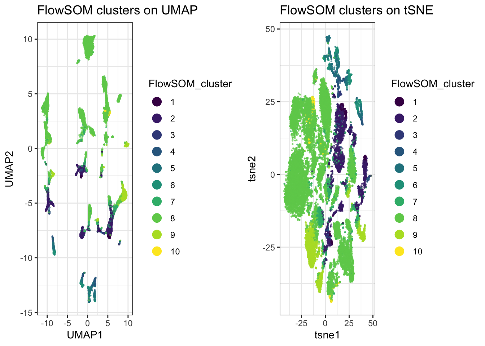
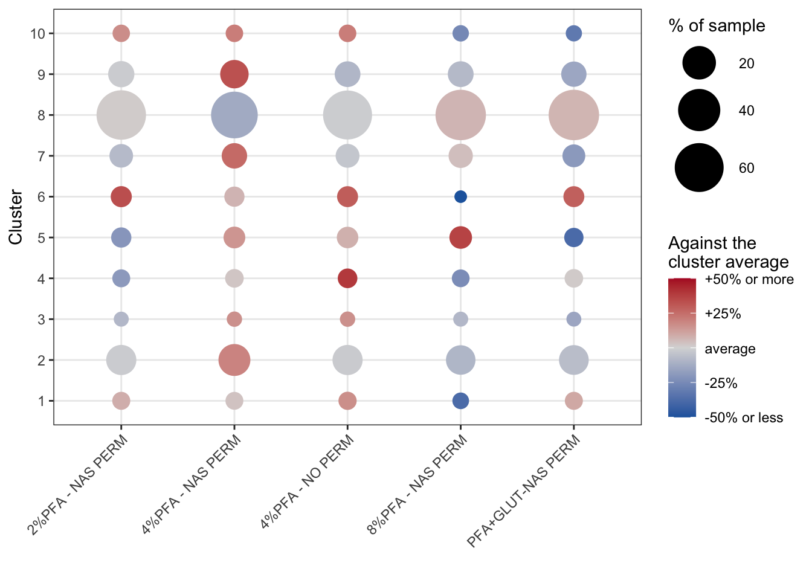
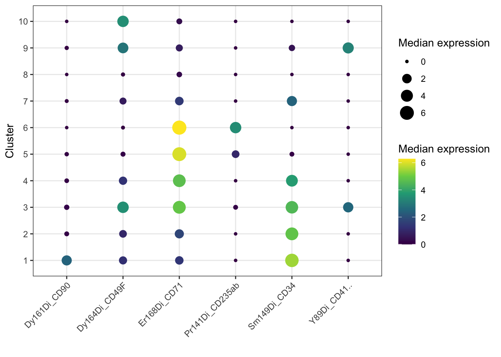

# Chapter 15 - Clustering and Population Discovery

## What You'll Learn

UMAP and tSNE show you structure, but they don't assign labels. This chapter runs two clustering algorithms, FlowSOM and Phenograph, to assign each event to a discrete population, so you can identify and count distinct cell types rather than just eyeballing a 2D plot.

## The Essentials {.essentials}

> **Stuck?** This chapter starts from `Data/RDS/EXPRESSION_DATA_SAMPLE_ID_UMAPPED_TSNE.rds`, made in Chapter 14. If the first chunk below errors, or Chapter 14's checkpoint didn't match, copy that file from the course data download over your own, then carry on from here.

### Step 1: Load Required Packages and Data


``` r
library(here)
#> here() starts at /Users/dcarragher/Sync/CLAUDE/Analysing-Cytometry-Data-With-R
library(flowCore)
library(ggplot2)
library(cowplot)
library(dplyr)
#> 
#> Attaching package: 'dplyr'
#> The following object is masked from 'package:flowCore':
#> 
#>     filter
#> The following objects are masked from 'package:stats':
#> 
#>     filter, lag
#> The following objects are masked from 'package:base':
#> 
#>     intersect, setdiff, setequal, union
library(tidyr)      # pivot_longer(), used in the Deep Dive
library(viridis)
#> Loading required package: viridisLite

EXPRESSION_DATA_SAMPLE_ID_UMAPPED_TSNE <- readRDS(here("Data", "RDS", "EXPRESSION_DATA_SAMPLE_ID_UMAPPED_TSNE.rds"))
```

### Step 2: Choose Markers to Cluster On

Clustering is usually done on lineage/phenotyping markers rather than every channel, functional markers and QC channels (Time, Event_length) tend to add noise rather than help define populations.

Name the antigens you want and let the panel file build the column names, the same approach as Chapter 14. Typing them out by hand tends to go wrong with real panels: `CD41` in this one carries trailing whitespace, so its column is actually `Y89Di_CD41..`, and a hardcoded `"Y89Di_CD41"` fails with an unhelpful subscript error.


``` r
panel <- read.csv(here("Data", "other", "ACDwR_panel.csv"))
panel_cols <- make.names(paste(panel$fcs_colname, panel$antigen, sep = "_"))

cluster_antigens <- c("CD34", "CD90", "CD49F", "CD71", "CD235ab", "CD41")
lineage_markers  <- panel_cols[trimws(panel$antigen) %in% cluster_antigens]

lineage_markers
#> [1] "Y89Di_CD41.."    "Pr141Di_CD235ab" "Sm149Di_CD34"   
#> [4] "Dy161Di_CD90"    "Dy164Di_CD49F"   "Er168Di_CD71"
```

**Success looks like this:**
```
[1] "Y89Di_CD41.."    "Pr141Di_CD235ab" "Sm149Di_CD34"    "Dy161Di_CD90"
[5] "Dy164Di_CD49F"   "Er168Di_CD71"
```

`trimws()` is doing the work that matters here: it strips the whitespace before matching, so you can ask for `CD41` and still get the column whose real name has two dots on the end.

This can be, and often should be, a different list from the one you used for UMAP/tSNE in Chapter 14. Clustering benefits from a narrower, more targeted marker set than visualisation does, using the same list for both isn't the goal. We're using six here against Chapter 14's thirty-two.

### Step 3: Run FlowSOM

FlowSOM works in two stages. First it builds a self-organising map, a grid of nodes where each node holds cells with similar expression, which gives you around a hundred small groups. Then it metaclusters those nodes down to the number of populations you actually want to work with.


``` r
library(FlowSOM)
#> Loading required package: igraph
#> 
#> Attaching package: 'igraph'
#> The following object is masked from 'package:tidyr':
#> 
#>     crossing
#> The following objects are masked from 'package:dplyr':
#> 
#>     as_data_frame, groups, union
#> The following object is masked from 'package:flowCore':
#> 
#>     normalize
#> The following objects are masked from 'package:stats':
#> 
#>     decompose, spectrum
#> The following object is masked from 'package:base':
#> 
#>     union
#> Thanks for using FlowSOM. From version 2.1.4 on, the scale 
#> parameter in the FlowSOM function defaults to FALSE

data_FlowSOM <- flowCore::flowFrame(as.matrix(EXPRESSION_DATA_SAMPLE_ID_UMAPPED_TSNE[, lineage_markers]))

set.seed(1234)
fSOM <- FlowSOM::ReadInput(data_FlowSOM, transform = FALSE, scale = FALSE)
fSOM <- FlowSOM::BuildSOM(fSOM, colsToUse = lineage_markers)
#> Building SOM
#> Mapping data to SOM
fSOM <- FlowSOM::BuildMST(fSOM)
#> Building MST

# every cell's SOM node
labels_pre <- fSOM$map$mapping[, 1]

k <- 10   # final number of clusters after metaclustering
fSOM_meta <- FlowSOM::metaClustering_consensus(fSOM$map$codes, k = k, seed = 1234)

# map each cell from its node to that node's metacluster
flowsom_labels <- fSOM_meta[labels_pre]
table(flowsom_labels)
#> flowsom_labels
#>     1     2     3     4     5     6     7     8     9    10 
#>   314  3580    82   409   843   622  1496 15257  2161   236
```

**Success looks like this:**
```
flowsom_labels
    1     2     3     4     5     6     7     8     9    10
  314  3580    82   409   843   622  1496 15257  2161   236
```

`k = 10` is the number of populations you are asking for, not something the data decides. Cluster 8 holding 15,257 of the 25,000 cells is worth noticing rather than glossing over: a single cluster carrying 61% of your events usually means either that population genuinely dominates the sample, or that `k` is too low and something is being lumped together. Try `k = 15` and see whether cluster 8 splits into things that look biologically distinct.

Both `set.seed()` and the `seed` argument are needed here, and they do different jobs. The first fixes the SOM build, the second fixes the metaclustering. Miss either and you get a different answer each run.

### Step 4: Add Cluster Labels and Save


``` r
EXPRESSION_DATA_SAMPLE_ID_UMAPPED_TSNE$FlowSOM_cluster <- as.factor(flowsom_labels)

saveRDS(EXPRESSION_DATA_SAMPLE_ID_UMAPPED_TSNE, here("Data", "RDS", "EXPRESSION_DATA_SAMPLE_ID_UMAPPED_TSNE.rds"))
```

### Step 5: Plot Clusters on the UMAP/tSNE


``` r
p_umap <- ggplot(EXPRESSION_DATA_SAMPLE_ID_UMAPPED_TSNE, aes(x = UMAP1, y = UMAP2, color = FlowSOM_cluster)) +
  geom_point(size = 0.3, alpha = 0.6) +
  scale_colour_viridis_d() +
  guides(colour = guide_legend(override.aes = list(size = 4, alpha = 1))) +
  theme_bw() +
  ggtitle("FlowSOM clusters on UMAP")

p_tsne <- ggplot(EXPRESSION_DATA_SAMPLE_ID_UMAPPED_TSNE, aes(x = tsne1, y = tsne2, color = FlowSOM_cluster)) +
  geom_point(size = 0.3, alpha = 0.6) +
  scale_colour_viridis_d() +
  guides(colour = guide_legend(override.aes = list(size = 4, alpha = 1))) +
  theme_bw() +
  ggtitle("FlowSOM clusters on tSNE")

plot_grid(p_umap, p_tsne)
```



``` r

ggsave2(here("Figures", "flowsom_clusters.pdf"), width = 11, height = 8.5)
ggsave2(here("Figures", "flowsom_clusters.png"), width = 11, height = 8.5)
```

### Step 6: Cluster Abundance per Sample

The UMAP/tSNE plots above show where clusters sit in 2D space, but not whether a cluster is a similar size across all samples or concentrated in just one or two. A bubble plot of each cluster's percentage of each sample's cells answers that directly:

First the numbers. `table()` counts the cells in each cluster for each sample, and `prop.table(cluster_counts, margin = 1)` turns each sample's row into percentages of that sample:


``` r
cluster_counts <- table(sample_id = EXPRESSION_DATA_SAMPLE_ID_UMAPPED_TSNE$sample_id, FlowSOM_cluster = EXPRESSION_DATA_SAMPLE_ID_UMAPPED_TSNE$FlowSOM_cluster)

round(prop.table(cluster_counts, margin = 1) * 100, 1)
#>                    FlowSOM_cluster
#> sample_id              1    2    3    4    5    6    7    8
#>   2%PFA - NAS PERM   1.4 14.1  0.3  1.3  2.7  3.3  5.5 61.8
#>   4%PFA - NAS PERM   1.3 17.0  0.4  1.7  3.9  2.7  7.5 52.9
#>   4%PFA - NO PERM    1.5 14.0  0.4  2.3  3.6  3.2  5.8 60.2
#>   8%PFA - NAS PERM   0.8 13.0  0.3  1.2  4.6  0.0  6.2 65.1
#>   PFA+GLUT-NAS PERM  1.4 13.4  0.3  1.7  2.1  3.2  4.8 65.1
#>                    FlowSOM_cluster
#> sample_id              9   10
#>   2%PFA - NAS PERM   8.5  1.1
#>   4%PFA - NAS PERM  11.5  1.1
#>   4%PFA - NO PERM    7.9  1.1
#>   8%PFA - NAS PERM   8.0  0.7
#>   PFA+GLUT-NAS PERM  7.4  0.6
```

**Success looks like this:**
```
                   FlowSOM_cluster
sample_id              1    2    3    4    5    6    7    8    9   10
  2%PFA - NAS PERM   1.4 14.1  0.3  1.3  2.7  3.3  5.5 61.8  8.5  1.1
  4%PFA - NAS PERM   1.3 17.0  0.4  1.7  3.9  2.7  7.5 52.9 11.5  1.1
  4%PFA - NO PERM    1.5 14.0  0.4  2.3  3.6  3.2  5.8 60.2  7.9  1.1
  8%PFA - NAS PERM   0.8 13.0  0.3  1.2  4.6  0.0  6.2 65.1  8.0  0.7
  PFA+GLUT-NAS PERM  1.4 13.4  0.3  1.7  2.1  3.2  4.8 65.1  7.4  0.6
```

Every row sums to 100, whatever the sample's cell count, so this compares composition rather than raw numbers.

The five samples look much the same, and they should. They are one bone marrow prepared five ways, and the six markers we clustered on are all on the cell surface, so they stain with or without permeabilisation. But look down column 6. 8% PFA has 0.0% where the others have about 3%. That is 2 cells against 133 to 166 in the other samples.

Now the plot. Size shows each cluster's share of the sample. Colour shows how far that share sits from the same cluster's average across all five samples: grey is average, red is more, blue is less.


``` r
cluster_percent <- as.data.frame(prop.table(cluster_counts, margin = 1) * 100)
colnames(cluster_percent)[3] <- "percent"

cluster_percent <- cluster_percent %>%
  group_by(FlowSOM_cluster) %>%
  mutate(vs_average = 100 * (percent - mean(percent)) / mean(percent)) %>%
  ungroup()

ggplot(cluster_percent, aes(x = sample_id, y = FlowSOM_cluster)) +
  geom_point(aes(size = percent, colour = vs_average)) +
  scale_size(range = c(3, 14)) +
  scale_colour_gradient2(low = "#2166ac", mid = "grey85", high = "#b2182b", midpoint = 0,
                         limits = c(-50, 50), oob = scales::squish,
                         breaks = c(-50, -25, 0, 25, 50),
                         labels = c("-50% or less", "-25%", "average", "+25%", "+50% or more")) +
  labs(x = "", y = "Cluster", size = "% of sample", colour = "Against the\ncluster average") +
  theme_bw() +
  theme(axis.text.x = element_text(angle = 45, hjust = 1))
```



``` r

ggsave2(here("Figures", "bubble_cluster_abundance.pdf"), width = 11, height = 8.5)
ggsave2(here("Figures", "bubble_cluster_abundance.png"), width = 11, height = 8.5)
```

The 8% PFA dot in cluster 6 is now the darkest blue on the plot. 4% PFA - NAS PERM shows red in clusters 2, 7 and 9 and blue in cluster 8, so that sample has fewer of the unresolved cells and more of everything else.

Colour by the percentage alone and none of this shows. Cluster 8 runs from 53% to 65% and cluster 6 from 0% to 3%, and on one size scale running to 65% both changes vanish. Every sample comes out looking identical. Comparing each sample with the cluster's own average is what makes the small differences visible. `oob = scales::squish` holds anything beyond ±50% at the end colour, so one extreme value cannot wash out the rest.

## A Deeper Dive {.deeper-dive}

### An Alternative: Phenograph

This section runs Phenograph on the same six markers to compare how many clusters it finds with FlowSOM's ten. It does not replace FlowSOM: the naming that follows, and everything saved at the end of the chapter, uses the FlowSOM clusters.

Phenograph builds a nearest-neighbour graph between events and detects communities within it, a different underlying approach to FlowSOM's self-organising map. It's worth trying both and comparing, they don't always agree, and disagreement is often informative about where population boundaries are genuinely ambiguous.


``` r
if(!require(Rphenograph)) devtools::install_github("JinmiaoChenLab/Rphenograph", force = TRUE)
#> Loading required package: Rphenograph
library(Rphenograph)

Rpheno_in <- unique(EXPRESSION_DATA_SAMPLE_ID_UMAPPED_TSNE[, lineage_markers])

set.seed(1234)
Rphenograph_result <- Rphenograph(Rpheno_in, k = 30) # k is nearest-neighbours here, not a cluster count
#> Run Rphenograph starts:
#>   -Input data of 24207 rows and 6 columns
#>   -k is set to 30
#>   Finding nearest neighbors...DONE ~ 0.229 s
#>   Compute jaccard coefficient between nearest-neighbor sets...DONE ~ 2.715 s
#>   Build undirected graph from the weighted links...DONE ~ 0.703 s
#>   Run louvain clustering on the graph ...DONE ~ 0.712 s
#> Run Rphenograph DONE, totally takes 4.359s.
#>   Return a community class
#>   -Modularity value: 0.9102834 
#>   -Number of clusters: 40
phenograph_labels <- factor(membership(Rphenograph_result[[2]]))

length(unique(phenograph_labels))
#> [1] 40
```

**Success looks like this:**
```
Run Rphenograph starts:
  -Input data of 24207 rows and 6 columns
  -k is set to 30
  Finding nearest neighbors...DONE ~ 0.228 s
  Compute jaccard coefficient between nearest-neighbor sets...DONE ~ 2.805 s
  Build undirected graph from the weighted links...DONE ~ 0.711 s
  Run louvain clustering on the graph ...DONE ~ 0.776 s
Run Rphenograph DONE, totally takes 4.52 s
  Return a community class
  -Modularity value: 0.9102834
  -Number of clusters: 40
```

Phenograph found forty clusters from the same six markers that gave FlowSOM ten, using 24,207 of those 25,000 cells once the duplicate rows were dropped.

That comes from the difference between the two methods rather than a disagreement about the biology. FlowSOM's `k` is a number you chose: you asked for ten populations and it gave you ten, whether or not ten is right. Phenograph's `k` is the size of each cell's neighbourhood when the graph is built, and the number of communities falls out of the graph structure. Forty is what the graph produced, not a number you set.

So the two are answering different questions. FlowSOM answers "divide this into ten", Phenograph answers "how many groups are actually here, given how tightly cells cluster at this neighbourhood size". Run both and the gap between the answers tells you something: forty against ten suggests the ten are coarse, and that several of them contain real substructure. That is the same signal as cluster 8 holding 61% of the cells.

**Modularity 0.91** is the graph's own measure of how well-separated those communities are, from 0 for no better than random to 1 for perfectly separated. 0.91 is high, which says the partition describes the graph well. It does not say the communities are biological. Chapter 14 found the dominant structure in this dataset is protocol rather than biology, and modularity would score that split just as highly. To say the structure is biological, rather than just real, you need the marker table below.

Trying a few values of `k` (10, 20, 30) and comparing both the cluster count and the modularity is normal practice. There is no single correct value, and watching how both numbers move as you change it tells you more than any one run.

Note `unique()` on the input. Phenograph will not accept duplicate rows, and after downsampling and transformation a six-marker table has plenty of cells with identical values, so the graph is built on the distinct rows rather than on every cell.

### Naming Clusters from Marker Expression: A Worked Example

Let's go back to FlowSOM's ten clusters, the ones saved in Step 4. Forty Phenograph clusters on six markers are too many to name one by one, so the worked example uses the ten.

FlowSOM and Phenograph both output numbered clusters, `1`, `2`, `3`. Turning those into biologically meaningful names, "HSC-like", "erythroid", is a judgement call based on each cluster's own marker expression, not something either algorithm does for you. The method: compute median expression per cluster per marker, look for which markers are distinctly high or low in each cluster, and match that pattern against what you know those markers mark.


``` r
cluster_expression <- EXPRESSION_DATA_SAMPLE_ID_UMAPPED_TSNE %>%
  select(FlowSOM_cluster, all_of(lineage_markers)) %>%
  group_by(FlowSOM_cluster) %>%
  summarise(across(everything(), median))

cluster_expression_long <- tidyr::pivot_longer(cluster_expression, -FlowSOM_cluster,
  names_to = "marker", values_to = "median_expression")

ggplot(cluster_expression_long, aes(x = marker, y = FlowSOM_cluster)) +
  geom_point(aes(size = median_expression, color = median_expression)) +
  scale_color_viridis_c() +
  labs(x = "", y = "Cluster", size = "Median expression", color = "Median expression") +
  theme_bw() +
  theme(axis.text.x = element_text(angle = 45, hjust = 1))
```



The bubble plot is for spotting patterns. To actually name things you want the numbers, along with how big each cluster is, because a striking phenotype in 0.3% of your cells means something different from the same phenotype in 30%:


``` r
cluster_expression %>%
  left_join(count(EXPRESSION_DATA_SAMPLE_ID_UMAPPED_TSNE, FlowSOM_cluster),
            by = "FlowSOM_cluster") %>%
  mutate(pct = round(100 * n / sum(n), 1),
         across(all_of(lineage_markers), ~ round(.x, 2))) %>%
  rename_with(~ sub("^[A-Za-z0-9]+_", "", .x), all_of(lineage_markers)) %>%
  as.data.frame()
#>    FlowSOM_cluster CD41.. CD235ab CD34 CD90 CD49F CD71
#> 1                1   0.00    0.00 5.46 2.44  1.19 1.36
#> 2                2   0.00    0.00 4.82 0.10  0.98 1.76
#> 3                3   2.54    0.10 4.51 0.18  3.52 4.87
#> 4                4   0.00    0.00 3.81 0.07  1.27 4.71
#> 5                5   0.00    0.98 0.10 0.04  0.12 5.97
#> 6                6   0.00    3.45 0.00 0.00  0.01 6.28
#> 7                7   0.00    0.00 2.44 0.01  0.68 1.44
#> 8                8   0.00    0.00 0.00 0.00  0.02 0.24
#> 9                9   3.22    0.00 0.46 0.03  2.89 0.71
#> 10              10   0.00    0.00 0.00 0.00  3.47 0.31
#>        n  pct
#> 1    314  1.3
#> 2   3580 14.3
#> 3     82  0.3
#> 4    409  1.6
#> 5    843  3.4
#> 6    622  2.5
#> 7   1496  6.0
#> 8  15257 61.0
#> 9   2161  8.6
#> 10   236  0.9
```

**Success looks like this:**
```
 FlowSOM_cluster CD41.. CD235ab CD34 CD90 CD49F CD71     n  pct
               1   0.00    0.00 5.46 2.44  1.19 1.36   314  1.3
               2   0.00    0.00 4.82 0.10  0.98 1.76  3580 14.3
               3   2.54    0.10 4.51 0.18  3.52 4.87    82  0.3
               4   0.00    0.00 3.81 0.07  1.27 4.71   409  1.6
               5   0.00    0.98 0.10 0.04  0.12 5.97   843  3.4
               6   0.00    3.45 0.00 0.00  0.01 6.28   622  2.5
               7   0.00    0.00 2.44 0.01  0.68 1.44  1496  6.0
               8   0.00    0.00 0.00 0.00  0.02 0.24 15257 61.0
               9   3.22    0.00 0.46 0.03  2.89 0.71  2161  8.6
              10   0.00    0.00 0.00 0.00  3.47 0.31   236  0.9
```

Now do the work the algorithm cannot. Take each row and ask what that combination of markers means:

**Cluster 1, CD34 high and CD90 high.** CD34 marks haematopoietic stem and progenitor cells, and CD90 is what separates true stem cells from the progenitors below them. Both are high and nothing else is on. These are haematopoietic stem cells, and 1.3% is the sort of frequency you would expect.

**Cluster 2, CD34 high and CD90 absent.** This is the same progenitor compartment, one step down. They are progenitors rather than stem cells, and there are ten times as many of them, which is also what you would expect.

**Clusters 4, 5 and 6 are the same lineage caught at three stages, and this is the nicest thing in the table.** CD71 is the transferrin receptor, which erythroid cells need in quantity to take up iron for haemoglobin. CD235ab is glycophorin, which arrives later as the cell commits. So: cluster 4 is CD34 positive with CD71 climbing, an erythroid progenitor still carrying its stem marker. Cluster 5 has CD34 down to 0.10, effectively gone, CD71 is higher still, glycophorin only just detectable. Cluster 6 has CD71 at its highest and glycophorin properly on. That is erythroid maturation, read straight off the medians, in a bone marrow sample where you would hope to find exactly that.

**Cluster 9, CD41 high with CD49F.** CD41 is integrin alpha-IIb, the platelet and megakaryocyte marker. This cluster is megakaryocytic.

Which leaves four clusters.

**Cluster 8 is 61% of your cells and every marker sits at or below 0.24.**

The clustering has not failed. Six markers are being asked to describe 25,000 bone marrow cells, and most of those cells are things this panel was never designed to see: mature lymphocytes, myeloid cells, anything without CD34, CD41 or an erythroid marker. The algorithm did its job and put them together correctly. There is simply nothing to call them.

**Name it "unresolved" and move on.** Keep it in your figures under that name rather than giving it a label the markers don't support. A cluster you cannot identify tells you about the limits of your panel. If 61% of your sample is invisible to your markers and the population you care about is in there, the next experiment needs different antibodies rather than better clustering.

Clusters 3, 7 and 10 are the same story in miniature. Cluster 3 is 82 cells with several markers up at once, too few and too mixed to call. Cluster 7 has CD34 at half the level of cluster 2, which could be a dimmer progenitor or could be spillover. Cluster 10 has CD49F alone. For each one, describe the phenotype and leave the name for a panel that can settle it.


``` r
levels(EXPRESSION_DATA_SAMPLE_ID_UMAPPED_TSNE$FlowSOM_cluster) <- c(
  "HSC",                      # 1: CD34+ CD90+
  "CD34+ progenitor",         # 2: CD34+ CD90-
  "Unclear, mixed",           # 3: 82 cells, several markers up
  "Erythroid progenitor",     # 4: CD34+ CD71+
  "Proerythroblast",          # 5: CD71 high, CD235ab just appearing
  "Erythroblast",             # 6: CD71 high, CD235ab on
  "Unclear, CD34 dim",        # 7
  "Unresolved",               # 8: 61% of cells, all six markers negative
  "Megakaryocytic",           # 9: CD41+ CD49F+
  "Unclear, CD49f only")      # 10

table(EXPRESSION_DATA_SAMPLE_ID_UMAPPED_TSNE$FlowSOM_cluster)
#> 
#>                  HSC     CD34+ progenitor 
#>                  314                 3580 
#>       Unclear, mixed Erythroid progenitor 
#>                   82                  409 
#>      Proerythroblast         Erythroblast 
#>                  843                  622 
#>    Unclear, CD34 dim           Unresolved 
#>                 1496                15257 
#>       Megakaryocytic  Unclear, CD49f only 
#>                 2161                  236

# Save again, now the clusters have names. Step 4's save was before this,
# so without this the naming exists only in your session.
saveRDS(EXPRESSION_DATA_SAMPLE_ID_UMAPPED_TSNE,
        here("Data", "RDS", "EXPRESSION_DATA_SAMPLE_ID_UMAPPED_TSNE.rds"))
```

We've named four of ten with confidence, two more as stages of one lineage, and left four open. That ratio is normal on a six-marker panel and it is a better outcome than ten confident labels, because every name here can be defended from the table above.

There are two things to hold on to. These names belong to this clustering run: change `k`, change the marker list, and the numbering changes with them, so re-derive rather than reuse. And a name is a hypothesis. Cluster 6 is erythroblasts because CD71 and glycophorin say so, and if that matters to your conclusion it wants confirming with a marker you did not cluster on.

### What's Next

With clusters identified and labelled, the next chapter covers statistical comparison between conditions and building publication-quality figures.
